# Architecture

## Status and documentation convention

ProcSight is an unreleased native development preview. The collector, domain contracts,
identity resolver, privacy/rule engine, SQLite storage, provider adapters, coordinator, and
investigation UI below are implemented. Automated verification uses synthetic providers;
live-provider and full desktop acceptance remain outstanding. The [design](docs/superpowers/specs/2026-10-13-procsight-design.md)
defines requirements; the [implementation plan](docs/superpowers/plans/2026-10-13-procsight.md)
maps them to tasks. This root document is the living architecture reference and must
track the actual implementation as it develops.

Current code owners: [native shell](src/ProcSight.App/MainWindow.xaml.cs),
[collector](src/ProcSight.Windows/Collection/WindowsSnapshotSource.cs),
[CPU sampler](src/ProcSight.Windows/Collection/ProcessSampler.cs), and
[identity resolver](src/ProcSight.Core/Identity/IdentityResolver.cs).

Additional code owners: [coordinator](src/ProcSight.Application/Analysis/AnalysisCoordinator.cs),
[privacy projection](src/ProcSight.Core/Privacy/AnalysisProjection.cs),
[output privacy filter](src/ProcSight.Core/Privacy/OutputPrivacyFilter.cs),
[rule validation](src/ProcSight.Core/Rules/RuleValidator.cs),
[local evaluation](src/ProcSight.Core/Rules/LocalAnalysisEngine.cs),
[SQLite](src/ProcSight.Infrastructure/Knowledge/SqliteKnowledgeStore.cs),
[provider HTTP](src/ProcSight.Infrastructure/Providers/ProviderHttp.cs),
[native table](src/ProcSight.App/MainWindow.Processes.cs), and
[portable presentation](src/ProcSight.Application/Presentation/ProcessListProjection.cs).
Live presentation also owns [local role labels](src/ProcSight.Application/Presentation/ProcessRoleLabels.cs);
Windows supplies [executable icon pixels](src/ProcSight.Windows/Collection/ExecutableIconReader.cs).
[KnownTaskCatalog](src/ProcSight.Core/Rules/KnownTaskCatalog.cs) supplies shared purpose references.

Use UML liberally to explain structure, interactions, and lifecycle behavior. Store diagrams
as editable Mermaid blocks alongside the prose so GitHub can render them. Prefer UML class,
sequence, and state diagrams for domain relationships, message ordering, and transitions.
The component view below uses UML class notation with component stereotypes. Use an activity
or deployment view when branching workflows or physical boundaries need one; label its notation
accurately. Diagrams supplement precise prose and do not establish implementation status.

Update affected diagrams in the same commit as changes to components, interfaces, data flow,
state transitions, persistence, or trust boundaries. Name real code owners once they exist;
verify the diagram source and rendering. Avoid diagrams that merely repeat a file list.

## Component boundaries

### Authentication operational diagnostics

[ChatGptAuthenticationLog](src/ProcSight.Infrastructure/Authentication/ChatGptAuthenticationLog.cs)
receives a closed typed event contract from
[OAuth stages](src/ProcSight.Infrastructure/Authentication/ChatGptSessionService.cs) and
[the account dialog](src/ProcSight.App/MainWindow.ChatGpt.cs). It queues at most 256 events and writes
off-thread to the package-scoped data folder, rotating a 128 KiB file to one previous file. This
diagnostic flow contains no credential/account/URL/payload text and is independent of AI activity.
Failures are isolated; shutdown or saturation may drop events. Live sign-in is performed by the user.

Connection dialogs own a fresh editor per opening and explicitly detach it when closed. A closing
deferral flushes valid settings before owner cleanup cancels in-flight account/model work. Transient
visual Unloaded notifications do not dispose the editor. Fatal UI exceptions synchronously append
only a numeric HRESULT without handling/suppressing the exception.

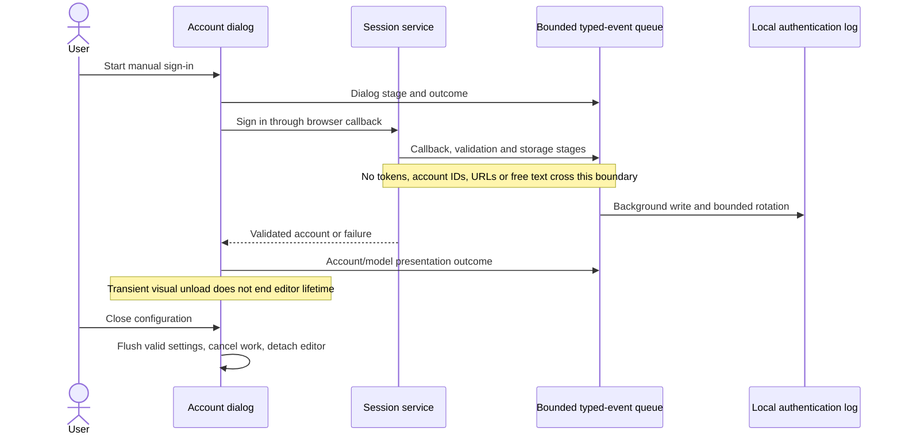

### MSIX distribution and release preparation

Local MSIX generation is implemented. The [packaging design](docs/superpowers/specs/2026-10-17-msix-packaging-design.md)
defines opt-in Direct/Store profiles, signing, package identity and elevation boundaries; the
[implementation plan](docs/superpowers/plans/2026-10-17-msix-packaging.md) covers verification and
installation lifecycle checks. Normal builds remain unpackaged; explicit Direct packaging bundles
runtimes and Store packaging declares runtime dependencies. Package trust, Store acceptance and
actual installed elevation/upgrade/uninstall behavior have not been established by synthetic tests.

The explicit [certificate drop target](scripts/trust-package-certificate.cmd) invokes
[public-certificate validation and trust](scripts/trust-package-certificate.ps1) separately from
packaging. It accepts one valid public code-signing `.cer`, displays its identity, and uses UAC
for LocalMachine/TrustedPeople only. The elevated process revalidates the thumbprint and imports
the parsed object, without reopening the input. Synthetic tests and WhatIf stop before elevation;
Explorer/UAC and actual certificate-store acceptance remain manual checks.

```mermaid
sequenceDiagram
    actor User
    participant Helper as Unelevated certificate helper
    participant Admin as UAC-approved helper
    participant Store as LocalMachine TrustedPeople
    User->>Helper: Drop one public .cer
    Helper->>Helper: Validate format, dates and code-signing EKU
    Helper-->>User: Display subject, thumbprint and expiry
    Helper->>Admin: Request UAC with literal path and expected thumbprint
    Note over Helper,Admin: Administrator privilege boundary
    Admin->>Admin: Revalidate certificate and thumbprint
    Admin->>Store: Add validated in-memory certificate
    Admin-->>Helper: Exit status
    Helper-->>User: Result; signed MSIX can now be retried
```

[PackageContext](src/ProcSight.Windows/Security/PackageContext.cs) reads identity/family/path from
Windows and the installed manifest with bounded, DTD-disabled XML parsing. Package family scopes
[credentials](src/ProcSight.Windows/Storage/CredentialStore.cs) and LocalState data; unpackaged state
is not implicitly migrated. Unknown inspection refuses credential access and uses isolated session
data. Packaged restart requires declared allowElevation, enforced in UI and launcher; asInvoker and
administrator-session sharing restrictions remain unchanged.

The local [release workflow](scripts/prepare-release.ps1) derives all live product/assembly/package/feed
versions from [Version.props](Version.props), using [scoped version helpers](scripts/release/Common.ps1).
It renders edits before changing source, prepares the dated changelog, runs verification, commits the
explicit inventory and calls [package generation](scripts/package.ps1) from that clean commit. Version,
source commit and artifact SHA-256 must agree before creating the annotated SemVer tag. Precommit
failure restores unchanged owned edits; postcommit failure retains the prepared commit for Resume.
Existing tags are immutable. Dependency versions and historical documentation remain separate.
Synthetic tests use temporary repositories; this implementation creates no actual product release.
Remote publication remains a separate action.

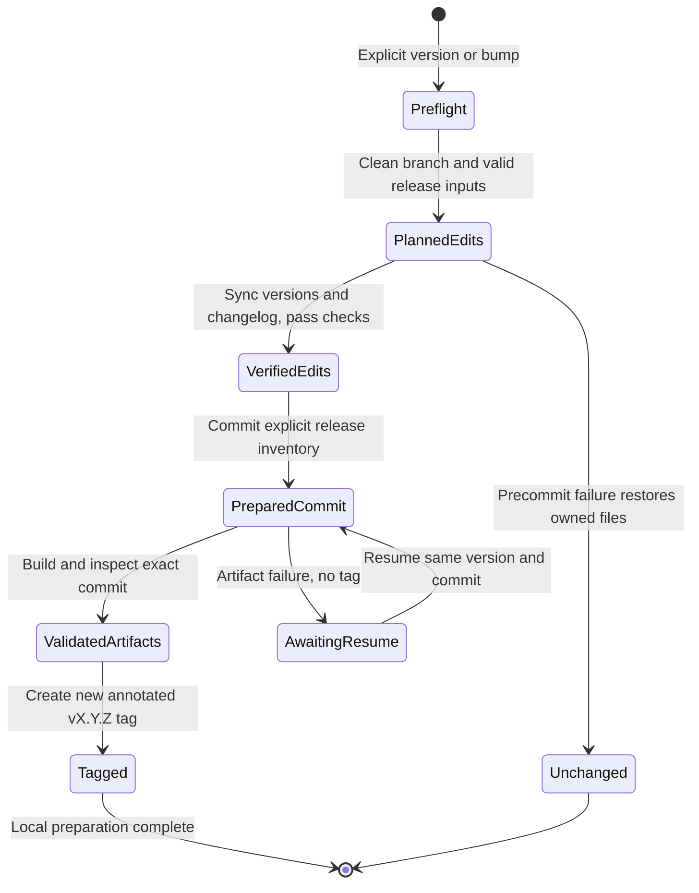

### Explicit administrator sessions

[PrivilegeContext](src/ProcSight.Windows/Security/PrivilegeContext.cs) reads the active token;
failed inspection uses restrictive privacy defaults. [ElevationLauncher](src/ProcSight.Windows/Security/ElevationLauncher.cs)
requests `runas` for the actual executable, holds its returned process handle and confirms an owned
visible window's ready property before allowing the original to close. Cancellation, startup failure
and a bounded wait preserve the original. This confirms lifecycle, not installation security.

Saved settings remain separate from cached [SessionPolicy](src/ProcSight.Application/Settings/SessionPolicy.cs)
effective settings. Elevated sessions exclude cloud routing until explicit consent, suppress research
and strip command/identifying sharing without separate consent. Local analysis remains available.
Coordinator, tester and payload preview use effective policy; dispatch rejects cloud calls without
permission. Consent changes invalidate old work, but session flags never enter persisted preferences.
All storage/credentials use the active Windows context. No broker or privilege adjustment exists.

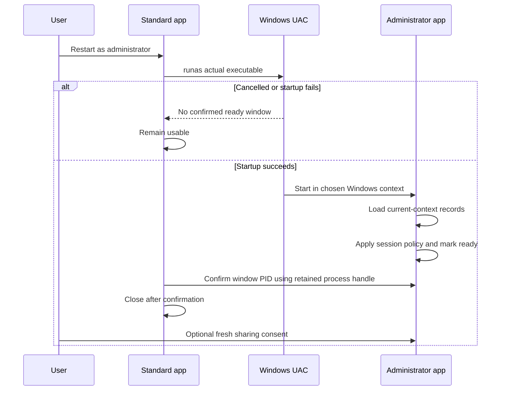

### Resource-cell presentation and live sorting

[ProcessTimePresentation](src/ProcSight.Application/Presentation/ProcessTimePresentation.cs) formats
Started as Today/Yesterday or a readable local date/time. Row labels cache by local day and lifetime;
the full ISO timestamp remains in the tooltip and separate export projection. Ordering still uses
actual start instants, with unknowns last, independently of presentation text.

CPU/Memory heat reflects current utilization. All resource cells share a configurable minimum
opacity (5% by default, below the former CPU/Memory 7% floor). Valid zero values retain the floor;
missing values, Off modes and high contrast are transparent. Disk/Network/GPU use transient history.
All five resource columns share a direct maximum opacity (50% default) and system Windows accent
or custom RGB color. Validated settings enforce floor <= roof <= 100 and #RRGGBB only; no alpha
channel hides inside the color. The old intensity multiplier is retained only for file compatibility.
Native NumberBox/ColorPicker drafts update valid presentation state immediately and save after
400 ms, with focus-loss/unload flushing. A stable shared palette delegate prevents unchanged
CPU/Memory cells from receiving fade-tick notifications and reuses bounded brush instances.

[ResourceHighlightState](src/ProcSight.Application/Presentation/ResourceHighlightState.cs) keeps
one bounded numeric history per Disk/Network/GPU cell: the last displayed quantum, change/spike
time, a ten-second exponential baseline and a decaying peak (30-second time constant). Default
recency uses changes in displayed precision (0.1 MB/s, 0.1 Mbps or 0.1%), not polling timestamps.
Missing observations and lifetime/group membership changes reset history. Current activity is
relative to that row's decaying peak; spikes are increases above its smoothed baseline; top
consumers compare currently displayed rows. These relative scales do not establish device capacity.

[Row state](src/ProcSight.App/ViewModels/ProcessRow.ResourceShading.cs) remains transient and
outside snapshot export, rules and provider payloads. Only
[mode/fade/opacity/color preferences](src/ProcSight.Core/Models/PolicyModels.cs) persist.
[Native rendering](src/ProcSight.App/MainWindow.ResourceShading.cs) uses monotonic time, a bounded
256-brush accent palette and one 200 ms timer for realized cells. Full snapshots initialize all row
brushes; recycled cells refresh on realization. No timer runs off-page, and hidden/minimized windows
skip animation. Missing values and high contrast use transparent backgrounds. Drag restoration
retains brush bindings. Appearance settings apply valid choices immediately.

Automatic process sorting is independently opt-in and defaults off. `RefreshRows` omits previous
order for the chosen sort when enabled, but still reconciles incrementally; only explicit large
reorders may use a collection Reset. Selection stays lifetime-aware. Column dragging temporarily
suspends automatic ordering. Services retain their existing stable live ordering.
[LiveRowCollection](src/ProcSight.App/ViewModels/LiveRowCollection.cs) emits remove/insert for logical
relocations: the WinRT adapter maps managed Move notifications to native vector Reset, invalidating
the realized list and causing a flash. Native event regression checks cover repeated automatic
reordering in both directions; managed-only Reset checks cannot establish this behavior.

UML sequence view of presentation-only highlighting:

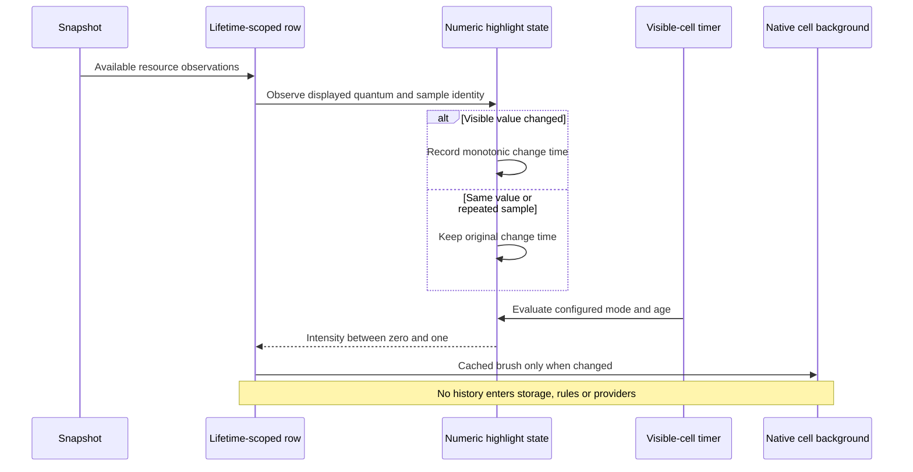

### Performance monitoring

[ProcessIoMonitor](src/ProcSight.Windows/Collection/ProcessIoMonitor.cs) starts an owned kernel
ETW session off-thread only in explicit administrator mode. Enable precedes Source creation;
the parser tracks thread/PID relationships without filename tracking. Disk read/write and
TCP/UDP IPv4/IPv6 byte events feed a bounded
[accumulator](src/ProcSight.Windows/Collection/ProcessIoAccumulator.cs). Confirmed snapshot
`ProcessKey` lifetimes gate attribution; process events invalidate buckets. Startup, event loss
and PID reuse require fresh baselines. Session loss-query failure also invalidates readings.
Only byte totals survive callbacks. Window shutdown synchronously stops the owned session before
the first await, including tray Exit and programmatic close. Unexpected process termination is
outside that guarantee. Ordinary mode retains unavailable reasons; it never prompts for elevation.

[SystemPerformanceSampler](src/ProcSight.Windows/Collection/SystemPerformanceSampler.cs) is a
separate one-second, off-thread source for CPU, RAM, physical-disk busy/read/write rates,
non-loopback adapter send/receive deltas and busiest reported GPU-engine utilization. Adapter
replacement/reset restarts the baseline. Aggregate network traffic can overlap on VPN/virtual
adapters; disk caching and buffered ETW delivery limit exact process/system comparisons.
No system metric substitutes for per-process attribution.

[ProcessGpuSampler](src/ProcSight.Windows/Collection/ProcessGpuSampler.cs) separately samples the
GPU Engine wildcard off-thread. Named-counter results remain transient and bounded; the pure
projection combines contexts for each physical engine and chooses the busiest engine per PID.
Confirmed `ProcessKey` baseline changes require warm-up, including PID reuse. Only utilization
observations join process snapshots; groups show their busiest member with incomplete coverage
marked. Driver/query errors stay unavailable without discarding process metadata. GPU is optional
in saved column layouts and included in new defaults, with numeric sorting and local export.
Standard-mode process pages expose the existing explicit administrator restart path for disk/network
monitoring; elevated monitoring failures show the collector's safe reason.

[Performance view](src/ProcSight.App/MainWindow.PerformanceView.cs) opens Overview first, with
a compact live subsystem selector and five adaptive tiles. CPU, Memory, Disks, Network and GPU
have native graph/readings detail views. [Sampling dispatch](src/ProcSight.App/MainWindow.Performance.cs)
coalesces pending updates and keeps at most 60 observations in memory. Subsystem selection retains
the sidebar, chart instances and compact selector; only the right-hand page is rebuilt, avoiding
list entrance transitions during navigation. Missing samples break
graph lines; accessible text and theme resources accompany every chart. Neither sampling path
uses AI, persistent history or provider payloads.

[PerformanceTimeAxis](src/ProcSight.Application/Presentation/PerformanceTimeAxis.cs) maps horizontal
positions from actual elapsed sample ages. Linear is the default; saved logarithmic mode uses
`x = 1 - log(1 + age) / log(1 + span)` to expand recent history while retaining a finite Now.
The displayed span is at least 60 seconds and grows to include delayed samples. Each detail chart
reuses six tick labels; miniature charts use the same time transform without labels. Value scaling,
observation gaps and the 60-sample history limit remain unchanged. The native toggle updates chart
geometry in place, retaining subsystem navigation and selection.

UML sequence view of the local-only monitoring boundary:

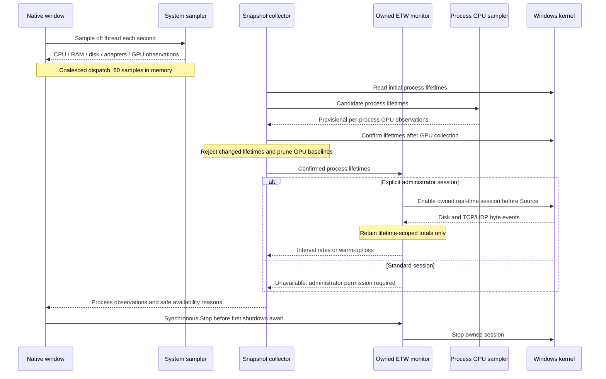

### System tray and app identity

[MainWindow.Tray](src/ProcSight.App/MainWindow.Tray.cs) owns opt-in visibility, metric selection,
window restoration and typed menu actions. The [notification adapter](src/ProcSight.Windows/Tray/NotificationIcon.cs)
owns the window subclass and Shell notification; [registration state](src/ProcSight.Windows/Tray/NotificationRegistration.cs)
re-adds after TaskbarCreated. No arbitrary command is dispatched from callbacks.
[TrayMetricSampler](src/ProcSight.Windows/Collection/TrayMetricSampler.cs) reuses CPU/RAM samples,
reads disk idle/GPU engine PDH counters and computes network adapter deltas off the UI thread at
most once per second. Percentages and throughput remain distinct; missing/warm-up readings stay
explicit. Queries, HICON/GDI resources and menu handles are disposed. Graph history is memory-only,
bounded to 30 samples, independent of process metadata and provider work. These system metrics
never fill per-process resource columns.

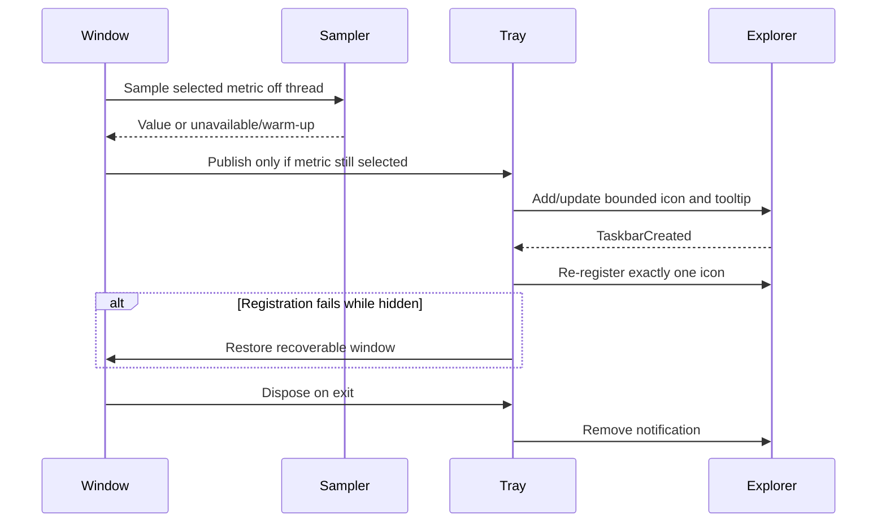

### Connection profiles

[ConnectionProfile](src/ProcSight.Core/Models/ConnectionProfile.cs) separates a stable connection ID
from provider kind, with enabled state, priority and a protected credential reference. Preferences
validate a maximum of 32 profiles under the existing bounded atomic JSON store.
[Migration](src/ProcSight.Application/Settings/ConnectionSettingsMigration.cs) copies existing API
credentials to independent protected slots before publishing profiles, preserving analysis/sharing
permissions and defaulting fallback off. Legacy fields remain for compatible migration; routing/UI
integration uses native selectable connection settings. Account references are opaque; no secret
enters ordinary preferences.
[ConnectionRouter](src/ProcSight.Application/Analysis/ConnectionRouter.cs) now resolves enabled
profiles by priority, with LocalOnly preferring a local model. The coordinator pauses authentication
per connection and only traverses the rest of the route on opted-in availability/rate/auth fallback.
Every attempt rebuilds its destination projection and reserves online budget; malformed output,
refusals, cancellation and valid Unknown results never trigger fallback. Activity records the actual
provider/model and a typed fallback reason; accepted rule provenance uses the winning connection.

[ImmediateSettingsController](src/ProcSight.Application/Settings/ImmediateSettingsController.cs)
serializes persistence and rejects stale completions. A restrictive overlay revokes sharing before
waiting for disk; enabling waits for successful persistence. WinUI keeps incomplete drafts outside
active policy, debounces text 400 ms, and flushes valid text on focus loss/unload. API-key edits use
explicit Enter/focus loss; a changed endpoint drops the prior credential binding.
[ConnectionTester](src/ProcSight.Application/Analysis/ConnectionTester.cs) invokes exactly the selected
profile with synthetic metadata and budget/activity accounting, independent of enabled/fallback routing.

The controller maintains cumulative `Desired` settings separately from `Current` applied settings;
later independent edits include pending changes without exposing them to collection before save.
Session consent re-applies through the same controller with a newer revision. Sharing revocations
and reduced request limits take effect before storage, including on failure. Active tests are linked
to policy/session cancellation and recheck the current revision after budget waits and responses.
Credential commits capture the authorized profile/destination before awaits and reject stale edits;
new profiles cannot borrow legacy provider keys. Auth pauses survive unrelated setting/view changes
and clear only on changed credentials/account configuration or explicit reauthorization/retry.
Protected credential envelopes bind provider kind and endpoint; plain settings cannot redirect a
key reference to a new destination or an unrelated protected credential namespace.

The connection settings page is a compact native toolbar/list with a separate fallback row.
Add/Configure hosts the existing editor in a per-profile ContentDialog; selection alone does not
create an editor. Closing defers dismissal until pending valid edits and key commits finish.
Unfinished new profiles are discarded; existing invalid drafts retain their last valid configuration.
[ConnectionProfileActions](src/ProcSight.Application/Settings/ConnectionProfileActions.cs) removes
a profile, compacts remaining priority indices and clears a matching research reference. Normal
policy application immediately revokes routing eligibility; shared account/credential storage is
left intact. Routine successful preference writes produce no persistent status row.

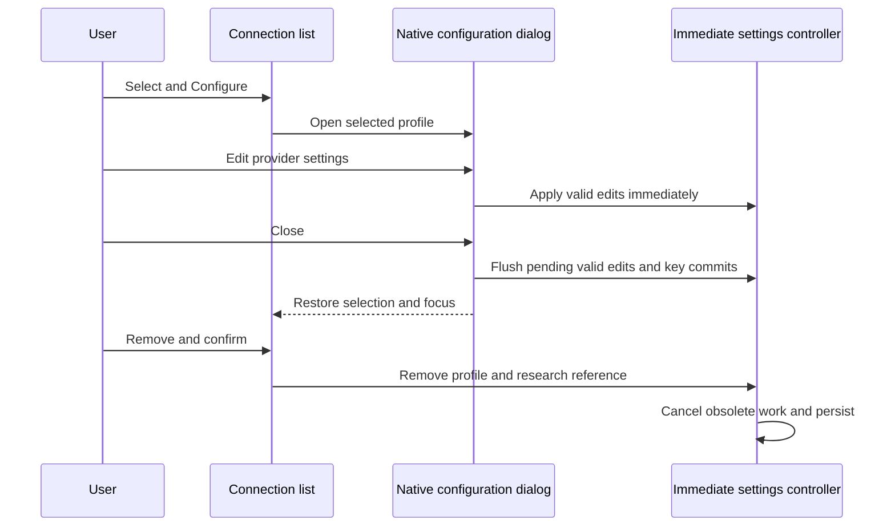

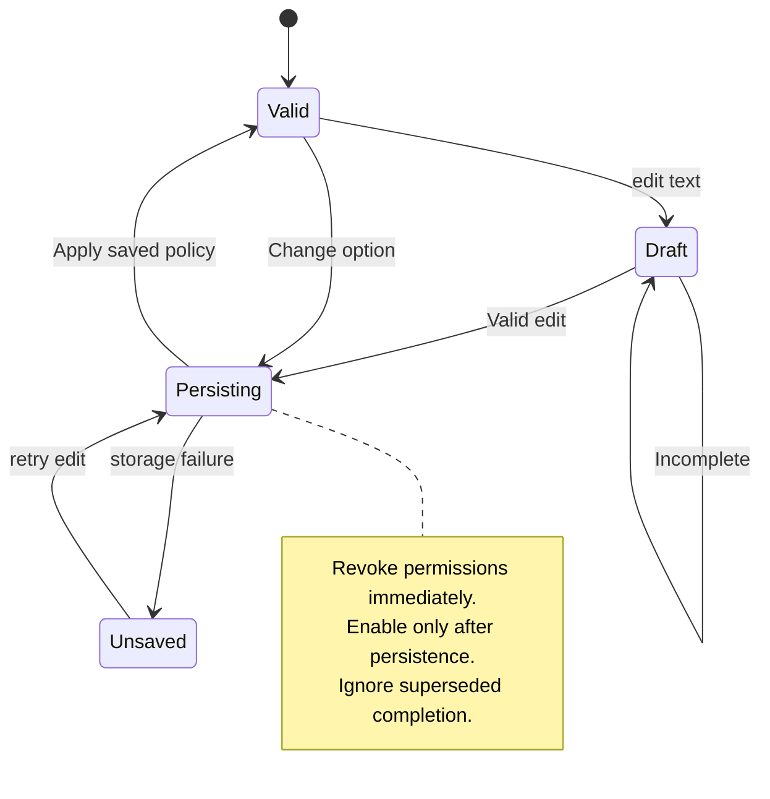

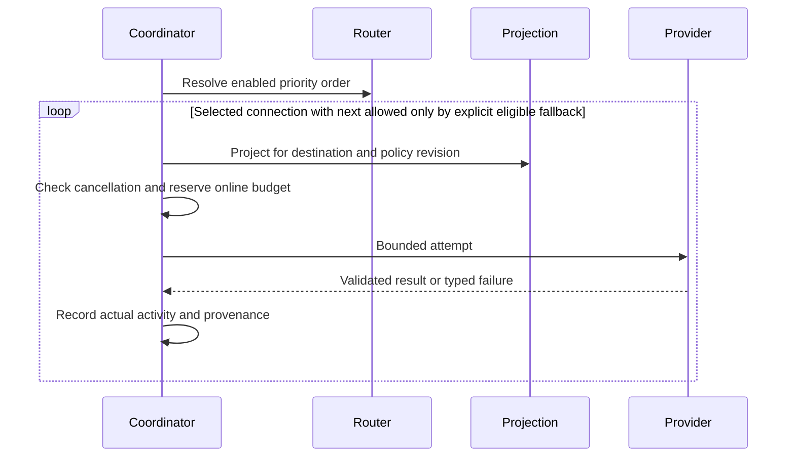

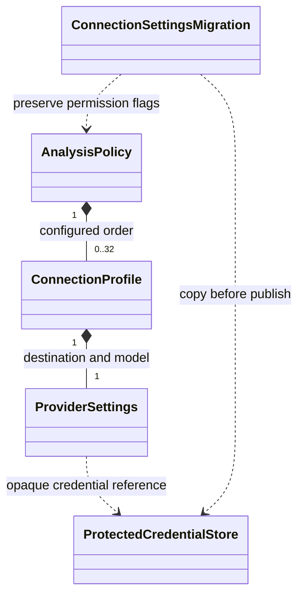

### ChatGPT plan connection

The [session adapter](src/ProcSight.Infrastructure/Authentication/ChatGptSessionService.cs) owns
open-source public-client OAuth, multiple issued client/account registrations, model discovery,
renewal and revocation. [Protected records](src/ProcSight.Infrastructure/Authentication/ChatGptProtectedStore.cs)
split large tokens into generation-addressed Windows credential chunks; the committed index is
published after all chunks exist. The account catalog is protected too. Preferences contain only
an opaque account-binding ID, provider/model selection and policy, never OAuth tokens or email.
[Named session/credential locks](src/ProcSight.Infrastructure/Authentication/ChatGptSessionLock.cs)
serialize cross-process refresh rotation and record publication; operations reload records under
the lock. Browser sign-in is bounded to three minutes and callbacks to 16 KiB/10-second reads.

[ChatGptPlanProvider](src/ProcSight.Infrastructure/Providers/ChatGptPlanProvider.cs) implements
IAnalysisProvider with fixed public HTTPS endpoints, fresh OAuth access tokens and a bounded
Responses SSE stream. A completed, non-refused, validated result is required before rule acceptance.
Successful completion can contain an empty output array even after text deltas were delivered.
In that case, retain the streamed text. Nonempty final text replaces it and still undergoes validation;
refusals/incomplete completion cannot activate a partial result.
Its transport accepts at most 1 MiB of events and 256 KiB of output over 60 seconds; it never
substitutes an API key. Existing coordinator budgets/retries still apply to transient failures.
Authentication failures pause analysis, while temporary refresh/body errors preserve transient
classification. Research remains available only through the explicit OpenAI API-key profile.

[Settings](src/ProcSight.App/MainWindow.Settings.cs) uses responsive native icon cards and expanders.
[Account controls](src/ProcSight.App/MainWindow.ChatGpt.cs) track a draft account/model separately
from the active analysis policy, reject stale asynchronous model loads, and require Save before
changing provider configuration. Sign-out cancels/drains current work and disables automatic analysis
for its profile before revoking/clearing credentials. Sign-in alone never enables automatic analysis.
Account and model discovery transmit no process metadata; inference uses the existing cloud projection.
These are implemented protocol boundaries. The user completed browser sign-in and the live catalog
was checked through the saved session. Two targeted inference smoke requests completed and validated;
full account-switch/revocation and provider acceptance remain unverified. Model catalogs have a separate 2 MiB cap because their metadata can exceed 256 KiB;
token and identity/JWKS responses retain the smaller bound. Catalog instruction fields are ignored.

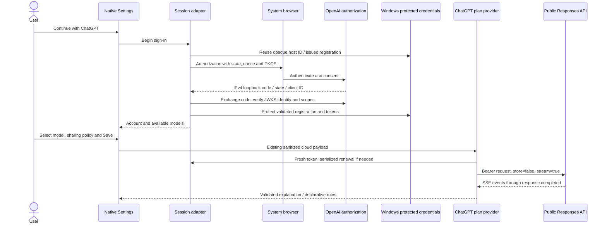

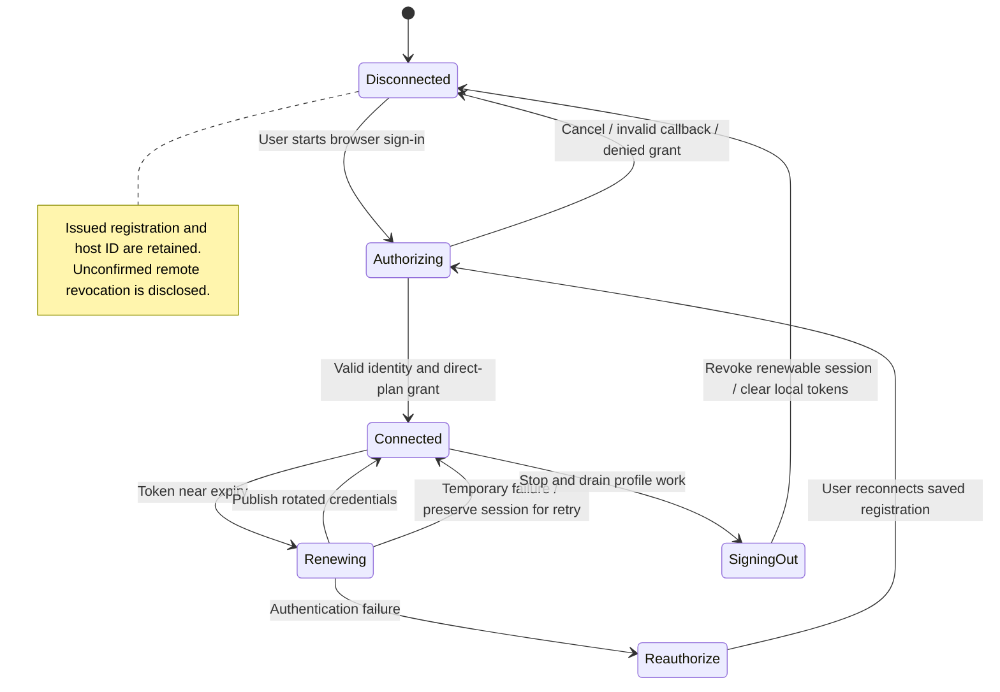

Protocol source: [OpenAI open-source sign-in](https://developers.openai.com/siwc/token-sharing-open-source/sign-in)
and [session management](https://developers.openai.com/siwc/token-sharing-open-source/profiles-and-sessions).

The first release is a C#/WinUI 3 application on Windows 11, ordinary-privilege by default with
explicit administrator restart. Collection,
identity enrichment, rules, storage, and provider work run away from the UI thread. The app
does not need a background service or Node.js server. ChatGPT browser sign-in temporarily opens an
IPv4 loopback callback listener; ordinary process collection has no listening network endpoint.

The UML dependency view shows implemented interfaces, not process deployment. Arrows mean
"uses"; adapters implement interfaces owned by Application/Core, so dependencies on provider
or storage behavior do not couple the coordinator to a concrete HTTP or SQLite implementation.


Core owns domain models, identity, rules, and privacy policy. Application owns coordination
and infrastructure interfaces. Windows owns OS collection and credential storage.
Infrastructure implements persistence, provider, and research adapters. App owns composition,
presentation, navigation, and UI dispatch. Domain tests do not require WinUI initialization.

## Identity and evidence model

A runtime process identity combines PID and creation time. When creation time is unavailable,
the identity is snapshot-scoped, preventing stale findings from transferring to a reused PID.
Parent links require lifetime validation. An executable identity and its invocation/ownership
context are separate: the same Node.js binary can serve unrelated applications.

Ownership candidates include an opaque identity derived from product and owner executable
path; equal product names at different paths stay distinct. Automatic learned rules retain
that ownership predicate when available. Native file descriptions provide readable labels
for generic Windows product metadata; model labels can further explain individual roles.
Command context uses a Windows-protected HMAC key and retains a separate shareable identity
for cloud requests whenever online command sharing is excluded.

The UML class view captures conceptual relationships, not complete C# declarations. A process
may host multiple services. An assessment may depend on several evidence records or rules;
invalidation follows these dependencies rather than deleting unrelated knowledge.

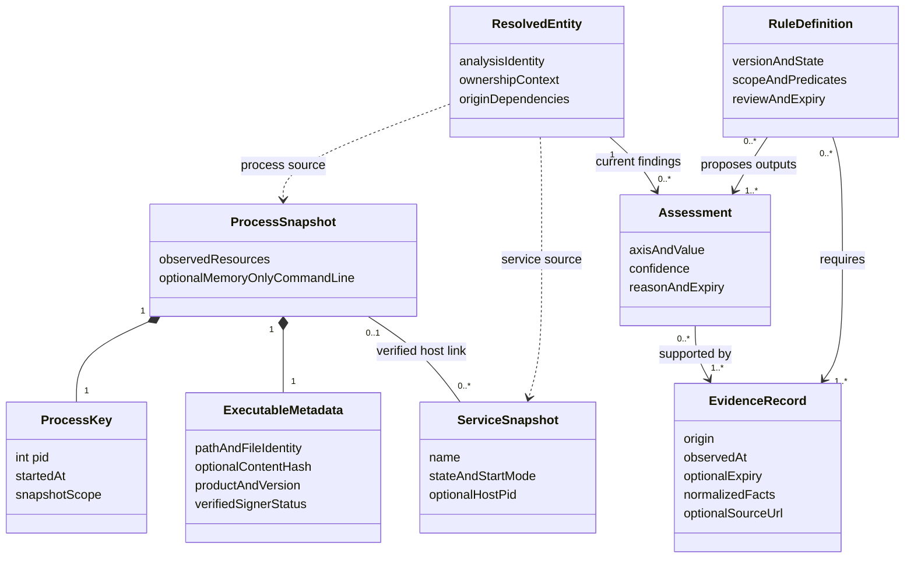

Purpose, security, and optionality are independent assessment axes. A metadata company string
is not a verified signer. Missing observations remain unavailable; unknown identity does not
imply threat. CPU, memory and process disk/network throughput preserve observation states;
unavailable measurements must not be presented as measured zero. GPU reports the busiest available
engine per process and for the system rather than a device-wide average.

## Local-first analysis interaction

Eligible rules and cached findings resolve dimensions before external calls. Equivalent
instances share queued work. Resource fluctuations alone do not trigger re-analysis.
Unknown or failed unchanged cases do not create a recurring request loop.
Successful local findings are reevaluated at their earliest rule/assessment/evidence expiry,
even while executable metadata stays unchanged. Policy revisions advance monotonically;
an older observation cannot restore a newer policy's withdrawn permission.
Name-only protected observations remain unknown and do not consume automatic jobs repeatedly
even when snapshot-scoped fallback identities change. Confirmed kernel lifetimes keep manual
investigation stable across collection; identity-unavailable assessments remain limited.
Exact cached assessments also require their supporting local metadata to agree with current
facts. Command-derived rules require a compatible command origin and controlled role context;
they cannot silently classify a metadata-only observation after online command sharing is excluded.

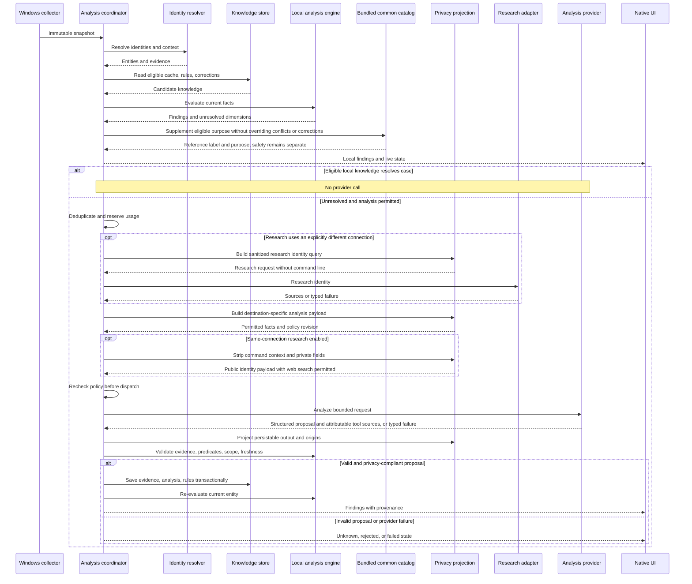

The single in-flight default, daily job/request allowances, bounded responses, and limited retries
limit request admission. ChatGPT plan requests reject `max_tool_calls`, so the additional research
allowance unit is not a strict remote tool-count or spending cap. API-key research can enforce one
tool call. Authentication failures pause provider work; collection remains
available. Results can enrich executable history after a process exits but cannot attach to
a newly reused PID. Shutdown cancels queued work and stops collection.

[ChatGptPlanProvider](src/ProcSight.Infrastructure/Providers/ChatGptPlanProvider.cs) and
[OpenAiResponsesProvider](src/ProcSight.Infrastructure/Providers/OpenAiResponsesProvider.cs) enable
web search in the analysis request when the research and analysis connections agree. An explicitly
different profile uses the separate research adapter. [AnalysisProjection](src/ProcSight.Core/Privacy/AnalysisProjection.cs)
strips commands, private fields and command origins from tools-enabled requests, independently of
ordinary online command-sharing consent. [InlineResearchResult](src/ProcSight.Infrastructure/Research/InlineResearchResult.cs)
validates URL aliases against completed tool sources/citations and maps them to internal evidence IDs.
The bounded full source set is checked before retaining at most ten records, prioritizing cited sources.
Partial or failed responses never activate findings. Web sources establish public context, not local
binary authenticity. See the [2026-10-17 revision](docs/superpowers/specs/2026-10-17-analysis-research-diagnostics.md).

## Rule lifecycle

The bundled catalog contains 373 machine-independent process/service reference definitions. It is versioned
with source rather than mixed into the learned-rule database. Verified certificate subjects
are parsed as distinguished names; product/original-file metadata gates matching. Windows
localized `.exe.mui` original filenames are accepted only for the corresponding component.
Catalog purpose fills an otherwise unresolved axis; it cannot settle conflicting learned
purpose or override a fresh correction. Security and optionality remain independent unknowns.
Knowledge and detail views expose the definitions and primary reference links.

Rules are constrained declarative data. AI may propose rules for all axes, but automatic
activation requires structural and semantic validation against attributable evidence.
The coordinator persists app-owned `RuleRejectionReason` codes from original and final validation,
separate from later revalidation against stored evidence. Missing legacy decisions are explicitly
unrecorded. Only the coordinator supplies the private invocation HMAC: provider parsing defers that
single requirement, then final validation requires it. Privacy predicate matching uses the same
case-insensitive exact/path-root semantics as rule matching, while unobserved literals are omitted.
Similarity selects candidates; missing required facts prevent matching. Threat findings
cannot generalize from an exact executable to an entire family without appropriate evidence.

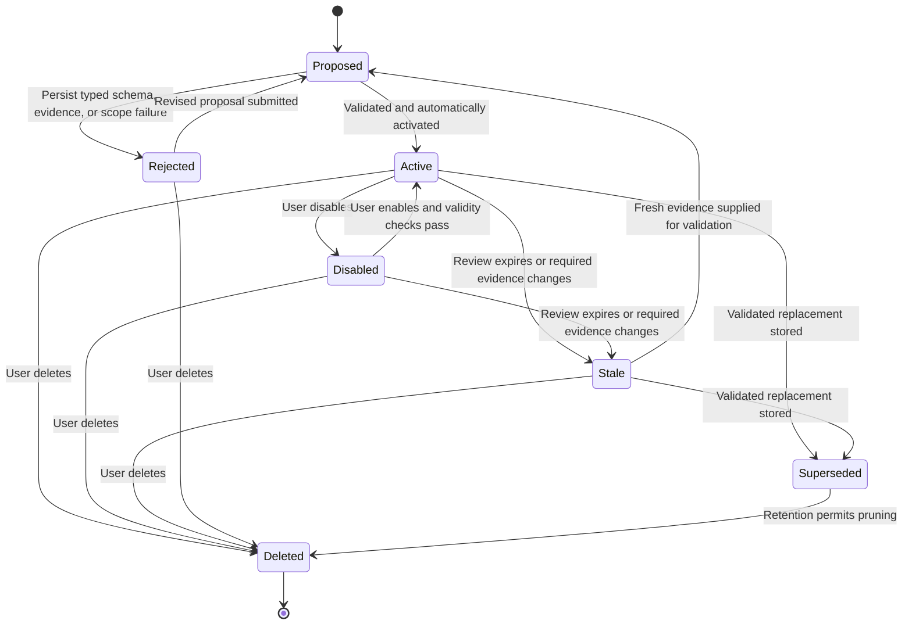

Stale, superseded, and deleted are conceptual lifecycle conditions; they need not be additional
persisted RuleState enum values. Stale findings remain inspectable as history. Default review
limits are 30 days for identity/purpose and 7 days for security/optionality; shorter evidence
expiry wins. Disabling or deleting a rule invalidates dependent current findings. Conflicting
eligible rules leave the affected axis unresolved and trigger fresh investigation. Scoped
user corrections take precedence without hiding independent conflicting security evidence.

## Command-line policy and external boundaries

Command lines are always collected for local display and rules when Windows permits access.
Off is the serialized default for online command exclusion; LocalOnly additionally prefers an
explicitly configured loopback model. OnlineFull permits verbatim transmission. A separate
ShareIdentifyingMetadata setting (default false) controls path/package/owner/service facts in
online metadata, evidence, and research. Raw command sharing independently includes identifiers
inside that line. Local-only findings and invocation HMAC digests cannot enter cloud requests.
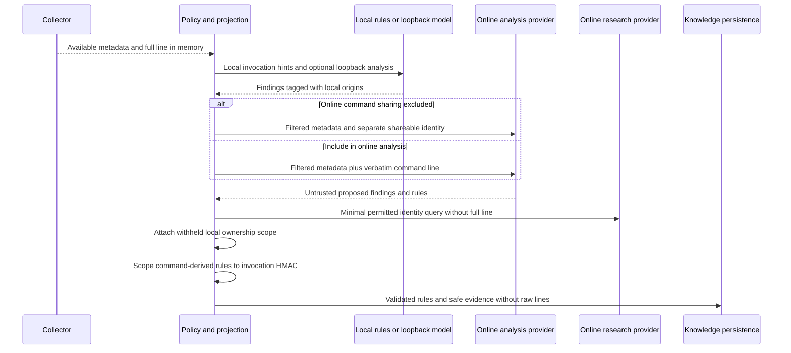

Origin restrictions survive storage and restart. A local-only finding is not retroactively
shareable after changing modes; build a newly authorized online projection instead. Before
dispatch, recheck the policy revision. A sharing change cancels/rebuilds queued payloads; local strings remain available. Already sent requests cannot be recalled.

Loopback model requests cannot follow remote redirects or fall back remotely. ProcSight
controls its own routing but cannot guarantee a separately operated local server's behavior.
Unavailable or oversized full lines are explicitly omitted with a reason, not silently
truncated while labeled full. Raw lines and unsafe echoed model output remain transient.

## Persistence and failure handling

SQLite stores versioned knowledge, evidence, lineage, corrections, and invalidation
dependencies. Separate atomic preferences store UI and operational settings without
conflating them. Windows-protected credential storage holds provider keys and local identity
digest keys. Usage accounting survives generated-knowledge resets.

`knowledge.db` stores generated findings/corrections; `usage.db` independently accounts for
requests; atomic `settings.json` stores operational and presentation choices under
`%LOCALAPPDATA%\ProcSight`. Credential Manager stores API keys and the HMAC key. Schema 1
creation is transactional; a newer schema is rejected without downgrading it. Knowledge
maintenance pauses observation and drains queued work before explicit recovery/reset.

[ExactAnalysisRule](src/ProcSight.Application/Analysis/ExactAnalysisRule.cs) covers a valid provider
result with no proposed rules: a known purpose plus submitted hash proof produces an exact-hash
rule from the privacy-projected known assessments. Unknown axes remain on the entry and unresolved;
they do not invalidate the known-purpose rule through missing evidence. The coordinator appends the
same local path/ownership/service and applicable private invocation scope, stamps trusted provenance
and runs full validation before storing it. Existing rejected proposals are never replaced. This
does not generalize across changed hashes, local scope boundaries or analyzed command contexts.

Older entry-level identity labels require active rule dependencies and a supported selected known
assessment. Local evaluation compares assessment fields, evidence IDs and origin sets by content
after SQLite reconstructs their collections; it does not confuse new collection references with
different findings. Contributions still track the owning rule's assessment instances. No schema or
bulk knowledge migration is needed; older rule-free entries with changed identities need fresh analysis.

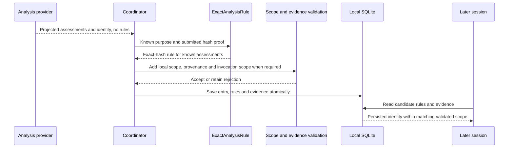

Toolhelp and nonthrowing native process queries enumerate protected processes without using
exception-based access probes. Resource intervals and unavailable facts remain explicit.
Service configuration uses WMI with a ten-second cache; available command lines are always collected locally through WMI.
Executable enrichment hashes/verifies at most sixteen uncached process files and eight service
files per poll, rotates service work for fairness, and caches by
file stamps. Offline WinVerifyTrust does not initiate online certificate retrieval.

Do not persist continuous resource history or raw snapshot DTOs. Prune unreferenced history
older than 90 days while preserving active corrections and evidence needed by active rules.
Schema updates are transactional. Preserve corrupt originals and require explicit recovery;
do not silently discard corrections or reset privacy policy to a more permissive state.

The UI distinguishes local findings, queued/analyzing, unknown, stale, budget-paused, and
failed states. It remains useful offline, without credentials, and with partial Windows access.
External/model text cannot initiate machine actions or request arbitrary local reads.
See [SECURITY.md](SECURITY.md) for reporting and intended security boundaries.

## Live table state and assets

### AI activity history

[AnalysisActivityLog](src/ProcSight.Application/Analysis/AnalysisActivityLog.cs) holds immutable
request summaries in a thread-safe ring of at most 200 entries, newest first. The coordinator
begins an entry immediately around each actual provider/research call, including retries, and
completes it with success, failure or cancellation. Cached/local-rule outcomes create no AI entry.
The [Settings connection test](src/ProcSight.App/MainWindow.Settings.cs) records synthetic requests
through the same API. Observer/logging failures cannot fail analysis; clearing/evicting an in-flight
entry does not recreate it when its result arrives. Pausing blocks new entries but finishes prior ones.

Summaries retain local process name/PID or service identity, selected provider/model, timing, attempt
number, safe metadata values/categories and a command-inclusion flag. They never retain the payload
or raw command. Returned assessments pass OutputPrivacyFilter before location/secret sanitization;
research keeps only the evidence count. Proposed rule counts are not claims that rules were activated.
An analysis entry records same-request research outcome and returned source count; it does not create
a fictitious separate research attempt. `RuleProvenance.Research` preserves the actual outcome for
future rule inspection. An Active rule containing only Unknown values remains unresolved.
ProviderError carries an optional typed ProviderFailureReason through the adapters and activity entry.
[ProviderFailureExplanation](src/ProcSight.Core/Models/ProviderFailureExplanation.cs) maps it to
app-owned cause/recovery wording; validator messages and rejected provider text are never retained.
Malformed JSON, evidence errors, invalid values/duplicate categories and stream/size failures remain
distinct. Old/unclassified failures explicitly state that the specific reason is unavailable.
No file/export/database storage exists for activity. [Native AI activity](src/ProcSight.App/MainWindow.Activity.cs)
offers status filtering, pause/clear and selected result details, updates rows without replacing the
whole list, and stops its UI refresh timer on unload.

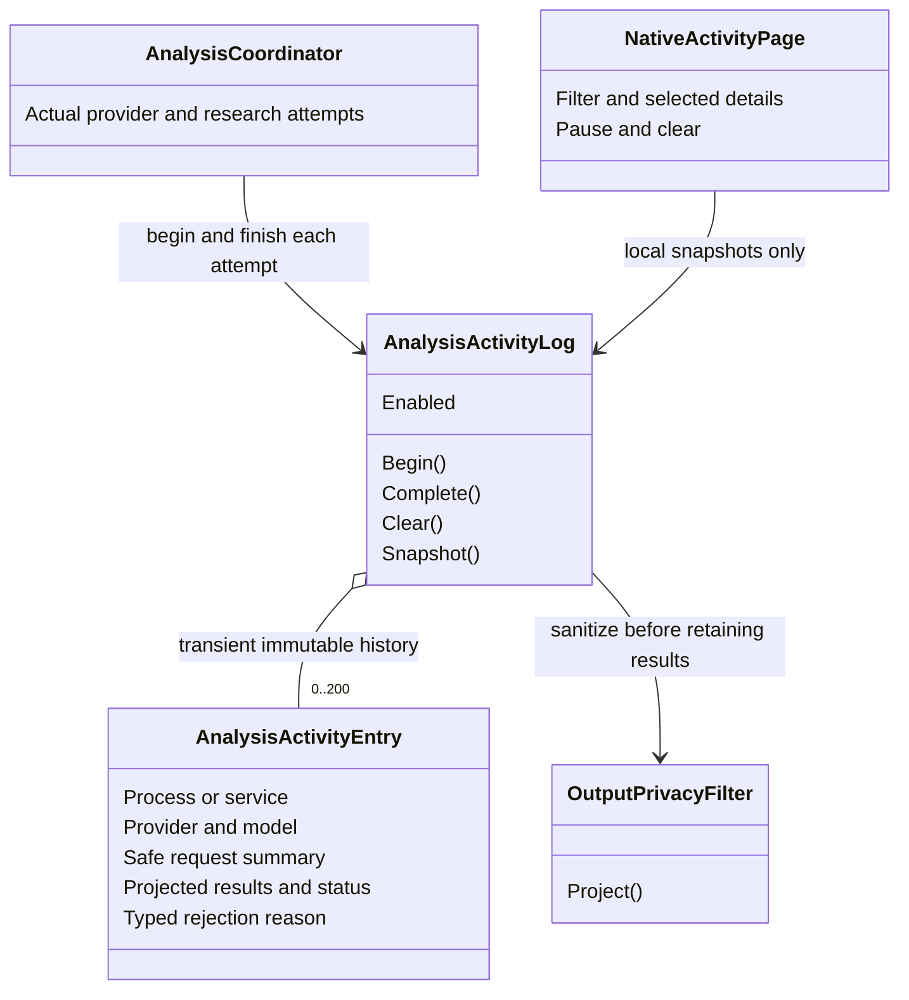

### Local window observations

[WindowMetadataReader](src/ProcSight.Windows/Collection/WindowMetadataReader.cs) enumerates visible
non-tool top-level desktop windows in the background collector. It checks HWND PID before/after
caption reads and rechecks known process creation times. Unknown lifetimes remain conservative local observations
observations. Limits are 4096 enumerated windows, 32 captured per process, 512 caption characters,
and 255 class characters. Same-process caption messages use a 50ms timeout; other captions use
the system's nonblocking foreign-caption API. Captions are not control contents or identity proof.

ProcessSnapshot.Windows and caption/class properties are JsonIgnore; diagnostic ToString methods
omit captions. They never enter facts, identity, knowledge, rules, or any provider/research
projection. DisplayName appends a useful caption while retaining host/role labels.
Specific local invocation/service labels take precedence over AI executable labels. Established application
identity is preserved; an assessed label can append an allowlisted role or name an otherwise unknown
executable only when it passes concise-name checks. Explanatory signer/metadata prose remains in
assessment details, even for old persisted labels. Captions prefer foreground then non-minimized
windows, with lexical fallback. Details exposes all observations.
Because window data is absent from identity/fingerprints, changing titles updates presentation
without provider re-analysis or regrouping.

The UML class view shows the local presentation boundary:

```mermaid
classDiagram
    WindowsSnapshotSource --> WindowMetadataReader : background collection
    WindowMetadataReader --> ProcessWindow : bounded caption observations
    ProcessSnapshot o-- ProcessWindow : transient JsonIgnore
    ProcessRoleLabels --> ProcessWindow : local name context
    ProcessDetails --> ProcessWindow : local details
    IdentityResolver --> ProcessSnapshot : ignores window observations
    AnalysisProjection --> ProcessSnapshot : excludes windows
    class ProcessWindow {
        privateTransientTitle
        privateTransientClass
        foreground
        minimized
    }
```

The native ListView owns horizontal and vertical scrolling, keeping its vertical scrollbar
inside the visible viewport. A header ScrollViewer synchronizes horizontally in both directions.
Header buttons fill each cell height and toggle direction; saved sort preferences include direction.
Sorting compares displayed workload names or classifications, with unavailable metrics last.
Explicit sorts affect siblings while retaining ownership/tree hierarchy and stable sampling order.

[ProcessDetails](src/ProcSight.Application/Presentation/ProcessDetails.cs) formats transient local
command lines and file/signature/lifetime metadata. [LocalCommandRules](src/ProcSight.Core/Rules/LocalCommandRules.cs)
shares literal script/module/package parsing across hosts and provides known extension/worker hints.
Rows follow host — hosted; groups retain application ownership. PowerToys component names use
verified catalog/executable metadata. Raw command values never enter rule literals or persistence.

When online identifiers are excluded, the coordinator appends local path/owner/service scopes
after provider responses. Command-derived learned rules additionally require a 64-hex keyed HMAC
commandContext predicate and controlled evidence. Distinct scripts under the same runtime cannot
inherit one another's invocation-specific findings. Older command-derived rules without this
scope fail validation and require re-analysis. Storage accepts only fixed categories and HMAC
scope values in command-origin evidence, never arguments or arbitrary labels.

Sampling updates cell values without sorting existing siblings. Explicit column sorting or
Refresh establishes a new order. Groups require multiple visible members; a sole member is
a normal process row with PID/resources and no expander or count. The top-level owner slot
retains its key across single/group transitions, preserving native viewport anchoring. Selection
maps a former child to its remaining process row by lifetime key when its visual key changes.
Blank Windows descriptions fall back to executable names. A stable
visual slot for a creation-time-unavailable PID does not relax domain lifetime boundaries;
kernel sequence scopes or conservative snapshot fallback determine the domain identity, and
row analysis is replaced when its entity identity changes. Reconciliation retains row objects,
notifies changed properties only, and preserves the viewport through native ItemsStackPanel
anchoring. New processes may append and exited processes disappear.

Application groups and raw parent/child nodes have separate expansion state. A native chevron
action owns toggling, independently of selection; collapse selects its parent row. The UML
state view describes one visible expandable node, not persisted knowledge state:

```mermaid
stateDiagram-v2
    state Initial <<choice>>
    [*] --> Initial
    Initial --> Single: One application process
    Initial --> Collapsed: Multiple application processes
    Initial --> Expanded: Raw process parent
    Collapsed --> Expanded: Chevron action
    Expanded --> Collapsed: Chevron action without reselection
    Single --> Collapsed: Additional related process appears
    Single --> Expanded: Additional process and remembered expansion
    Collapsed --> Single: One process remains
    Expanded --> Single: One process remains and child selection follows
    Single --> Removed: Sole process exits
    Collapsed --> Collapsed: Sample updates cells and count
    Expanded --> Expanded: Sample updates cells and count
    Collapsed --> Removed: Last process exits
    Expanded --> Removed: Last process exits
    Removed --> [*]
```

An application's remembered expansion choice is retained during its single-process state;
when it regains multiple members it may return directly to Expanded. Raw process-parent
expansion is independent of application group membership.

`ProcessRoleLabels` uses local metadata, host service associations, and permitted command
tokens to explain generic children provisionally. A generic catalog/model executable label
does not erase a specific service or invocation role. These display-only command-derived
labels never enter entity facts, provider payloads, research, or persistence.

Windows Shell supplies executable artwork off-thread; a two-reader gate and 512-entry memory
cache bound work. Lookup rejects network/missing paths, frees HICON/GDI resources, and uses a
fallback when unavailable. Pixels are cosmetic, never identity or security evidence. The App
creates WinUI bitmaps on its dispatcher and checks asset identity before applying async results.

## Extensions and maintenance

### Authenticated shared knowledge and invocation hints

The embedded [catalog](src/ProcSight.Core/Rules/common-tasks.json) supplies 373 definitions:
96 process references and 277 service references, including publisher-only hints. IDs include
executable/product/service scope. Full matches require verified signer and exact product or
original-file/Windows-path evidence. Publisher-only matches retain unknown purpose. Reference
links provide product/Windows background; configured metadata supplies the file evidence.
Purpose rules cannot establish security, optionality, or exact invocation behavior.

[ServiceBinaryReader](src/ProcSight.Windows/Collection/ServiceBinaryReader.cs) reads configured
executables and root/Parameters ServiceDll values. Per-user template fallback requires a hex
instance suffix and the registry per-user Type bit. Network and ambiguous unquoted paths are
unavailable. [Collection](src/ProcSight.Windows/Collection/WindowsSnapshotSource.cs) separately
hashes/verifies the implementation and host; the resolver scopes knowledge to implementation
path/hash/signature and uses identity-scoped evidence IDs. Raw configured arguments are JsonIgnore
and excluded from shareable identities. Configuration does not establish loaded-module state.

This UML class view separates authenticated file evidence from invocation hints:

```mermaid
classDiagram
    ServiceSnapshot o-- ExecutableMetadata : configured implementation
    ServiceSnapshot o-- ExecutableMetadata : configured host
    IdentityResolver --> ServiceSnapshot : scopes module identity
    KnownTaskCatalog --> ExecutableMetadata : verified signer and metadata
    KnownTaskCatalog --> LocalAnalysis : purpose or unknown publisher
    LocalCommandRules --> LocalCommandRole : bounded token rules
    ProcessRoleLabels --> LocalCommandRole : transient display label
    AnalysisCoordinator --> LocalCommandRole : allowlisted category only
    class LocalCommandRole {
        Label
        Category
        RuleId
    }
```

[LocalCommandRules](src/ProcSight.Core/Rules/LocalCommandRules.cs) uses bounded Windows quote
tokenization and fixed switch/entry-point/module tables. Inline interpreter code and encoded
payloads remain opaque; no rule can execute or fetch code. Only Renderer/Utility/Worker/CLI categories and 64-hex HMAC invocation scopes enter command-origin evidence, while arbitrary entry-point names remain display-only.
Local-only HMAC context and derived findings retain their existing cloud exclusion.

The UML sequence shows the distinction between service host and implementation verification:

```mermaid
sequenceDiagram
    participant W as WMI and read-only registry
    participant C as Background collector
    participant V as Offline file verifier
    participant I as Identity resolver
    participant K as Shared catalog
    participant U as Investigation UI
    C->>W: Read configured host and service implementation
    W-->>C: Local paths or unavailable
    C->>V: Bounded cached hash and signature checks
    V-->>C: Separate host and implementation proofs
    C->>I: Snapshot without persisted raw arguments
    I->>K: Match own module signer and metadata
    K-->>U: Purpose reference or unknown
    Note over U: Host proof cannot authenticate service DLL. Loaded module is unverified
```

Phase 2 adds an explicitly initiated management-command boundary with fresh target identity,
permission, and impact checks. Phase 3 adds installation/startup/dependency evidence for
cleanup recommendations. Neither phase lets AI rules execute actions automatically.

Keep this document and its UML views current as these boundaries evolve. Update the component
view for ownership/interfaces, class view for evidence dependencies, sequence views for data
flow/privacy, and state view for rule lifecycle changes. Add deployment/activity views when
new process, privilege, or branching boundaries make them useful. Dated design records remain
history; this document must state which parts are implemented, planned, and verified.

## Rule contribution and local unavailability

[Rule models](src/ProcSight.Core/Models/RuleModels.cs) store optional provider provenance stamped by
[the coordinator](src/ProcSight.Application/Analysis/AnalysisCoordinator.cs) after privacy filtering.
Legacy JSON remains valid without it. [Local evaluation](src/ProcSight.Core/Rules/LocalAnalysisEngine.cs)
records all eligible matches separately from rules owning the final selected assessments; corrections,
conflicts and cached copies cannot manufacture rule contribution. Bundled purpose contribution is
recorded by [KnownTaskCatalog](src/ProcSight.Core/Rules/KnownTaskCatalog.cs).
Local evaluation indexes stored/current evidence once (current records win duplicate IDs), filters
predicate matches first and runs the unchanged full validator against that shared index for eligible
rules. This avoids rebuilding the evidence map for unrelated rules; candidate-store reads and their
existing invalidation semantics are unchanged.
[RuleInspection](src/ProcSight.Application/Presentation/RuleInspection.cs) explains predicates,
evidence, expiry, source and contribution; [native dialogs](src/ProcSight.App/MainWindow.Rules.cs)
reuse it from the library and selected-process details. Private matching fingerprints remain hidden.

The following UML class view shows persisted provenance and result attribution:

```mermaid
classDiagram
    RuleDefinition "1" o-- "0..1" RuleProvenance
    RuleDefinition "1" o-- "*" RulePredicate
    RuleDefinition "1" o-- "*" Assessment
    LocalAnalysisEngine ..> RuleDefinition : validates and evaluates
    LocalAnalysisEngine ..> LocalAnalysis : selects assessments
    LocalAnalysis : MatchingRuleIds
    LocalAnalysis : AppliedRuleIds
    RuleProvenance : ProviderId
    RuleProvenance : Model
    RuleProvenance : Destination
    RuleProvenance : GeneratedAt
    AnalysisCoordinator ..> RuleProvenance : stamps configured source
    RuleInspection ..> RuleDefinition : describes conditions and evidence
    RuleInspection ..> LocalAnalysis : explains contribution
```

[MetadataAccess](src/ProcSight.Windows/Collection/MetadataAccess.cs) classifies expected native,
WMI, registry and file failures into bounded reasons. Readers retain partial records; each service
property is handled independently. [snapshot models](src/ProcSight.Core/Models/SnapshotModels.cs)
carry JSON-ignored local `MetadataIssue` lists; [ProcessDetails](src/ProcSight.Application/Presentation/ProcessDetails.cs)
renders reasons without arbitrary exception messages or guesses about the owner. Signature access
failure yields Unavailable, not Unsigned. Unknown or absent data does not imply access denied.

This UML sequence view shows the local-only diagnostic boundary:

```mermaid
sequenceDiagram
    participant Windows as Windows APIs / WMI / files
    participant Reader as Metadata readers
    participant Snapshot as Local snapshot
    participant DetailView as Native details
    participant Projection as Online projection
    Windows-->>Reader: Readable fields or restricted-read error
    Reader->>Reader: Classify safe field/reason and preserve partial data
    Reader->>Snapshot: Metadata plus local MetadataIssue
    Snapshot->>DetailView: Readable values and unavailable reasons
    Snapshot->>Projection: Allowed evidence only
    Note over Snapshot,Projection: MetadataIssue is JSON-ignored with no exception text or raw command diagnostics
```

## Native rules list/details presentation

The [design guide](docs/WINUI3-DESIGN.md) applies to the shell's shared native presentation.
[MainWindow.Knowledge](src/ProcSight.App/MainWindow.Knowledge.cs) loads rule and evidence records
on worker tasks, constructs a searchable source/state-filtered collection, preserves selected IDs
when available, and selects side-by-side or stacked details based on actual content width.
[RuleInspection.Name](src/ProcSight.Application/Presentation/RuleInspection.cs) uses explicit
identity predicates first, then metadata from referenced evidence with the same exact hash.
Names are contextual labels; they do not change rule predicates or validate trust.

[RulePresentation](src/ProcSight.App/MainWindow.RulePresentation.cs) supplies shared native content
for the nonmodal library and existing process dialogs. Classification, condition, evidence and
provenance sections preserve the separate privacy/trust meanings. Commands invalidate coordinator
knowledge only after storage succeeds. Enabling still requires fresh supported evidence; deletion
requires explicit inline confirmation so inspectors never create nested modal dialogs. Bundled
reference definitions remain read-only. No new persistence or provider contracts are introduced.

The UML state view describes the responsive investigation flow:

```mermaid
stateDiagram-v2
    [*] --> Browse
    Browse --> Details: Select rule
    Details --> Browse: Back at narrow width
    Details --> Details: Enable or disable succeeds / refresh records
    Details --> ConfirmDelete: Delete command in overflow
    ConfirmDelete --> Details: Cancel
    ConfirmDelete --> Browse: Confirm and storage succeeds
    ConfirmDelete --> ConfirmDelete: Storage fails / inline feedback
    note right of Details
        Wide layout keeps list visible.
        Narrow layout shows one pane.
        Both use shared structured content.
    end note
```

## Structured local process investigation

### Configurable columns and explicit local export projection

[TableColumns](src/ProcSight.Application/Presentation/TableColumns.cs) defines app-owned column IDs,
availability, default widths and private-field groups. Layout normalization preserves one Name column
at the first position, ignores unknown/duplicate IDs and bounds widths before native rendering.
Presentation preferences store separate process/service layouts, never cell contents.
[Native columns](src/ProcSight.App/MainWindow.Columns.cs) generate the header and virtualized row
template from that same catalog, binding both to shared observable width objects. Native thumbs,
header drag/drop and the immediate chooser update only layout. Name cannot be hidden or moved.
Header gestures preview order changes in place, retain the row template and header control instances,
and save only on a valid release. A small pointer threshold separates sorting from dragging.
[Header dragging](src/ProcSight.App/MainWindow.HeaderDrag.cs) translates the actual full header and
realized body cells together at the pointer's grab offset. One shared native transform per column
moves its header, resize target and body cells; neighboring columns use one short animation each.
Preview does not rewrite widths or Grid.Column slots. Only a valid drop commits the new grid layout;
Escape/cancel discards transforms without changing the original order. Recycled rows attach to the
same active transforms. Dragged cells temporarily use an opaque surface resolved for the actual
element theme; cleanup restores transforms, layering and resource-background bindings.
Resize thumbs have transparent templates in all pointer states and a 20px hit
area centered across each divider; they follow column identity after a move and inherit a horizontal
resize cursor. Virtualized containers apply the latest cell order and active drag translation when
realized. Template/width-slot reconstruction
is reserved for changed visible-column sets; old index bindings are detached before slot counts change.
[Row actions](src/ProcSight.App/MainWindow.RowActions.cs) use context requests to target the clicked
item while preserving existing multi-selection, and reject stale process lifetimes at invocation.
[Native export](src/ProcSight.App/MainWindow.Export.cs) captures entities/assessments before dialogs,
expands selected groups once and offers selected, filtered or full scopes. It excludes collapsed-tree
visibility from filter scope. The owner-bound Windows App SDK Save picker chooses a destination;
off-thread serialization writes a temporary sibling before replacement. No provider is involved.

```mermaid
classDiagram
    PresentationPreferences "1" --> "0..*" TableColumnPreference : per-table saved IDs and widths
    NativeColumns --> TableColumns : normalize and generate cells
    NativeColumns "1" --> "1..*" TableColumnWidth : current observable widths
    NativeHeader --> TableColumnWidth : bind
    VirtualizedRows --> TableColumnWidth : bind
    HeaderDrag --> NativeHeader : translate entire header at pointer grab offset
    HeaderDrag --> VirtualizedRows : translate matching realized cells
    HeaderDrag --> NativeColumns : preview order then commit or restore
    HeaderDrag "1" --> "1..*" ColumnMotion : one shared transform per optional column
    NativeHeader --> ColumnMotion : shared rendering offset
    VirtualizedRows --> ColumnMotion : same offset including recycled rows
    RowContextMenu --> ProcessKey : lifetime check
    NativeExport --> TableValues : explicit local disclosure
    NativeExport --> InventoryExport : snapshot serialization
    NativeExport --> SavePicker : explicit destination
```

The [row view model](src/ProcSight.App/ViewModels/ProcessRow.cs) keeps transient display caches
across resource-only samples, invalidating them for changed identity, metadata or analysis. No cached
command/path/caption values enter persistence, provider projection or logs. Projection indexes verified
parent links once and retains existing sibling order without reevaluating sort labels on ordinary ticks.
[LiveRowCollection](src/ProcSight.App/ViewModels/LiveRowCollection.cs) batches large explicit sorts/filters
into one native list reset, reusing row objects and restoring selected lifetimes. Resource-only updates
remain incremental and do not reset the list. Detail/rule text reuses app-owned native styles rather
than parsing equivalent XAML for every label.

[TableValues](src/ProcSight.Application/Presentation/TableValues.cs) projects transient local fields;
it is separate from AnalysisProjection and must never feed providers, rules or activity history.
[InventoryExport](src/ProcSight.Application/Presentation/InventoryExport.cs) writes explicitly selected
fields: quoted CSV/TSV protects formula-like text and JSON retains original text and nulls. Export
projection strips excluded command/window context before deriving names. Missing observations stay
null, and availability text comes from typed collector issues without raw exceptions.

```mermaid
sequenceDiagram
    participant View as Local inventory UI
    participant Layout as TableColumns
    participant Fields as TableValues
    participant Writer as InventoryExport
    View->>Layout: Normalize stable IDs, widths, order and visibility
    Layout-->>View: Name first plus eligible columns
    View->>Fields: Frozen entities and explicit export disclosure choices
    Fields-->>View: Local fields with excluded private context removed
    View->>Writer: Allowed columns and projected snapshot
    Writer-->>View: CSV, TSV or JSON text for an explicit local destination
    Note over Fields,Writer: No provider, credential store, rule persistence or telemetry path
```

[ProcessDetails.Sections](src/ProcSight.Application/Presentation/ProcessDetails.cs) creates local,
transient field groups for process or service identity, executable metadata, signature/file identity,
commands, visible windows, hosted services and collection availability. Field values are JSON-ignored
and excluded from diagnostic record text. The native pane is owned by
[MainWindow.ProcessDetails](src/ProcSight.App/MainWindow.ProcessDetails.cs), sharing native section,
field and typography helpers with rule inspection. Service host/implementation proofs remain separate.

A transient comparison key includes displayed local metadata and analysis results but excludes
resource samples. Unchanged views are retained, reducing reconstruction and repeated database reads.
When displayed metadata changes for the same selection/lifetime, the pane restores top-level
expansion state and scroll position. A different selection retains top-level expansion choices but
starts with fresh item content and scroll. [Shared section presentation](src/ProcSight.App/MainWindow.RulePresentation.cs)
remembers native IsExpanded property changes by app-owned section kind in a window-session dictionary.
Process/service sections and rule-inspection sections have separate namespaces; learned/bundled rules
share matching-condition preferences. Missing sections do not erase remembered choices. Preferences
contain no item identity or metadata and are never persisted. Item-specific nested evidence remains
selection-scoped. Local comparison strings
can contain private command context and must never enter persistence, logs or providers.
Evidence results require both current selection/lifetime and pane generation to prevent an older
async read from overwriting newly selected or rebuilt details. Group selection requests an individual
process rather than displaying the representative child's metadata as group-wide evidence.

This UML sequence view describes updates and the local evidence boundary:

```mermaid
sequenceDiagram
    participant Live as Live collection / analysis
    participant Pane as Native details pane
    participant Model as Local presentation fields
    participant Store as Knowledge store
    opt User selects another process or service
        Pane->>Pane: Retain section-kind choices and discard old item content and scroll
    end
    Live->>Pane: Update selected process
    Pane->>Model: Build local metadata sections
    Model-->>Pane: JSON-ignored private values and safe unavailable reasons
    alt Display inputs unchanged
        Pane->>Pane: Retain controls and scroll
    else Display inputs changed
        Pane->>Pane: Keep section-kind choices and same-selection scroll
        Pane->>Pane: Rebuild structured view and increment generation
        Pane->>Store: Read candidate evidence off UI thread
        Store-->>Pane: Stored rules and evidence
        alt Selection and generation still match
            Pane->>Pane: Render rule and evidence sections
        else Selection or generation changed
            Pane->>Pane: Discard stale completion
        end
    end
    Note over Pane,Model: Local commands and captions never become provider payloads through presentation
```

The native table header is left-anchored and sized to the greater of minimum column width,
ScrollViewer content extent and viewport width. Synchronization covers layout/extent changes
as well as resizing and scrolling, with guarded assignments to avoid unnecessary layout work.
CommandBar content aligns vertically with its actions. Keep the header and row column geometry
identical when collection starts empty, the window resizes, or horizontal scrolling is active.

## Restricted lifetime continuity and service icons

[KernelProcessLifetimeReader](src/ProcSight.Windows/Collection/KernelProcessLifetimeReader.cs) optionally
uses the Windows 11 SystemBasicProcessInformation API. Its sequence number distinguishes PID reuse
without opening the target process. It is [documented by Microsoft](https://learn.microsoft.com/en-us/windows/win32/api/winternl/nf-winternl-ntquerysysteminformation?redirectedfrom=MSDN)
for Windows 11 26100.4770 and later. Runtime resolution and bounded parsing permit conservative
Toolhelp fallback on unavailable or unsupported builds.

`ProcessLifetimeTracker` derives a collector-session/PID/sequence GUID for ProcessKey.SnapshotScope,
which can now represent a confirmed lifetime scope instead of a fresh snapshot scope. It retains
observed creation time through permission failures only while the kernel sequence still matches.
[WindowsSnapshotSource](src/ProcSight.Windows/Collection/WindowsSnapshotSource.cs) enumerates those
kernel records, reads metadata, then confirms sequences before publishing. Reused or unconfirmed
rows are excluded; scope reuse never authenticates files or resolves parent ownership without the
existing creation-time checks. Handle failures attach safe unavailability reasons. If the optional
API is unavailable initially, unknown creation times retain conservative per-snapshot scopes.

The [coordinator](src/ProcSight.Application/Analysis/AnalysisCoordinator.cs) keeps name-only automatic
assessments Unknown with explicit limited-analysis guidance. Manual work against a stable lifetime
can complete across polling; generated rules still require validated identifying evidence.
[ProcessIconSource](src/ProcSight.Application/Presentation/ProcessIconSource.cs) selects configured
service implementation or host file metadata for cosmetic display. [Icon loading](src/ProcSight.App/MainWindow.Icons.cs)
remains bounded/cached/off-thread and checks the selected file key before publication. A change of
source clears the row icon. Missing icons use a 16px Fluent gear; this is not loaded-module proof.

This UML sequence view shows the lifetime and privilege boundary:

```mermaid
sequenceDiagram
    participant Kernel as Optional kernel enumeration
    participant Collector as WindowsSnapshotSource
    participant Scope as ProcessLifetimeTracker
    participant Target as Per-process metadata APIs
    participant Resolver as Identity resolver / coordinator
    Kernel-->>Collector: PID and lifetime sequence
    Collector->>Target: Read available metadata without elevation
    Target-->>Collector: Readable fields or safe denial reasons
    Collector->>Scope: Resolve scope using session / PID / sequence
    Scope-->>Collector: Stable scope and observed creation time if known
    Collector->>Kernel: Confirm sequence after capture
    alt Sequence still matches
        Collector->>Resolver: Publish partial metadata under confirmed scope
    else Missing or changed confirmation
        Collector->>Collector: Exclude unconfirmed rows
    end
    Note over Scope,Resolver: Lifetime continuity does not prove executable identity or parent ownership
```
