# Architecture

## Status and documentation convention

ProcSight is an unreleased native development preview. The collector, domain contracts,
identity resolver, privacy/rule engine, SQLite storage, provider adapters, coordinator, and
investigation UI below are implemented. Automated verification uses synthetic providers;
live-provider and full desktop acceptance remain outstanding. The [design](docs/superpowers/specs/2026-10-13-procsight-design.md)
defines requirements; the [implementation plan](docs/superpowers/plans/2026-10-13-procsight.md)
maps them to tasks. This root document is the living architecture reference and must
track the actual implementation as it develops.

Current code owners: [native shell](src/ProcSight.App/MainWindow.xaml.cs),
[collector](src/ProcSight.Windows/Collection/WindowsSnapshotSource.cs),
[CPU sampler](src/ProcSight.Windows/Collection/ProcessSampler.cs), and
[identity resolver](src/ProcSight.Core/Identity/IdentityResolver.cs).

Additional code owners: [coordinator](src/ProcSight.Application/Analysis/AnalysisCoordinator.cs),
[privacy projection](src/ProcSight.Core/Privacy/AnalysisProjection.cs),
[output privacy filter](src/ProcSight.Core/Privacy/OutputPrivacyFilter.cs),
[rule validation](src/ProcSight.Core/Rules/RuleValidator.cs),
[local evaluation](src/ProcSight.Core/Rules/LocalAnalysisEngine.cs),
[SQLite](src/ProcSight.Infrastructure/Knowledge/SqliteKnowledgeStore.cs),
[provider HTTP](src/ProcSight.Infrastructure/Providers/ProviderHttp.cs),
[native table](src/ProcSight.App/MainWindow.Processes.cs), and
[portable presentation](src/ProcSight.Application/Presentation/ProcessListProjection.cs).
Live presentation also owns [local role labels](src/ProcSight.Application/Presentation/ProcessRoleLabels.cs);
Windows supplies [executable icon pixels](src/ProcSight.Windows/Collection/ExecutableIconReader.cs).
[KnownTaskCatalog](src/ProcSight.Core/Rules/KnownTaskCatalog.cs) supplies shared purpose references.

Use UML liberally to explain structure, interactions, and lifecycle behavior. Store diagrams
as editable Mermaid blocks alongside the prose so GitHub can render them. Prefer UML class,
sequence, and state diagrams for domain relationships, message ordering, and transitions.
The component view below uses UML class notation with component stereotypes. Use an activity
or deployment view when branching workflows or physical boundaries need one; label its notation
accurately. Diagrams supplement precise prose and do not establish implementation status.

Update affected diagrams in the same commit as changes to components, interfaces, data flow,
state transitions, persistence, or trust boundaries. Name real code owners once they exist;
verify the diagram source and rendering. Avoid diagrams that merely repeat a file list.

## Component boundaries

### ChatGPT plan connection

The [session adapter](src/ProcSight.Infrastructure/Authentication/ChatGptSessionService.cs) owns
open-source public-client OAuth, multiple issued client/account registrations, model discovery,
renewal and revocation. [Protected records](src/ProcSight.Infrastructure/Authentication/ChatGptProtectedStore.cs)
split large tokens into generation-addressed Windows credential chunks; the committed index is
published after all chunks exist. The account catalog is protected too. Preferences contain only
an opaque account-binding ID, provider/model selection and policy, never OAuth tokens or email.
[Named session/credential locks](src/ProcSight.Infrastructure/Authentication/ChatGptSessionLock.cs)
serialize cross-process refresh rotation and record publication; operations reload records under
the lock. Browser sign-in is bounded to three minutes and callbacks to 16 KiB/10-second reads.

[ChatGptPlanProvider](src/ProcSight.Infrastructure/Providers/ChatGptPlanProvider.cs) implements
IAnalysisProvider with fixed public HTTPS endpoints, fresh OAuth access tokens and a bounded
Responses SSE stream. A completed, non-refused, validated result is required before rule acceptance.
Its transport accepts at most 1 MiB of events and 256 KiB of output over 60 seconds; it never
substitutes an API key. Existing coordinator budgets/retries still apply to transient failures.
Authentication failures pause analysis, while temporary refresh/body errors preserve transient
classification. Research remains available only through the explicit OpenAI API-key profile.

[Settings](src/ProcSight.App/MainWindow.Settings.cs) uses responsive native icon cards and expanders.
[Account controls](src/ProcSight.App/MainWindow.ChatGpt.cs) track a draft account/model separately
from the active analysis policy, reject stale asynchronous model loads, and require Save before
changing provider configuration. Sign-out cancels/drains current work and disables automatic analysis
for its profile before revoking/clearing credentials. Sign-in alone never enables automatic analysis.
Account and model discovery transmit no process metadata; inference uses the existing cloud projection.
These are implemented protocol boundaries. The user completed browser sign-in and the live catalog
was checked through the saved session; live inference and full account-switch/revocation acceptance
remain unverified. Model catalogs have a separate 2 MiB cap because their metadata can exceed 256 KiB;
token and identity/JWKS responses retain the smaller bound. Catalog instruction fields are ignored.

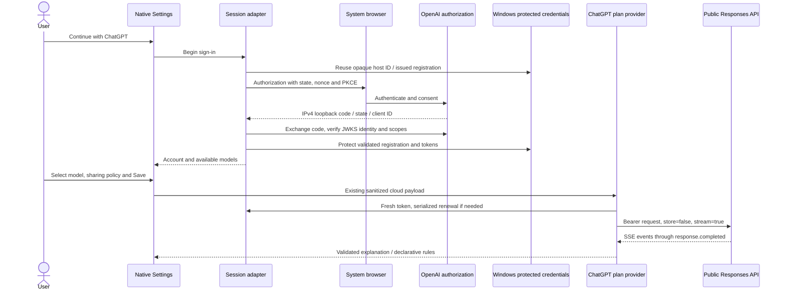

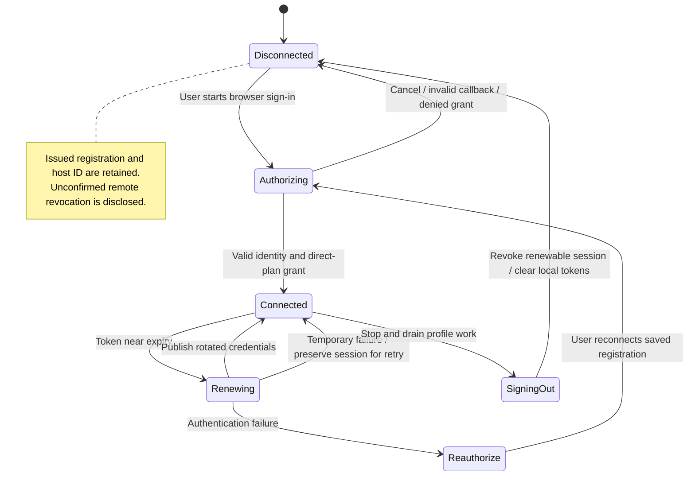

Protocol source: [OpenAI open-source sign-in](https://developers.openai.com/siwc/token-sharing-open-source/sign-in)
and [session management](https://developers.openai.com/siwc/token-sharing-open-source/profiles-and-sessions).

The first release is an ordinary-privilege C#/WinUI 3 application on Windows 11. Collection,
identity enrichment, rules, storage, and provider work run away from the UI thread. The app
does not need a background service or Node.js server. ChatGPT browser sign-in temporarily opens an
IPv4 loopback callback listener; ordinary process collection has no listening network endpoint.

The UML dependency view shows implemented interfaces, not process deployment. Arrows mean
"uses"; adapters implement interfaces owned by Application/Core, so dependencies on provider
or storage behavior do not couple the coordinator to a concrete HTTP or SQLite implementation.

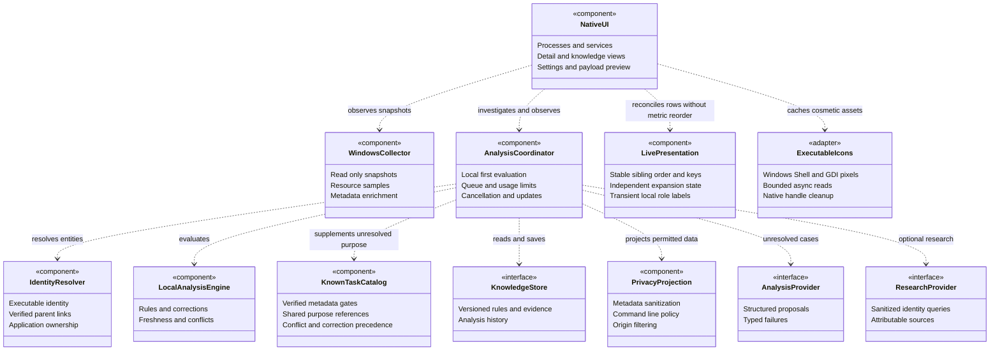

Core owns domain models, identity, rules, and privacy policy. Application owns coordination
and infrastructure interfaces. Windows owns OS collection and credential storage.
Infrastructure implements persistence, provider, and research adapters. App owns composition,
presentation, navigation, and UI dispatch. Domain tests do not require WinUI initialization.

## Identity and evidence model

A runtime process identity combines PID and creation time. When creation time is unavailable,
the identity is snapshot-scoped, preventing stale findings from transferring to a reused PID.
Parent links require lifetime validation. An executable identity and its invocation/ownership
context are separate: the same Node.js binary can serve unrelated applications.

Ownership candidates include an opaque identity derived from product and owner executable
path; equal product names at different paths stay distinct. Automatic learned rules retain
that ownership predicate when available. Native file descriptions provide readable labels
for generic Windows product metadata; model labels can further explain individual roles.
Command context uses a Windows-protected HMAC key and retains a separate shareable identity
for cloud requests whenever online command sharing is excluded.

The UML class view captures conceptual relationships, not complete C# declarations. A process
may host multiple services. An assessment may depend on several evidence records or rules;
invalidation follows these dependencies rather than deleting unrelated knowledge.

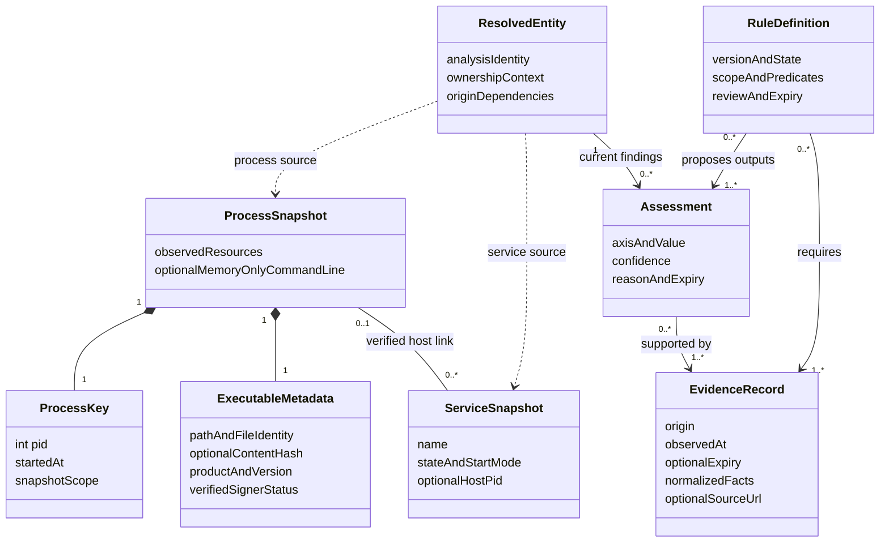

Purpose, security, and optionality are independent assessment axes. A metadata company string
is not a verified signer. Missing observations remain unavailable; unknown identity does not
imply threat. CPU and memory are first-class metrics; unavailable disk/network measurements
must not be presented as measured zero. GPU collection is deferred.

## Local-first analysis interaction

Eligible rules and cached findings resolve dimensions before external calls. Equivalent
instances share queued work. Resource fluctuations alone do not trigger re-analysis.
Unknown or failed unchanged cases do not create a recurring request loop.
Successful local findings are reevaluated at their earliest rule/assessment/evidence expiry,
even while executable metadata stays unchanged. Policy revisions advance monotonically;
an older observation cannot restore a newer policy's withdrawn permission.
Name-only protected observations remain unknown and do not consume automatic jobs repeatedly
as snapshot-scoped identities change. Manual investigation is still available within limits.
Exact cached assessments also require their supporting local metadata to agree with current
facts. Command-derived rules require a compatible command origin and controlled role context;
they cannot silently classify a metadata-only observation after online command sharing is excluded.

```mermaid
sequenceDiagram
    participant C as Windows collector
    participant A as Analysis coordinator
    participant I as Identity resolver
    participant K as Knowledge store
    participant L as Local analysis engine
    participant B as Bundled common catalog
    participant P as Privacy projection
    participant R as Research adapter
    participant M as Analysis provider
    participant U as Native UI
    C->>A: Immutable snapshot
    A->>I: Resolve identities and context
    I-->>A: Entities and evidence
    A->>K: Read eligible cache, rules, corrections
    K-->>A: Candidate knowledge
    A->>L: Evaluate current facts
    L-->>A: Findings and unresolved dimensions
    A->>B: Supplement eligible purpose without overriding conflicts or corrections
    B-->>A: Reference label and purpose, safety remains separate
    A-->>U: Local findings and live state
    alt Eligible local knowledge resolves case
        Note over A,M: No provider call
    else Unresolved and analysis permitted
        A->>A: Deduplicate and reserve usage
        opt Research enabled and supported
            A->>P: Build sanitized research identity query
            P-->>A: Research request without command line
            A->>R: Research identity
            R-->>A: Sources or typed failure
        end
        A->>P: Build destination-specific analysis payload
        P-->>A: Permitted facts and policy revision
        A->>A: Recheck policy before dispatch
        A->>M: Analyze bounded request
        M-->>A: Structured proposal or typed failure
        A->>P: Project persistable output and origins
        A->>L: Validate evidence, predicates, scope, freshness
        alt Valid and privacy-compliant proposal
            A->>K: Save evidence, analysis, rules transactionally
            A->>L: Re-evaluate current entity
            A-->>U: Findings with provenance
        else Invalid proposal or provider failure
            A-->>U: Unknown, rejected, or failed state
        end
    end
```

The single in-flight default, daily job/call caps, bounded responses, and limited retries
prevent runaway analysis. Authentication failures pause provider work; collection remains
available. Results can enrich executable history after a process exits but cannot attach to
a newly reused PID. Shutdown cancels queued work and stops collection.

## Rule lifecycle

The bundled catalog contains 373 machine-independent process/service reference definitions. It is versioned
with source rather than mixed into the learned-rule database. Verified certificate subjects
are parsed as distinguished names; product/original-file metadata gates matching. Windows
localized `.exe.mui` original filenames are accepted only for the corresponding component.
Catalog purpose fills an otherwise unresolved axis; it cannot settle conflicting learned
purpose or override a fresh correction. Security and optionality remain independent unknowns.
Knowledge and detail views expose the definitions and primary reference links.

Rules are constrained declarative data. AI may propose rules for all axes, but automatic
activation requires structural and semantic validation against attributable evidence.
Similarity selects candidates; missing required facts prevent matching. Threat findings
cannot generalize from an exact executable to an entire family without appropriate evidence.

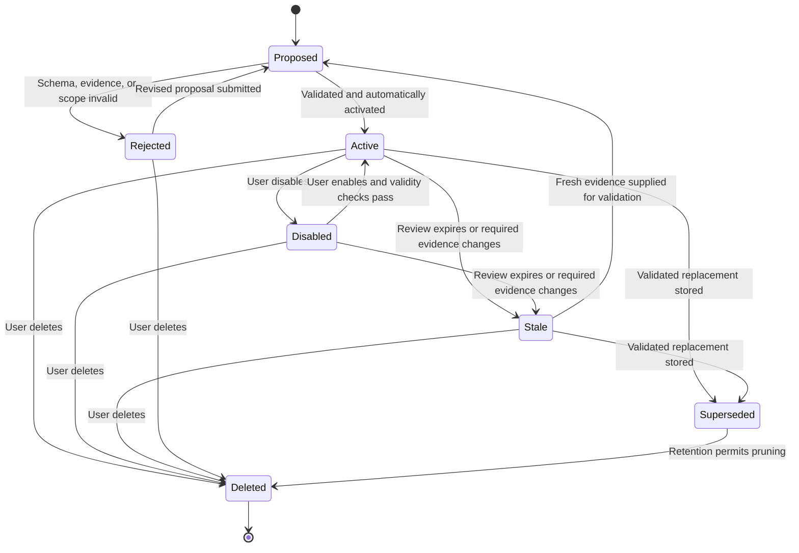

Stale, superseded, and deleted are conceptual lifecycle conditions; they need not be additional
persisted RuleState enum values. Stale findings remain inspectable as history. Default review
limits are 30 days for identity/purpose and 7 days for security/optionality; shorter evidence
expiry wins. Disabling or deleting a rule invalidates dependent current findings. Conflicting
eligible rules leave the affected axis unresolved and trigger fresh investigation. Scoped
user corrections take precedence without hiding independent conflicting security evidence.

## Command-line policy and external boundaries

Command lines are always collected for local display and rules when Windows permits access.
Off is the serialized default for online command exclusion; LocalOnly additionally prefers an
explicitly configured loopback model. OnlineFull permits verbatim transmission. A separate
ShareIdentifyingMetadata setting (default false) controls path/package/owner/service facts in
online metadata, evidence, and research. Raw command sharing independently includes identifiers
inside that line. Local-only findings and invocation HMAC digests cannot enter cloud requests.
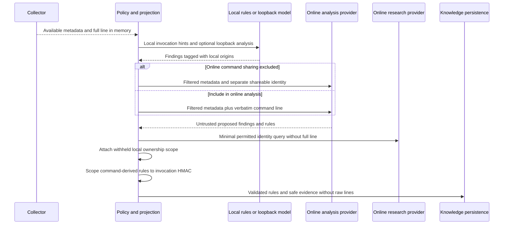

Origin restrictions survive storage and restart. A local-only finding is not retroactively
shareable after changing modes; build a newly authorized online projection instead. Before
dispatch, recheck the policy revision. A sharing change cancels/rebuilds queued payloads; local strings remain available. Already sent requests cannot be recalled.

Loopback model requests cannot follow remote redirects or fall back remotely. ProcSight
controls its own routing but cannot guarantee a separately operated local server's behavior.
Unavailable or oversized full lines are explicitly omitted with a reason, not silently
truncated while labeled full. Raw lines and unsafe echoed model output remain transient.

## Persistence and failure handling

SQLite stores versioned knowledge, evidence, lineage, corrections, and invalidation
dependencies. Separate atomic preferences store UI and operational settings without
conflating them. Windows-protected credential storage holds provider keys and local identity
digest keys. Usage accounting survives generated-knowledge resets.

`knowledge.db` stores generated findings/corrections; `usage.db` independently accounts for
requests; atomic `settings.json` stores operational and presentation choices under
`%LOCALAPPDATA%\ProcSight`. Credential Manager stores API keys and the HMAC key. Schema 1
creation is transactional; a newer schema is rejected without downgrading it. Knowledge
maintenance pauses observation and drains queued work before explicit recovery/reset.

Toolhelp and nonthrowing native process queries enumerate protected processes without using
exception-based access probes. Resource intervals and unavailable facts remain explicit.
Service configuration uses WMI with a ten-second cache; available command lines are always collected locally through WMI.
Executable enrichment hashes/verifies at most sixteen uncached process files and eight service
files per poll, rotates service work for fairness, and caches by
file stamps. Offline WinVerifyTrust does not initiate online certificate retrieval.

Do not persist continuous resource history or raw snapshot DTOs. Prune unreferenced history
older than 90 days while preserving active corrections and evidence needed by active rules.
Schema updates are transactional. Preserve corrupt originals and require explicit recovery;
do not silently discard corrections or reset privacy policy to a more permissive state.

The UI distinguishes local findings, queued/analyzing, unknown, stale, budget-paused, and
failed states. It remains useful offline, without credentials, and with partial Windows access.
External/model text cannot initiate machine actions or request arbitrary local reads.
See [SECURITY.md](SECURITY.md) for reporting and intended security boundaries.

## Live table state and assets

### AI activity history

[AnalysisActivityLog](src/ProcSight.Application/Analysis/AnalysisActivityLog.cs) holds immutable
request summaries in a thread-safe ring of at most 200 entries, newest first. The coordinator
begins an entry immediately around each actual provider/research call, including retries, and
completes it with success, failure or cancellation. Cached/local-rule outcomes create no AI entry.
The [Settings connection test](src/ProcSight.App/MainWindow.Settings.cs) records synthetic requests
through the same API. Observer/logging failures cannot fail analysis; clearing/evicting an in-flight
entry does not recreate it when its result arrives. Pausing blocks new entries but finishes prior ones.

Summaries retain local process name/PID or service identity, selected provider/model, timing, attempt
number, safe metadata values/categories and a command-inclusion flag. They never retain the payload
or raw command. Returned assessments pass OutputPrivacyFilter before location/secret sanitization;
research keeps only the evidence count. Proposed rule counts are not claims that rules were activated.
No file/export/database storage exists for activity. [Native AI activity](src/ProcSight.App/MainWindow.Activity.cs)
offers status filtering, pause/clear and selected result details, updates rows without replacing the
whole list, and stops its UI refresh timer on unload.

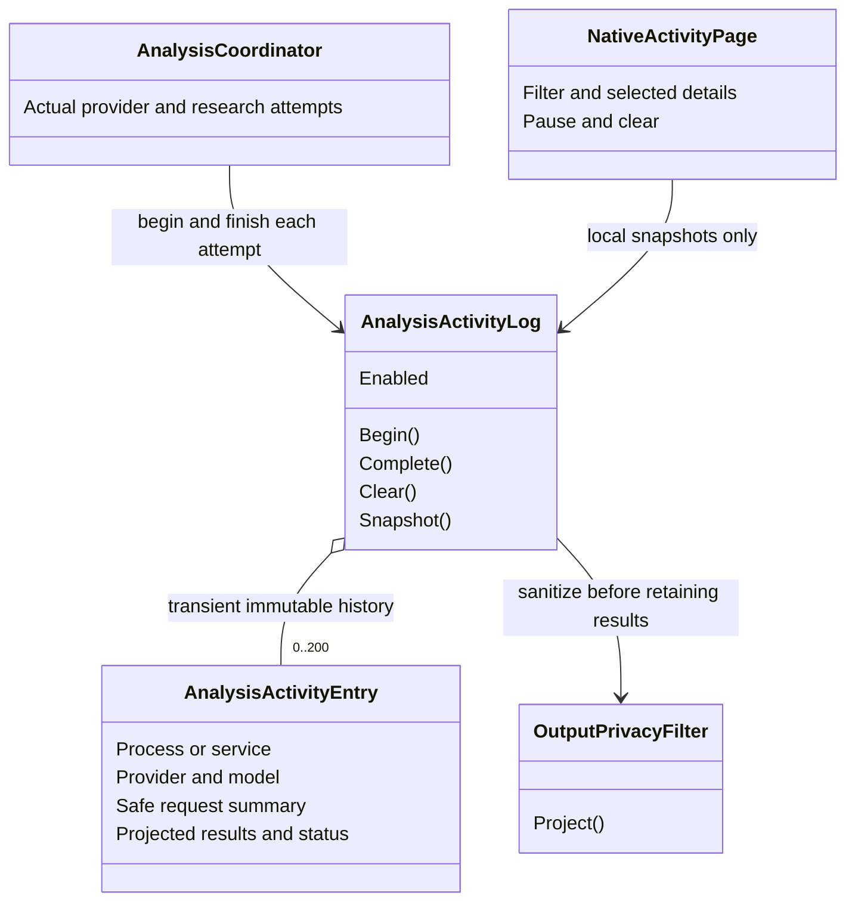

### Local window observations

[WindowMetadataReader](src/ProcSight.Windows/Collection/WindowMetadataReader.cs) enumerates visible
non-tool top-level desktop windows in the background collector. It checks HWND PID before/after
caption reads and rechecks known process creation times. Unknown lifetimes remain snapshot-only
observations. Limits are 4096 enumerated windows, 32 captured per process, 512 caption characters,
and 255 class characters. Same-process caption messages use a 50ms timeout; other captions use
the system's nonblocking foreign-caption API. Captions are not control contents or identity proof.

ProcessSnapshot.Windows and caption/class properties are JsonIgnore; diagnostic ToString methods
omit captions. They never enter facts, identity, knowledge, rules, or any provider/research
projection. DisplayName appends a useful caption while retaining host/role labels; foreground and
non-minimized windows take priority, with lexical fallback. Details exposes all observations.
Because window data is absent from identity/fingerprints, changing titles updates presentation
without provider re-analysis or regrouping.

The UML class view shows the local presentation boundary:

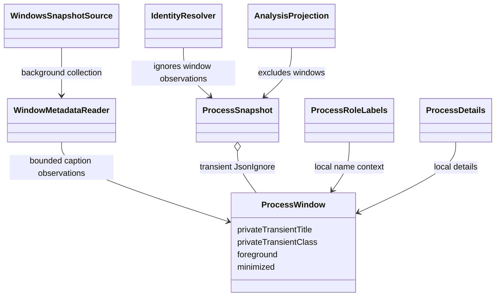

The native ListView owns horizontal and vertical scrolling, keeping its vertical scrollbar
inside the visible viewport. A header ScrollViewer synchronizes horizontally in both directions.
Header buttons fill each cell height and toggle direction; saved sort preferences include direction.
Sorting compares displayed workload names or classifications, with unavailable metrics last.
Explicit sorts affect siblings while retaining ownership/tree hierarchy and stable sampling order.

[ProcessDetails](src/ProcSight.Application/Presentation/ProcessDetails.cs) formats transient local
command lines and file/signature/lifetime metadata. [LocalCommandRules](src/ProcSight.Core/Rules/LocalCommandRules.cs)
shares literal script/module/package parsing across hosts and provides known extension/worker hints.
Rows follow host — hosted; groups retain application ownership. PowerToys component names use
verified catalog/executable metadata. Raw command values never enter rule literals or persistence.

When online identifiers are excluded, the coordinator appends local path/owner/service scopes
after provider responses. Command-derived learned rules additionally require a 64-hex keyed HMAC
commandContext predicate and controlled evidence. Distinct scripts under the same runtime cannot
inherit one another's invocation-specific findings. Older command-derived rules without this
scope fail validation and require re-analysis. Storage accepts only fixed categories and HMAC
scope values in command-origin evidence, never arguments or arbitrary labels.

Sampling updates cell values without sorting existing siblings. Explicit column sorting or
Refresh establishes a new order. Groups require multiple visible members; a sole member is
a normal process row with PID/resources and no expander or count. The top-level owner slot
retains its key across single/group transitions, preserving native viewport anchoring. Selection
maps a former child to its remaining process row by lifetime key when its visual key changes.
Blank Windows descriptions fall back to executable names. A stable
visual slot for a creation-time-unavailable PID does not relax snapshot-scoped domain identity;
row analysis is replaced when its entity identity changes. Reconciliation retains row objects,
notifies changed properties only, and preserves the viewport through native ItemsStackPanel
anchoring. New processes may append and exited processes disappear.

Application groups and raw parent/child nodes have separate expansion state. A native chevron
action owns toggling, independently of selection; collapse selects its parent row. The UML
state view describes one visible expandable node, not persisted knowledge state:

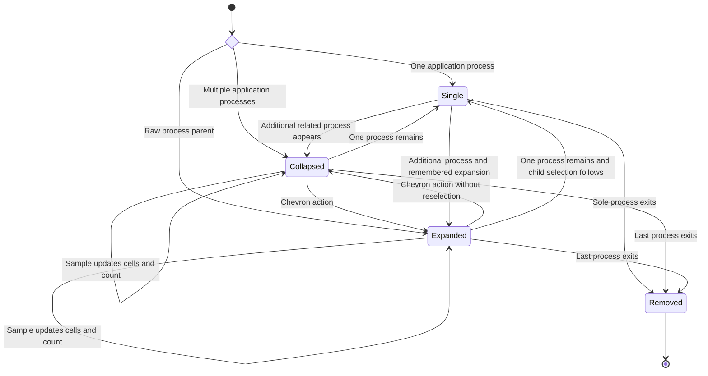

An application's remembered expansion choice is retained during its single-process state;
when it regains multiple members it may return directly to Expanded. Raw process-parent
expansion is independent of application group membership.

`ProcessRoleLabels` uses local metadata, host service associations, and permitted command
tokens to explain generic children provisionally. A generic catalog/model executable label
does not erase a specific service or invocation role. These display-only command-derived
labels never enter entity facts, provider payloads, research, or persistence.

Windows Shell supplies executable artwork off-thread; a two-reader gate and 512-entry memory
cache bound work. Lookup rejects network/missing paths, frees HICON/GDI resources, and uses a
fallback when unavailable. Pixels are cosmetic, never identity or security evidence. The App
creates WinUI bitmaps on its dispatcher and checks asset identity before applying async results.

## Extensions and maintenance

### Authenticated shared knowledge and invocation hints

The embedded [catalog](src/ProcSight.Core/Rules/common-tasks.json) supplies 373 definitions:
96 process references and 277 service references, including publisher-only hints. IDs include
executable/product/service scope. Full matches require verified signer and exact product or
original-file/Windows-path evidence. Publisher-only matches retain unknown purpose. Reference
links provide product/Windows background; configured metadata supplies the file evidence.
Purpose rules cannot establish security, optionality, or exact invocation behavior.

[ServiceBinaryReader](src/ProcSight.Windows/Collection/ServiceBinaryReader.cs) reads configured
executables and root/Parameters ServiceDll values. Per-user template fallback requires a hex
instance suffix and the registry per-user Type bit. Network and ambiguous unquoted paths are
unavailable. [Collection](src/ProcSight.Windows/Collection/WindowsSnapshotSource.cs) separately
hashes/verifies the implementation and host; the resolver scopes knowledge to implementation
path/hash/signature and uses identity-scoped evidence IDs. Raw configured arguments are JsonIgnore
and excluded from shareable identities. Configuration does not establish loaded-module state.

This UML class view separates authenticated file evidence from invocation hints:

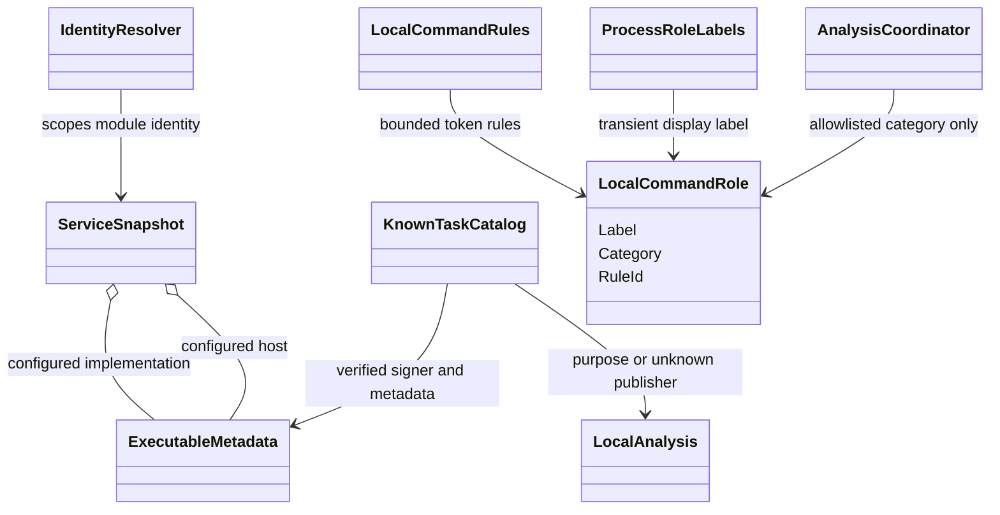

[LocalCommandRules](src/ProcSight.Core/Rules/LocalCommandRules.cs) uses bounded Windows quote
tokenization and fixed switch/entry-point/module tables. Inline interpreter code and encoded
payloads remain opaque; no rule can execute or fetch code. Only Renderer/Utility/Worker/CLI categories and 64-hex HMAC invocation scopes enter command-origin evidence, while arbitrary entry-point names remain display-only.
Local-only HMAC context and derived findings retain their existing cloud exclusion.

The UML sequence shows the distinction between service host and implementation verification:

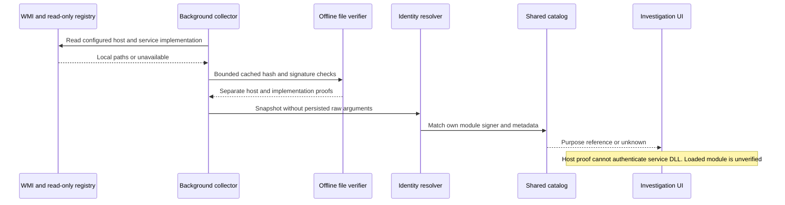

Phase 2 adds an explicitly initiated management-command boundary with fresh target identity,
permission, and impact checks. Phase 3 adds installation/startup/dependency evidence for
cleanup recommendations. Neither phase lets AI rules execute actions automatically.

Keep this document and its UML views current as these boundaries evolve. Update the component
view for ownership/interfaces, class view for evidence dependencies, sequence views for data
flow/privacy, and state view for rule lifecycle changes. Add deployment/activity views when
new process, privilege, or branching boundaries make them useful. Dated design records remain
history; this document must state which parts are implemented, planned, and verified.
