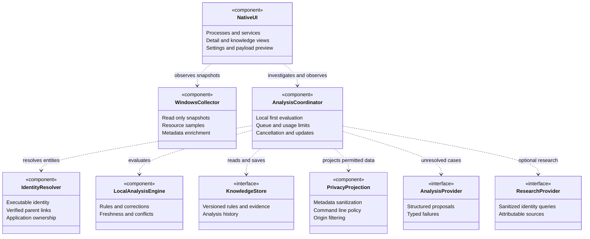
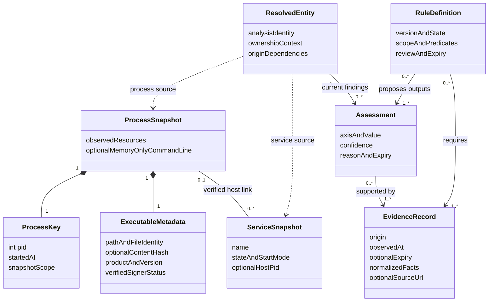
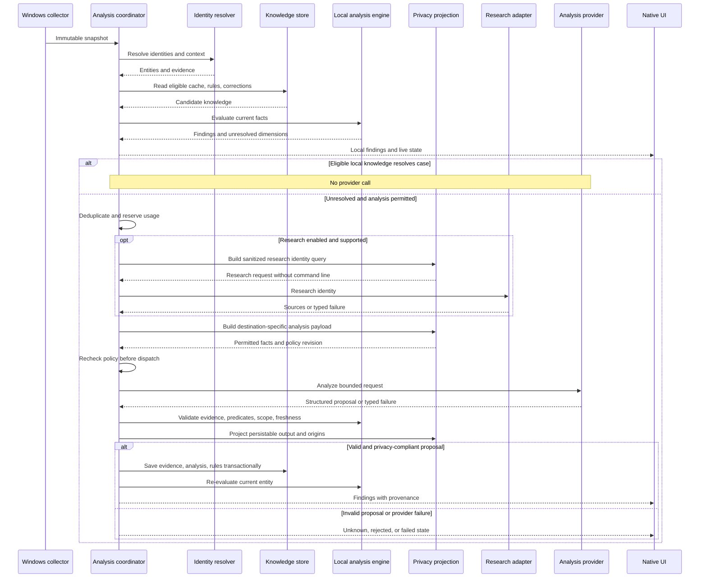
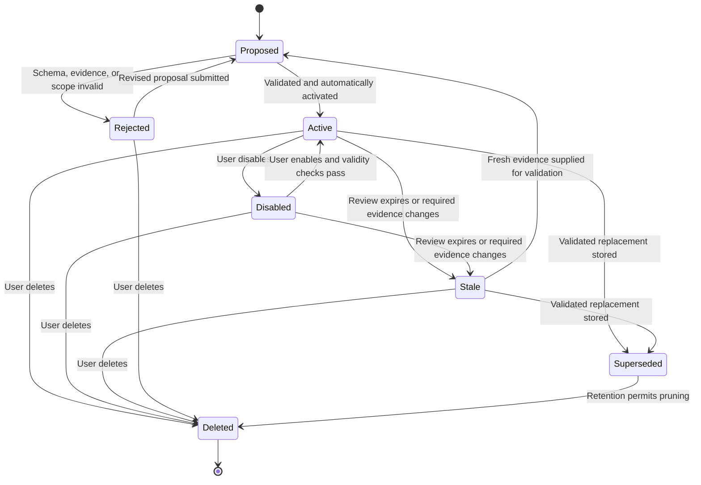
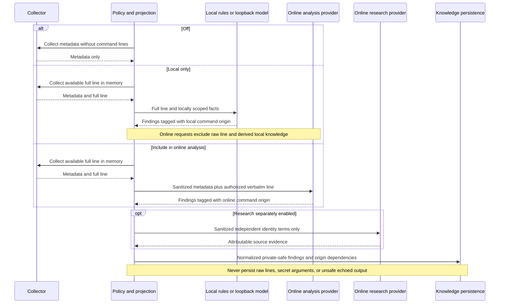

# Architecture

## Status and documentation convention

ProcSight implementation is underway. The native shell, collector, shared contracts, and
initial identity resolver exist; provider/rule/storage flows below remain planned until
their tasks are implemented and verified. The [design](docs/superpowers/specs/2026-10-13-procsight-design.md)
defines requirements; the [implementation plan](docs/superpowers/plans/2026-10-13-procsight.md)
maps them to tasks. This root document is the living architecture reference and must
track the actual implementation as it develops.

Current code owners: [native shell](src/ProcSight.App/MainWindow.xaml.cs),
[collector](src/ProcSight.Windows/Collection/WindowsSnapshotSource.cs),
[CPU sampler](src/ProcSight.Windows/Collection/ProcessSampler.cs), and
[identity resolver](src/ProcSight.Core/Identity/IdentityResolver.cs).

Use UML liberally to explain structure, interactions, and lifecycle behavior. Store diagrams
as editable Mermaid blocks alongside the prose so GitHub can render them. Prefer UML class,
sequence, and state diagrams for domain relationships, message ordering, and transitions.
The component view below uses UML class notation with component stereotypes. Use an activity
or deployment view when branching workflows or physical boundaries need one; label its notation
accurately. Diagrams supplement precise prose and do not establish implementation status.

Update affected diagrams in the same commit as changes to components, interfaces, data flow,
state transitions, persistence, or trust boundaries. Name real code owners once they exist;
verify the diagram source and rendering. Avoid diagrams that merely repeat a file list.

## Component boundaries

The first release is an ordinary-privilege C#/WinUI 3 application on Windows 11. Collection,
identity enrichment, rules, storage, and provider work run away from the UI thread. The app
does not need a background service, Node.js server, or a local network listener.

The UML dependency view shows intended interfaces, not process deployment. Arrows mean
"uses"; adapters implement interfaces owned by Application/Core, so dependencies on provider
or storage behavior do not couple the coordinator to a concrete HTTP or SQLite implementation.

Core owns domain models, identity, rules, and privacy policy. Application owns coordination
and infrastructure interfaces. Windows owns OS collection and credential storage.
Infrastructure implements persistence, provider, and research adapters. App owns composition,
presentation, navigation, and UI dispatch. Domain tests do not require WinUI initialization.

## Identity and evidence model

A runtime process identity combines PID and creation time. When creation time is unavailable,
the identity is snapshot-scoped, preventing stale findings from transferring to a reused PID.
Parent links require lifetime validation. An executable identity and its invocation/ownership
context are separate: the same Node.js binary can serve unrelated applications.

The UML class view captures conceptual relationships, not complete C# declarations. A process
may host multiple services. An assessment may depend on several evidence records or rules;
invalidation follows these dependencies rather than deleting unrelated knowledge.

Purpose, security, and optionality are independent assessment axes. A metadata company string
is not a verified signer. Missing observations remain unavailable; unknown identity does not
imply threat. CPU and memory are first-class metrics; unavailable disk/network measurements
must not be presented as measured zero. GPU collection is deferred.

## Local-first analysis interaction

Eligible rules and cached findings resolve dimensions before external calls. Equivalent
instances share queued work. Resource fluctuations alone do not trigger re-analysis.
Unknown or failed unchanged cases do not create a recurring request loop.

The single in-flight default, daily job/call caps, bounded responses, and limited retries
prevent runaway analysis. Authentication failures pause provider work; collection remains
available. Results can enrich executable history after a process exits but cannot attach to
a newly reused PID. Shutdown cancels queued work and stops collection.

## Rule lifecycle

Rules are constrained declarative data. AI may propose rules for all axes, but automatic
activation requires structural and semantic validation against attributable evidence.
Similarity selects candidates; missing required facts prevent matching. Threat findings
cannot generalize from an exact executable to an entire family without appropriate evidence.

Stale, superseded, and deleted are conceptual lifecycle conditions; they need not be additional
persisted RuleState enum values. Stale findings remain inspectable as history. Default review
limits are 30 days for identity/purpose and 7 days for security/optionality; shorter evidence
expiry wins. Disabling or deleting a rule invalidates dependent current findings. Conflicting
eligible rules leave the affected axis unresolved and trigger fresh investigation. Scoped
user corrections take precedence without hiding independent conflicting security evidence.

## Command-line policy and external boundaries

Off is the default. Local only enables full-command-line analysis in local rules and an
explicitly configured loopback model; its raw and derived data cannot reach online analysis.
Include in online analysis additionally permits the verbatim line at the chosen analysis
provider. Other online metadata remains sanitized. Research queries never contain full lines.

Origin restrictions survive storage and restart. A local-only finding is not retroactively
shareable after changing modes; build a newly authorized online projection instead. Before
dispatch, recheck the policy revision. A mode change cancels/rebuilds queued payloads; Off
also releases raw collected strings. Already sent requests cannot be recalled.

Loopback model requests cannot follow remote redirects or fall back remotely. ProcSight
controls its own routing but cannot guarantee a separately operated local server's behavior.
Unavailable or oversized full lines are explicitly omitted with a reason, not silently
truncated while labeled full. Raw lines and unsafe echoed model output remain transient.

## Persistence and failure handling

SQLite stores versioned knowledge, evidence, lineage, corrections, and invalidation
dependencies. Separate atomic preferences store UI and operational settings without
conflating them. Windows-protected credential storage holds provider keys and local identity
digest keys. Usage accounting survives generated-knowledge resets.

Do not persist continuous resource history or raw snapshot DTOs. Prune unreferenced history
older than 90 days while preserving active corrections and evidence needed by active rules.
Schema updates are transactional. Preserve corrupt originals and require explicit recovery;
do not silently discard corrections or reset privacy policy to a more permissive state.

The UI distinguishes local findings, queued/analyzing, unknown, stale, budget-paused, and
failed states. It remains useful offline, without credentials, and with partial Windows access.
External/model text cannot initiate machine actions or request arbitrary local reads.
See [SECURITY.md](SECURITY.md) for reporting and intended security boundaries.

## Extensions and maintenance

Phase 2 adds an explicitly initiated management-command boundary with fresh target identity,
permission, and impact checks. Phase 3 adds installation/startup/dependency evidence for
cleanup recommendations. Neither phase lets AI rules execute actions automatically.

Keep this document and its UML views current as these boundaries evolve. Update the component
view for ownership/interfaces, class view for evidence dependencies, sequence views for data
flow/privacy, and state view for rule lifecycle changes. Add deployment/activity views when
new process, privilege, or branching boundaries make them useful. Dated design records remain
history; this document must state which parts are implemented, planned, and verified.
