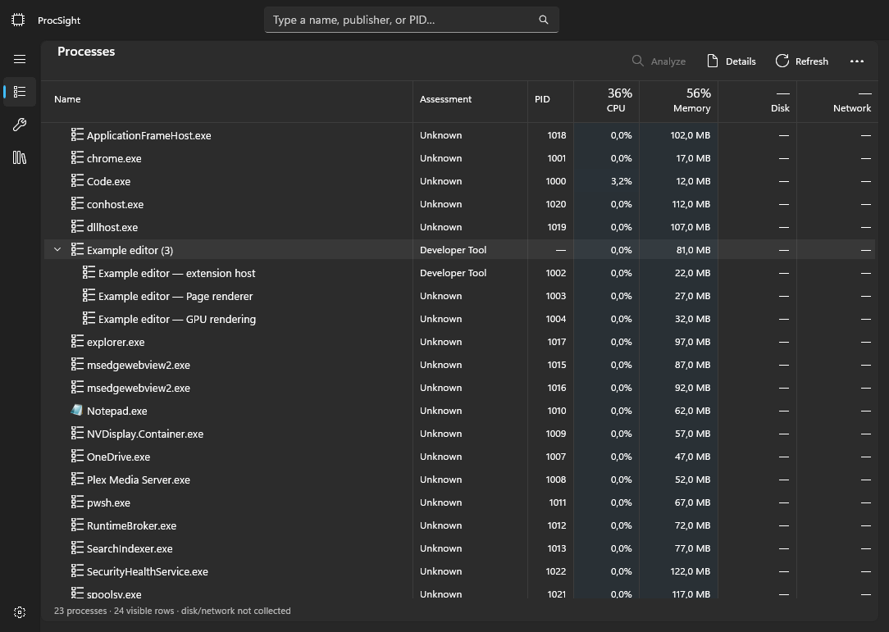

# ProcSight

ProcSight is a native Windows 11 process explorer built with C# and WinUI 3.
It explains what processes and services belong to, why they are running, and
what evidence supports their classifications.

**Status: development preview; no published release.** Live collection, local rules and
knowledge, provider adapters, optional research, and the investigation interface are
implemented. Automated checks use synthetic metadata and fake providers. Targeted live inference
smoke checks passed; full provider acceptance and desktop accessibility/scaling remain unverified.

On Windows 11 with .NET SDK 10.0.301 and Windows App Runtime 2.2 installed:

```powershell
./scripts/build.ps1
./scripts/start.ps1
./scripts/verify.ps1
```

In VS Code, open this repository folder and install the recommended Microsoft C#
extension. Select **ProcSight (Debug)** in Run and Debug, then press **F5** to build
and debug or **Ctrl+F5** to build and run without debugging. See the
[VS Code setup](DEVELOPERS.md#run-and-debug-in-vs-code) for tasks and troubleshooting.

## Current experience



This is the actual XAML rendering, using synthetic processes and a synthetic analysis label.

- A familiar Task Manager-style process table with meaningful application grouping,
  resource measurements, search, and a raw process-tree view.
- Processes and services explained through ownership, purpose, and supporting evidence.
- Separate purpose, security, and optionality assessments, with confidence and unknown
  outcomes when the evidence is insufficient.
- Local rules and cached knowledge first, with automatic AI analysis for unresolved
  cases. Validated rules are reused for matching processes, reducing repeated API calls.
- User-configured OpenAI or compatible API endpoints, optional loopback local models,
  and separately enabled online research with source links.
- Direct **Continue with ChatGPT** connection for eligible ChatGPT plans, with account-specific
  models and protected renewable sessions. Live model discovery and targeted inference smoke checks passed.
- An **AI activity** page showing queried processes/services, provider/model, retries, returned
  classifications and explanations, research evidence counts, and failures. The last 200 requests
  stay in memory, with filtering, Pause recording and Clear; raw transport/debug data is omitted.
  Failures explain what went wrong and what to do next, with specific safe validation reasons.

The table uses compact rows, resource totals, classification filters, and optional details.
Disk/network are explicitly unavailable; GPU collection is deferred. Executable icons are
loaded from Windows Shell and cached; inaccessible or missing assets use a fallback symbol.
Live samples update cells while preserving sibling order and scroll position. Click a column
or Refresh to reorder; use each row's chevron to expand/collapse independently of selection.
Right/Left expand/collapse selected nodes; Left also returns from a child to its parent.
Click anywhere in a column header to sort; repeat to reverse direction. Direction arrows and
saved sort preferences reflect the current order. Names sort by their visible workload label.
Both scrollbars stay inside the visible table viewport, with the header following horizontal scroll.
Collection remains useful without an API key or network connection.

Only multiple related processes get an application group header. A single process appears
directly with its name, PID, and resources. Membership changes preserve the top-level slot;
selection follows a remaining child when its group becomes a single process.

Visible-window captions add local context to process names, such as `Notepad — document.txt`.
Established app names and specific host/script roles take priority over AI label suggestions.
AI signer/metadata explanations stay in assessment details; concise suggestions can still name unknown executables.
Foreground windows take priority; host/script roles remain visible. Details lists collected
captions, window classes, and foreground/minimized state. Window metadata stays transient and
local, never entering provider payloads, learned rules, or process identity/grouping.

Generic child processes receive provisional local role labels when permitted metadata or
command context identifies a script, MCP launcher, renderer, GPU worker, extension host, language server, or service
host. Specific roles remain visible after a generic executable assessment arrives. Derived
command labels are display-only and never enter provider payloads or persistence.

A bundled catalog supplies 373 process/service definitions for Windows components, applications,
and developer runtimes. These are shared definitions with reference links, gated by verified
signer and product/original-name metadata. They do not declare a task safe or essential.
Learned findings and fresh user corrections take precedence; purpose conflicts remain unresolved.
Search the bundled catalog in Knowledge by executable, service, product, or publisher. Publisher-only
references leave purpose unknown. Service rules verify the configured executable or service DLL;
the host's signature cannot authenticate its DLL. Loaded-module state is not verified.
Local command rules also recognize Python modules, .NET operations, PowerShell invocation modes,
and language-server entry points. They never execute scripts or decode encoded payloads.
Command lines remain available locally regardless of the online sharing mode.
The Windows native host
in VidVNC informed the WinUI shell, spacing, preferences, and component boundaries.

## Privacy and command-line analysis

Command lines are always collected locally when Windows permits it. Details shows the full
command line and the path, original filename, version/product, verified signer, hash, parent PID,
and creation time used for identification. Child-row names use host — hosted for scripts, packages, and worker roles; Python/VS Code and other application ownership groups remain intact.

Settings controls online sharing with three explicit modes:

| Mode | Behavior |
| --- | --- |
| Exclude from online analysis (default; stored as Off) | Full command lines remain available locally; exclude them and derived knowledge online |
| Prefer local model; exclude online (stored as LocalOnly) | Also prefer a configured loopback model for full local analysis |
| Include in online analysis | Permit the full, verbatim command line at the selected online analysis provider |

Other online metadata remains sanitized. Full command lines can contain credentials or
personal paths; the online option includes a payload preview and explicit disclosure.
Raw command lines are excluded from the knowledge database, logs, rule literals,
and online research queries. API access requires the selected
provider's credentials; a ChatGPT subscription is not assumed to include API access.

A separate checkbox controls online file paths and ownership, package, and service identifiers.
These fields are excluded by default from both provider metadata and evidence. Enabling full
command sharing sends the verbatim line, including any identifying data within it, independently
of that metadata checkbox. Research still never receives command lines. Local rule scope is
attached after provider responses, preserving application boundaries without transmitting it.

AI assessments are explanations with evidence and uncertainty. They are not antivirus
verdicts or authorization to change the computer.

Settings follows the Windows 11 Task Manager card layout: Appearance, AI connections,
Analysis and privacy, and Advanced, with expandable options and responsive controls.
For ChatGPT plan usage, expand **ChatGPT account**, select **Continue with ChatGPT**, complete
browser consent, choose an available model, select **ChatGPT plan** as provider, and save.
Use **Use another account** to register another account; sign-out disables automatic analysis
for the connected profile. Plan usage shares the user's ChatGPT allowance; no API-key billing fallback occurs.
API-key profiles remain separately billed. Research currently requires the OpenAI API-key profile.

Automatic analysis and research start disabled. Configure a model and connection in Settings,
save API keys in Windows Credential Manager when using API-key profiles, and use the synthetic connection test before
enabling automatic analysis. Default daily limits are 20 automatic jobs and 60 billable
calls, including retries and reserved research calls. OpenAI research requires a model that
supports web search; compatible/local providers currently supply analysis only.

Preferences and SQLite knowledge live under `%LOCALAPPDATA%\ProcSight`. Usage accounting
uses a separate database and survives knowledge resets. Local models must use loopback
HTTP/HTTPS endpoints, with redirects disabled. Command lines above 32,768 characters are
omitted rather than truncated. See [verification](docs/verification.md) for checked behavior
and remaining desktop/live-provider validation.

## Roadmap

1. **Understand and investigate:** live processes/services, ownership, classifications,
   local knowledge, AI fallback, optional research, and an inspectable rule library.
2. **Process and service management:** explicitly initiated controls with identity,
   permission, and impact checks.
3. **Cleanup recommendations:** investigate startup items, optional software, and
   possible leftovers using installation and dependency evidence.

## Project documents

- [Design](docs/superpowers/specs/2026-10-13-procsight-design.md)
- [Implementation plan](docs/superpowers/plans/2026-10-13-procsight.md)
- [Architecture and UML diagrams](ARCHITECTURE.md)
- [Developer guide](DEVELOPERS.md)
- [Agent instructions](AGENTS.md)
- [Changelog](CHANGELOG.md)
- [Security policy](SECURITY.md)

See the developer guide for toolchain, verification, and contribution instructions.

## License

ProcSight uses GitHub's standard **GNU Affero General Public License v3.0** template.
See [LICENSE](LICENSE) for the complete terms. Third-party components retain their own
licenses; their notices must accompany any distribution that includes them.

## Rule inspection and collection availability

**Rules & knowledge** lists bundled definitions and learned rules, with
search and source/state filters. In process or service details, **Inspect rules…** distinguishes
matched rules from rules whose assessments contributed to the result. Inspect a rule for its
conditions, evidence, classifications, review dates, and recorded AI provider/model. Older learned
rules explicitly lack provider/model history; provenance does not establish trust.

Protected processes and services retain readable fields and show safe reasons for unavailable
metadata, including access denied, missing files, or read failures. No elevation is required.
