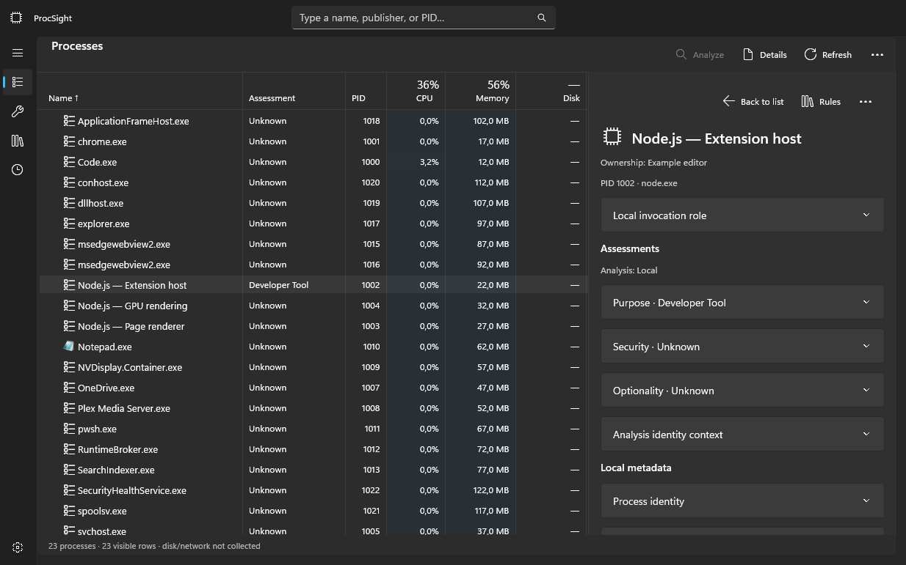

# ProcSight

Understand what is running on your Windows PC. ProcSight combines a familiar process
list with readable workload names, system performance graphs and explanations of what
processes and services do.

  
   
  <em>Process list and investigation details with synthetic demonstration data.</em>

**Development preview — no public release or download is available yet.**
Current packaging produces self-contained MSI installers and MSIX packages. A standalone EXE installer and a Microsoft
Store listing are not currently available. Installation and full desktop acceptance
checks are still in progress; see [known validation limits](docs/verification.md).

## What you can do

- **Understand processes and services.** See application groups, host/script roles,
  executable details, signatures, command lines and the evidence behind assessments.
- **Watch system performance.** Overview tiles and CPU, memory, disk, network and GPU
  pages show recent activity. Add per-process resource columns to the process list.
- **Make the list your own.** Search, sort, resize and reorder columns, choose which
  information appears, and select multiple entries for investigation or export.
- **Reuse what you learn.** Built-in definitions and saved rules help identify tasks
  across sessions. Inspect matching rules, their sources and any AI-generated findings.
- **Add optional AI explanations.** Use an eligible ChatGPT account, an API provider or
  a local model. Inspect requests and results in **AI activity**.
- **Keep an eye on load.** Enable a system-tray icon and choose its resource metric.

ProcSight currently focuses on read-only investigation. It does not terminate processes,
change services or clean up software. Unknown assessments and unavailable measurements
are shown explicitly.

## Download and install

ProcSight targets **Windows 11 24H2 or later, x64**. Public downloads will be listed in
this repository's GitHub Releases when a release is published.

### MSI installer

If you have been supplied an MSI preview, close ProcSight and double-click the `.msi`.
Choose **Just me** (initially selected) for your user account or **All users** for a
machine-wide installation. Just me uses your local Programs folder; All users uses
**Program Files\ProcSight** and requires Windows administrator approval. Both add
**ProcSight** to the corresponding Start menu and include the required runtimes.
The app starts normally; administrator mode remains an explicit in-app choice.

**No certificate import is required for MSI.** Unsigned installers can still trigger
publisher/reputation warnings or be blocked by Smart App Control or device policy.
Only install files from a source you trust.

Install a newer MSI in the same scope to upgrade; choose All users for an existing
machine-wide installation. Choosing another scope does not migrate the installation.
Remove it through **Settings → Apps → Installed apps**.
User settings and credentials are retained. MSI and MSIX use separate settings/account
storage; switching formats does not migrate them automatically. Installer lifecycle
acceptance testing is still pending.

### MSIX package

If you have been supplied a signed development-preview package:

1. Download the complete `.msix` file from a source you trust.
2. Double-click it and choose **Install** in Windows App Installer.
3. Open **ProcSight** from the Start menu.

The self-contained Direct MSIX includes the required app runtimes. Installing that
package does not require Visual Studio, the .NET SDK or a source checkout.

A development package may need its signing certificate trusted first. See
[development certificate installation and troubleshooting](DEVELOPERS.md#install-a-signed-development-package).
Trust only a certificate whose source and identity you have verified; certificate trust
applies beyond a single installation. An unsigned development package is not ready to install.

### GitHub build downloads

Once the build workflow is on the GitHub default branch and has been run manually, open the repository's **Actions** tab, select a
successful **Windows build and MSI** run, and download its **ProcSight-…-windows-x64** artifact.
Extract the ZIP and open the MSI. These are unsigned preview builds; GitHub sign-in is
required to download workflow artifacts. See the [build guide](docs/GITHUB-ACTIONS.md).
The workflow also prepares a draft GitHub Release with the MSI and hash manifest attached.
Maintainers review its assets and notes, then publish it for normal release downloads.

## Getting started

1. Open **Processes** or **Services** and select an entry. Use **Details** to inspect
   its identity, purpose, signature, command line and matching rules.
2. Use the chevron beside a group to expand or collapse it. Each child keeps a readable
   role where one can be identified, such as a script or extension host.
3. Open **Performance** for an overview, then choose a subsystem for its history graph.
4. Use **Choose columns** to add information such as GPU, command line, executable name,
   publisher or start time. Drag header dividers to resize and optional headers to reorder.
5. Right-click entries for available investigation, copy and export actions. Export
   selected entries, filtered entries or the full list as CSV, JSON or TSV.

Rows keep their positions during live updates by default. Click a column header to
sort, and click it again to reverse direction. Enable **Automatically sort live values**
if you prefer the list to keep following a changing resource value.

Per-process disk and network monitoring requires **Restart as administrator**. The app
normally starts without elevation; protected processes can still restrict access even
in administrator mode. GPU readings depend on the available driver and Windows counters.
Missing or warming-up measurements are different from measured zero.

In **Settings**, you can change appearance, resource-cell shading, AI connections and
system-tray behavior. Valid settings take effect automatically. Minimize-to-tray is
optional; closing the app exits it.

## Optional AI and privacy

Process collection, performance monitoring and local rules work without an AI connection.
**Automatic AI analysis and online research are off by default.** Connecting an account
alone does not enable them.

Configure a connection in **Settings → AI connections**. Choose its account/model or API
settings, enable it in the connection list and set its priority. Use **Test connection**
to check it with synthetic metadata. Trying another connection after failure requires
an explicit fallback setting, which is off by default.

Eligible ChatGPT-plan connections use your plan allowance. API-key connections have
separate provider billing; a ChatGPT subscription does not include API credits. Online
research can be enabled for supported ChatGPT/OpenAI connections. Usage limits help bound
requests but are not a guaranteed monetary or remote search-call cap.

You control what can leave the computer:

- Available command lines are collected for local display. Online sharing excludes
  them and command-derived knowledge by default; verbatim sharing requires an explicit setting.
- Paths and ownership, package and service identifiers have a separate online-sharing
  setting and are excluded by default. Window titles stay local.
- Research excludes raw command lines and private paths, including when ordinary
  analysis is allowed to receive command lines.
- Local export has separate choices for commands, paths/ownership and window titles.
  Review exports before sharing them: they can contain personal information or secrets.

Use the payload preview to inspect proposed analysis data. **AI activity** shows recent
provider attempts and results for the current session, without raw transport payloads.
AI explanations can be wrong; they are not antivirus verdicts or proof that a task is safe.
See the [security and privacy policy](SECURITY.md) for details.

## Help and feedback

See [support and troubleshooting](SUPPORT.md) for reporting a problem or requesting a
feature. Include the app version, Windows build and reproduction steps. Remove personal
paths, command lines, account details and sensitive screenshot content before posting.
Follow [SECURITY.md](SECURITY.md) for suspected vulnerabilities.

Read the [changelog](CHANGELOG.md) for changes and the
[verification notes](docs/verification.md) for known preview limitations.

## For developers and contributors

Building, debugging, signing packages and preparing releases are covered in the
[developer guide](DEVELOPERS.md). Start with [CONTRIBUTING.md](CONTRIBUTING.md) if you want
to help. Technical references include [architecture](ARCHITECTURE.md),
[dependency and license review](docs/DEPENDENCIES.md), and
[Windows UI conventions](docs/WINUI3-DESIGN.md).

Source checkout must include the pinned winbuildtools submodule. Clone recursively
or run `git submodule update --init --recursive` before verification/packaging;
build scripts do not download missing tools or follow upstream branch updates.

## License

ProcSight is licensed under the [GNU AGPL v3.0](LICENSE). Third-party components retain
their own licenses; see [third-party notices](THIRD_PARTY_NOTICES.md).
