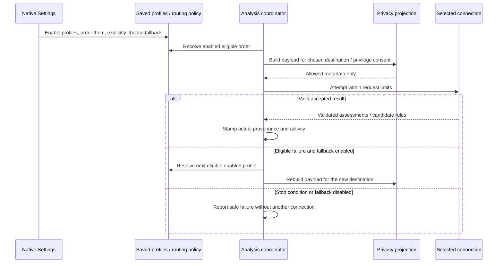
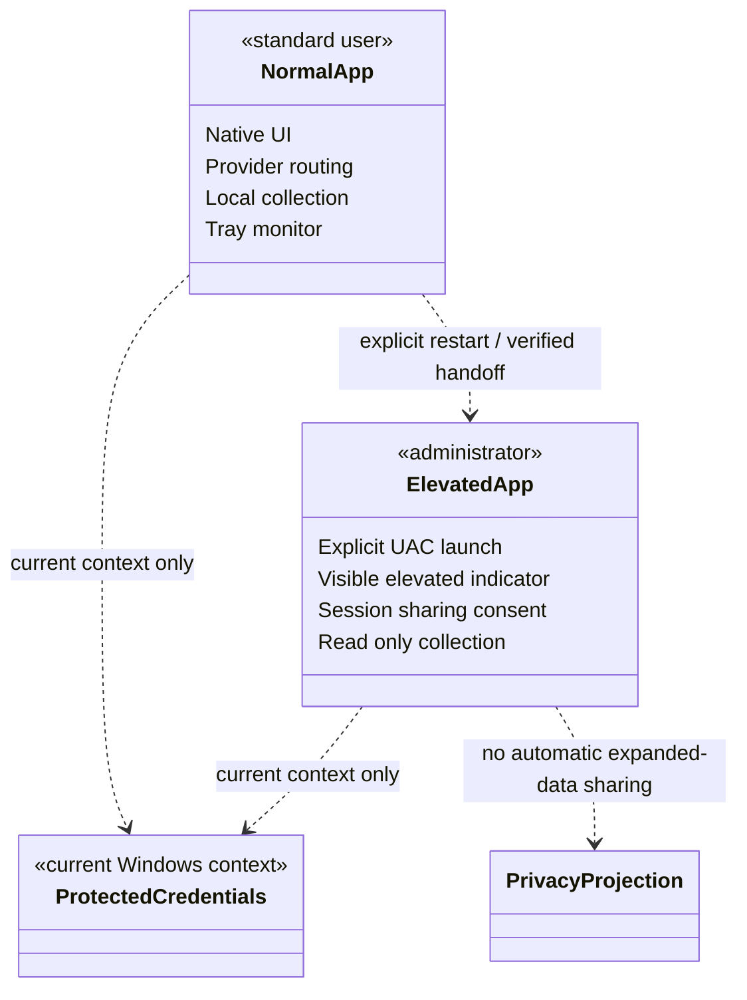

# Connection priority, app identity, tray monitoring, and administrator mode

Date: 2026-10-16. Status: approved for implementation planning; not implemented.
This builds on the existing ChatGPT integration and native UI guide. The account-card layout
fix is separate and may land first. The user has selected fallback only behind an explicit option.

## Intended outcome

Configure multiple AI connections independently, select which are allowed, and order their use.
Provide a recognizable ProcSight app icon and a system-tray load indicator. Support explicit
administrator launches while documenting and containing the additional data/privilege exposure.
The first release remains read-only toward managed processes and services.

## Connection profiles and routing

- Store independent profiles for ChatGPT plan, OpenAI API, compatible API, and local models.
  A profile contains an opaque ID, provider kind, endpoint/model, enabled flag and priority.
  ChatGPT profiles reference their protected opaque account ID; API secrets remain protected
  in Windows credential storage using profile-specific keys. Account emails/tokens are not
  written into normal preferences or activity/provenance history.
- A native Settings list shows enabled state and Move up/Move down actions. Selecting a row
  opens its configuration. Disable retains configuration and credentials. Valid changes apply
  immediately without a Save button; ordering changes invalidate queued work under the prior
  policy revision. The user's subsequent instruction adds immediate settings throughout the page.
  Toggles and selections apply directly. Text fields debounce for 400 ms, validate, and commit
  only complete values; leaving a field flushes pending valid edits. Incomplete edits retain the
  last valid configuration and show contextual feedback, never silently altering another field.
  Serialize commits and suppress stale completion feedback. Failure is visible and never reported
  as saved. Disabling analysis or reducing sharing takes effect in memory immediately even if
  persistence fails; already transmitted requests cannot be recalled.
- Place Test connection in the connection-priority section, targeting the selected connection,
  including a disabled connection when explicitly tested. Testing is explicit, uses synthetic
  metadata, observes call limits and privacy/session safeguards, and never tests fallback profiles
  or enables analysis implicitly. Incomplete edits must be resolved before that profile is tested.
  A nonblank API-key edit commits on focus loss or Enter; do not store partial keystrokes. Clearing
  the editor does not delete a stored key; removal remains a separate explicit action.
- Local rules and knowledge remain first. AI routing chooses the first enabled, configured,
  privacy-eligible connection. A disabled profile is never selected, including as fallback.
  Local-only command mode still prefers an enabled local model and excludes local context
  from online requests. Ordering cannot relax projection/privacy rules.
- Fallback defaults off. The user may explicitly enable “Try the next enabled connection if
  the selected connection is unavailable,” with disclosure that separately billed API access
  may be used. With fallback off, failure stops and provides recovery guidance.
- With fallback enabled, move to the next eligible profile only for bounded availability,
  rate-limit, or authentication failures after the existing retry policy. Authentication pause
  is per profile. Cancellation, changed privacy/policy, invalid configuration, exhausted global
  automatic-work limits, and rejected/malformed provider output stop rather than bypass checks.
  Online-call limits apply before every online attempt. No fallback is triggered merely because
  an answer correctly remains Unknown.
- Each actual attempt appears in AI activity with its real provider/model and safe fallback
  reason. Rule provenance uses the connection that returned the accepted result. Local-rule
  hits remain separate from AI calls. Research uses only an eligible explicitly configured
  research-capable API profile and separate consent/budget; it never silently bills another profile.
- Migrate existing provider/local configuration without changing enabled analysis, sharing
  permissions or billing behavior. Keep fallback off. Existing credentials remain protected.
  Validate missing/disabled/all-disabled configurations and report them clearly.

## App icon and tray

Use an editable SVG icon depicting a process chip with a magnifying lens, with crisp small-size
variants and generated multi-resolution ICO/PNG assets. Apply the same identity to executable,
window/title bar and tray menu. Keep generation reproducible and assets tracked.

- Add a Settings option to show a system-tray icon and select the metric: CPU, memory, disk,
  network, or GPU. CPU and memory reuse existing system samples. Disk/GPU use bounded Windows
  performance counters; network uses adapter statistics. Metric labels/tooltips state their units
  and aggregation (disk busy, network throughput, busiest GPU engine). Unavailable/warm-up data
  is explicit and never rendered as zero.
- Render one compact dynamic icon (load bar/history) for the chosen metric, with a readable tooltip
  containing name/value and an unavailable reason where needed. Default metric is CPU. The choice
  persists; choosing another metric changes only monitoring presentation.
- Tray menu: Open ProcSight, choose metric, Settings, Exit. Activation restores the main window.
  Re-register after Explorer restarts; release notification, GDI/icon and counter resources on exit.
  Metrics continue while minimized. Closing still exits by default; minimize-to-tray is a separate
  explicit option, and Exit always exits. No elevated action is hidden behind ordinary tray clicks.
- Tray and metric collection never use providers, credentials, process commands or persistent
  diagnostic histories. Collection/rendering is bounded and kept off the UI thread as appropriate.

## Administrator mode and security assessment

Keep the application manifest asInvoker and uiAccess=false. Normal launch stays unelevated.
Add “Restart as administrator” with a clear UAC shield, cancellation handling and a visible
Administrator indicator. Resolve the actual application executable directly; never execute a
path or command taken from model output, process command lines or editable preferences.
Do not elevate automatically because a metadata read fails. Protected/PPL data may remain
unavailable even as administrator; existing partial-data behavior must remain.

### Approaches considered

| Approach | Impact | Decision |
| --- | --- | --- |
| Elevate the full app on an explicit request | Smallest implementation; UI, storage, provider adapters and native parsers also run elevated | Support as the requested initial administrator mode, with safeguards below |
| Elevate only a narrow collector broker | Smaller privileged attack surface, but requires authenticated IPC, broker lifecycle and another executable | Preferred longer-term hardening; separate follow-up design, not silently added here |
| Always require administrator | Exposes all sessions to elevated parsing/network code and creates repeated prompts | Reject |

### Required safeguards

1. Elevation broadens readable metadata, potentially including other users' sensitive command
   lines. Each elevated session starts with automatic external analysis off and online command/
   identifying-data sharing excluded. Saved normal-session preferences are retained, not silently
   overwritten. Explicit session consent is required before enabling elevated-data transmission.
   Every connection, fallback and research request still uses the normal privacy projection.
2. Remain read-only: do not add process termination, service modification, automatic cleanup,
   code execution, privilege adjustment or SeDebugPrivilege enablement with this feature.
3. Treat ordinary preferences, learned rules, cached evidence, process metadata and model output
   as untrusted, including when a normal user can modify them. Validate profiles/endpoints and
   rules before use. Do not load user-selected plugins or execute rule content. Bound native and
   database reads. Do not weaken UIPI or accept arbitrary privileged commands from window messages.
4. Use the current Windows security context's credential store. If UAC switches to another
   account or Administrator Protection changes the account context, do not borrow the original
   user's credentials/settings through paths or copied tokens. Clearly show missing connection
   configuration and require configuration under the active context if needed.
5. A locally built unsigned app in a user-writable checkout is not a hardened privileged
   distribution. Document that the entire app/runtime/dependency tree must be trusted before
   elevation. Shipping a signed protected installation is later release work, not authorized
   publishing in this task. No credentials or UAC passwords are collected/stored by ProcSight.
6. Preserve cancellation and runtime-bootstrap failure recovery. Do not close the original
   instance until elevated startup is confirmed; otherwise keep it usable and show safe feedback.
   Restarting normally must use the shell's unelevated launch context or explain how to reopen
   normally, never pretend a child of an elevated process is automatically unelevated.

Residual risk: full-app elevation increases the consequences of a vulnerability in native metadata,
SQLite, UI or network parsing. Consent, read-only behavior and privacy defaults reduce exposure;
they do not eliminate it. A collector-only broker remains the stronger separation.

## Architecture sketches

UML sequence: connection choice and guarded fallback.

UML deployment-style component view (class notation with stereotypes): privilege boundary.

## Verification and documentation

Synthetic tests: legacy migration, order/disable/all-disabled, per-profile credentials and account
binding, opt-in-only fallback, bounded retries and independent authentication pause, budget limits,
local-only projection on every destination, actual activity/provenance, UAC cancellation/launch
failure, elevated session privacy consent and alternate-user isolation, tray metric selection and
unavailable data, history/icon bounds, Explorer recreation and deterministic disposal.

Native fixtures: wide/narrow light/dark Settings, complete profile ordering, app icon variants,
tray menu and load rendering. Live Windows checks: UAC and alternate account behavior, elevated
WinUI runtime bootstrap, Explorer restart, shell icon overflow behavior, metric accuracy against
Windows tools and resource cleanup. Do not equate synthetic checks with that live acceptance.
Keep AGENTS, README, DEVELOPERS, ARCHITECTURE/UML, SECURITY, changelog and verification current.
No CI/CD, remote publication, new license terms or process management is introduced.

## Primary references

- [Microsoft UAC behavior](https://learn.microsoft.com/en-us/windows/security/application-security/application-control/user-account-control/how-it-works)
- [Microsoft administrator application guidance](https://learn.microsoft.com/en-us/windows/win32/secbp/running-with-administrator-privileges)
- [Shell launch and runas](https://learn.microsoft.com/en-us/windows/win32/shell/launch)
- [Windows App SDK unpackaged deployment](https://learn.microsoft.com/en-us/windows/apps/windows-app-sdk/deploy-unpackaged-apps)
- [Notification-area lifecycle](https://learn.microsoft.com/en-us/windows/win32/shell/notification-area)
- [Taskbar recreation](https://learn.microsoft.com/en-us/windows/win32/shell/taskbar)
- [AppWindow icon](https://learn.microsoft.com/en-us/windows/windows-app-sdk/api/winrt/microsoft.ui.windowing.appwindow.seticon)
- [Windows performance counter APIs](https://learn.microsoft.com/en-us/windows/win32/perfctrs/performance-counters-functions)
