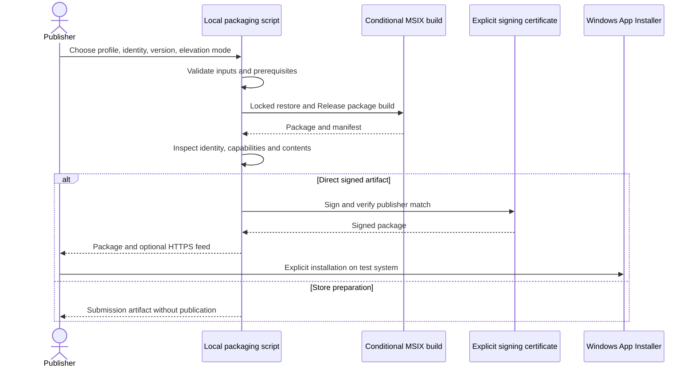

# MSIX packaging design

Date: 2026-10-17. Status: proposed written design; not implemented.
The user approved the MSIX direction and requested the design and implementation plan.

## Outcome and scope

Produce a native Windows installer for ProcSight and a distinct preparation path for Microsoft
Store submission. Keep the current unpackaged debug workflow. Target Windows 11 x64, minimum
build 26100, matching the existing application. Installation must not enable AI analysis,
change sharing permissions, request administrator startup or introduce a background service.
No CI/CD, hosting, Store registration, publication, remote upload or certificate trust installation
is authorized by this work. Store acceptance remains an external certification decision.

## Packaging and dependencies

Use single-project MSIX packaging in `ProcSight.App.csproj`, enabled only with the explicit
`ProcSightPackaging=true` property. Ordinary Debug/Release builds remain unpackaged. Add a
package manifest, separate from the executable's existing asInvoker manifest. ProcSight runs as
a full-trust desktop application, not an AppContainer application. Declare runFullTrust; add no
broad filesystem, packaged service or UIAccess capabilities.

Two profiles share app source and manifest structure:

| Profile | Purpose | Runtime deployment | Identity and signing |
| --- | --- | --- | --- |
| Direct | Local testing and eventual direct download | Self-contained .NET and Windows App SDK | Development identity by default; explicit production identity and trusted signing for public distribution |
| Store | Submission preparation | Self-contained .NET, framework-dependent Windows App SDK | Exact reserved Partner Center identity required; do not sign using a development identity |

Use the pinned SDK/package versions. No PublishSingleFile, trimming or Native AOT is introduced.
Include app binaries, required runtime content, generated branding and distributed license/notices;
never package credentials, databases, settings, diagnostic output, repository files or test fixtures.
Packaging must fail with an actionable prerequisite error if installed tools or runtime metadata
cannot produce the selected profile. Do not silently change deployment models.

The development identity is `ProcSight.Development`, publisher `CN=ProcSight Development`.
The product version comes from the central release version described below; the initial development
version is `0.1.0`, mapped to `0.1.0.0`. Reject overflow, malformed versions and a nonzero final
component for Store artifacts. Store releases conservatively require major >= 1, matching the
documented Store version rules; do not silently promote a 0.x development release to 1.x. Do not derive release identity or versions
from local account information. Store/direct-production builds require explicit identity settings
and reject development/example placeholders. Store and direct identities may differ: do not promise
transparent cross-channel upgrades or shared credentials/data without testing the final identities.

## Release versioning and local release preparation

Added user requirement, 2026-10-17: release preparation automatically updates all required product
version locations, changelog and related release files, and creates the matching Git tag. This is a
local release command, not a CI/CD or remote-publication workflow.

Use Semantic Versioning for stable releases, `MAJOR.MINOR.PATCH`, with annotated Git tags
`vMAJOR.MINOR.PATCH`. GitHub releases are tag-based; GitHub does not impose its own distinct version
syntax. The maintainer selects Major/Minor/Patch (breaking change/feature/fix) or an explicit version;
the script computes and propagates the version. Do not infer a breaking-change boundary from commit
messages or dependency updates. The first implementation accepts stable SemVer only: reject suffixes
and build metadata explicitly rather than inventing a lossy prerelease-to-MSIX ordering scheme.

`Version.props` is the single authoritative product version and is imported by Directory.Build.props.
Derived values must be consistent:

| Location | Example for release 1.2.3 |
| --- | --- |
| Product Version/VersionPrefix | 1.2.3 |
| AssemblyVersion and FileVersion | 1.2.3.0 |
| InformationalVersion | 1.2.3 plus the exact release commit ID |
| Executable app.manifest assemblyIdentity/version | 1.2.3.0 |
| MSIX manifest, package/bundle and App Installer identities | 1.2.3.0 |
| Local annotated tag | v1.2.3 |
| Changelog heading | [1.2.3] followed by release date |
| Release notes/artifact names/checksum manifest | Same version and release commit |

The release script owns synchronization of any checked-in product-version fields; build/package/feed
values are derived from the central version. A centralized inventory of live version locations and
verification assertions prevents future fields from drifting. Do not perform repository-wide string
replacement: historical changelogs/specifications, example versions, Windows SDK/framework versions,
dependency pins and licensing notices are not product-version targets. Existing user-facing version
badges/download links, if introduced, must join the explicit inventory.

Planned command: `./scripts/prepare-release.ps1 -Bump Patch -Profile Direct`, or `-Version 1.2.3`.
`-DryRun` reports the exact version/tag, file edits and commands without mutations. The first release
may explicitly use the initial central version when no release tag exists. Subsequent releases must
increase version relative to the central value and existing release tags. Components must fit Windows'
numeric version limits; do not wrap/truncate values. Version selection has no implicit default bump.

Execution order:

1. Require a clean tracked checkout/index, a branch rather than detached HEAD, available Git identity,
   a new valid version/tag, populated Unreleased release notes and selected packaging prerequisites.
   Examine existing local release tags; do not fetch, push or assume unseen remote tags are absent.
2. Prepare all edits in memory, then update central/live version fields and move Unreleased entries
   into the dated release section. Leave a fresh Unreleased heading. Preserve the entries' wording;
   draft release notes come from that section, not generated claims of unverified readiness.
3. Validate synchronized MSBuild/manifests and run required tests/build checks. Failure before commit
   restores only script-owned edits from captured originals, never a destructive Git reset.
4. Commit only the explicit release file inventory, with `chore: release v1.2.3` as the message.
5. Build, inspect and, when selected, sign release packages from that exact clean release commit.
   Generate versioned release notes/checksums with the commit ID. No unrelated edit may enter artifacts.
6. Create the annotated local tag pointing to that commit only after artifact validation succeeds.
   Never move, overwrite or force a pre-existing release tag. Pushing, GitHub release publication,
   uploading binaries and Store submission remain separate explicit operations.

If packaging fails after the release commit, leave the commit intact, create no tag and report a
resumable prepared release. `-Resume -Version 1.2.3` requires matching prepared files/release commit
and regenerates artifacts without bumping again. A matching completed release is idempotent; mismatched
tags/commits stop with a clear error. Never silently roll back committed history or delete a release tag.
The release date defaults to the operator's local date with an explicit `-ReleaseDate yyyy-MM-dd`
override for reproducibility. No actual release/tag is created as part of implementing these scripts.

## Signing and installation

Development certificate creation is an explicit separate command. Create a nonexportable code-signing
key in CurrentUser\\My, with the development publisher subject; export only its public certificate to
ignored artifacts. Neither packaging nor installation scripts silently import trust, elevate, weaken
execution policy or install developer mode. Explain certificate trust as a deliberate manual test step.

Signing uses an explicitly selected certificate thumbprint, checks code-signing eligibility and exact
publisher match, and invokes SDK SignTool with SHA-256. Public direct builds require trusted signing
and timestamping. Never put a PFX password in a process argument, log or tracked file. A Store artifact
is submission input, not a directly installable unsigned public download. Microsoft signs accepted
Store packages. No certificate purchase or Store account creation is included.

Native MSIX deployment supplies Start-menu registration and Apps > Installed apps integration.
Local scripts create artifacts; installation is an explicit user action through App Installer or
Add-AppxPackage. Test install/update/uninstall on a disposable Windows account/VM, not by replacing
the user's active development environment without approval.

## Administrator mode

Keep normal activation asInvoker. Direct packages declare allowElevation for the existing explicit
restart action, subject to testing of packaged activation, process identity and ready-window handoff.
Preserve cancellation recovery and session-only sharing restrictions. Packaging does not authorize
SeDebugPrivilege, a service, a broker or always-elevated startup.

Store elevation requires restricted-capability approval. Store packaging requires an explicit
`ElevationMode` choice: `Disabled` or `Approved`. `Approved` represents the publisher's external
approval, never approval inferred by a script. `Disabled` omits allowElevation and makes administrator
restart unavailable with a clear explanation in the UI. No silent feature removal and no claim that
disabling elevation alone guarantees Store acceptance. If packaged elevation fails, preserve the
unpackaged build and report the blocker; a traditional installer requires a separate decision.

## Data, updates and lifecycle

Audit MSIX filesystem virtualization and active-user Credential Manager behavior. No writes to the
immutable installation directory. Installation must not import an existing unpackaged database or
credential catalog implicitly. Test stable same-identity updates with synthetic settings, rules and
credentials; test uninstall behavior and document what is removed and what remains. Credential Manager
entries are not assumed to be removed by MSIX. Do not add custom uninstall actions or automatic secret
deletion. Reinstall must never silently re-enable sharing or automatic analysis.

Store updates are managed by the Store. A direct `.appinstaller` file is optional and generated only
when the user supplies explicit HTTPS package/feed locations and a production identity. No placeholder
feed is activated or hosted. Default on-launch update checking is nonblocking, without mandatory
updates or background scheduled tasks. Reject feeds containing userinfo or non-HTTPS URLs.

## Verification and documentation

Test both normal build and explicit packaging, inspect the generated manifest/package contents, and
run scripts/verify.ps1. Add synthetic tests for identity/version validation, publisher mismatch,
certificate selection, artifact paths, feed escaping and privilege declarations. Validate SDK tools'
exit status and inspect actual package contents rather than treating file existence as success.
Run native installed-app smoke checks for process collection, partial access, icons, tray restoration,
OAuth loopback/browser return, local model access, data persistence and elevation cancellation/readiness.
Use Windows App Certification Kit for the Store profile when available; record unavailable checks.

Update README, DEVELOPERS, ARCHITECTURE/UML, SECURITY, AGENTS, CHANGELOG, verification notes and
ignore rules with implementation. Preserve AGPL and dependency notices. Keep signing keys, certificates
exported for testing, packages, uploads and local identity overrides outside tracked source.

## References

- [Distribution choices](https://learn.microsoft.com/en-us/windows/apps/package-and-deploy/choose-distribution-path)
- [Deployment models](https://learn.microsoft.com/en-us/windows/apps/package-and-deploy/)
- [Self-contained deployment](https://learn.microsoft.com/en-us/windows/apps/package-and-deploy/self-contained-deploy/deploy-self-contained-apps)
- [Elevation and full-trust capabilities](https://learn.microsoft.com/en-us/windows/apps/package-and-deploy/app-capability-declarations)
- [Store signing and certification](https://learn.microsoft.com/en-us/windows/apps/publish/publish-your-app/msix/app-certification-process)
- [GitHub tag-based releases](https://docs.github.com/en/repositories/releasing-projects-on-github/about-releases)
- [GitHub release management and SemVer](https://docs.github.com/en/repositories/releasing-projects-on-github/managing-releases-in-a-repository)
- [Store package version numbering](https://learn.microsoft.com/en-us/windows/apps/publish/publish-your-app/msix/app-package-requirements#package-version-numbering)
