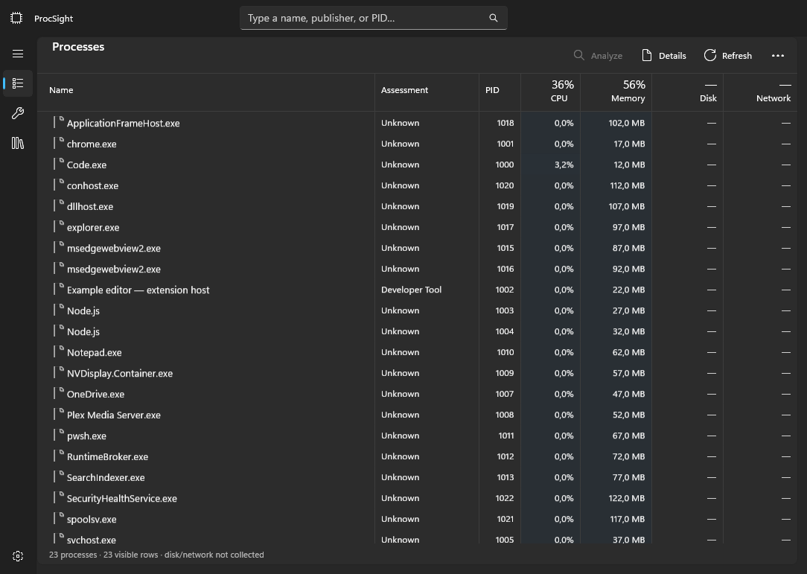
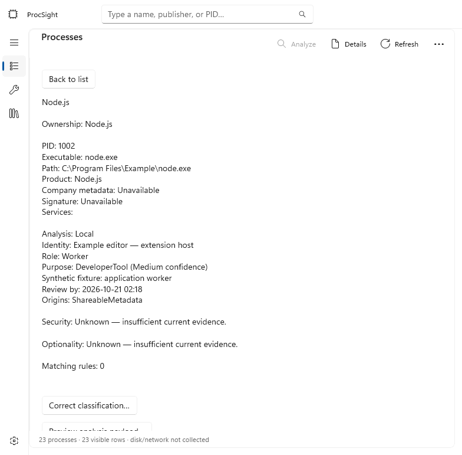

# Development verification

Recorded 2026-10-14. ProcSight is an unreleased development preview, not a completed
release certification. No real API credentials, process dumps, or paid provider requests
were used for automated verification.

## Local checks

On Windows 11 x64 with .NET SDK 10.0.301 and installed Windows App Runtime 2.2:

```powershell
./scripts/verify.ps1 -Configuration Release
```

Locked restore and native Release build passed with zero warnings/errors. Test results:

| Project | Passed | Focus |
| --- | ---: | --- |
| Core | 31 | Identity, ownership boundaries, privacy, rule validation/matching/expiry |
| Application | 4 | Navigation, search, incomplete totals, 500-process projection/churn |
| Infrastructure | 30 | SQLite, provider/research validation, coordinator, persistent learning |
| Windows | 10 | Live read-only collection, native protected reads, enrichment, preferences, credentials |
| Total | 75 | No failed or skipped tests |

Key behaviors covered include same-name owners at different paths, PID reuse, all three
classification axes, rejected name-only rules, expired referenced evidence, changed-owner
reanalysis, zero provider calls after learned-rule restart, disabled-rule cache invalidation,
unchanged failure suppression, successful knowledge expiry during a live session, daily
caps/retries, authentication pause, older-policy rejection, queued-work cancellation, and
local-only cloud projection using a shareable identity.

Privacy checks use synthetic secrets and quoted commands. They cover full-line preservation
when allowed, cloud omission in Off/Local only, exclusion from research, safe command-derived
outputs, arbitrary private rule/evidence rejection, and origin persistence after restart.
Storage checks include atomic corrections, separate clear scopes/usage accounting, retention,
and rejection of a newer schema. These focused tests are not exhaustive corruption/fault injection.

Windows integration queries the current process and available services without elevation.
A first-chance exception observer verifies that protected-process counter reads do not throw
managed Win32Exception probes. Task cancellation exceptions may still appear in a debugger
when cooperative shutdown cancels awaited operations; a normal exit code 0 is expected.

## Native UI observations

The Debug-only `--visual-fixture` mode renders the actual WinUI XAML tree with synthetic
processes and assessments, then exits. It does not collect machine metadata, load preferences,
access credentials, or send provider requests. Dark wide-table and light narrow-detail
captures were inspected. Header/row alignment and the light detail background were corrected
from those captures. The renderer omits native caption buttons and Mica composition.





A live credential-free launch exposed the native title bar, navigation, processes, group
counts, CPU/memory totals, and search through accessibility inspection. The computer-use
capture returned the background window, and input failed with unavailable coordinate
geometry. Therefore desktop clicks, keyboard/screen-reader behavior, and live caption/Mica
appearance are not claimed verified by that tool.

Mermaid class, sequence, and state diagrams in [ARCHITECTURE.md](../ARCHITECTURE.md) were
parsed and rendered locally. Local documentation targets and whitespace were checked.

## Outstanding acceptance work

- Run the live provider smoke test with a user-selected model and synthetic metadata;
  check structured-output and web-search support on that account/model. Fake HTTP coverage
  does not establish current hosted API compatibility.
- Check full-command-line routing with a synthetic, non-secret process against an explicit
  local/online endpoint, including live policy changes and provider-side retention behavior.
- Complete keyboard, narrator, narrow/wide, and 100/150/200% desktop scaling checks.
  The 500-row test checks projection identity/churn, not a timed native UI performance claim.
- Exercise recovery and storage fault injection while collection runs, and audit the complete
  package redistribution/license inventory before distributing executable releases.
- Finish the independent whole-branch review. A fresh reviewer reported ownership-identity
  and referenced-evidence/cache freshness findings, reproduced and fixed, then stopped because
  the account usage limit prevented review completion. No independent security audit is claimed.

Disk/network counters remain unavailable; GPU collection and management/cleanup actions are
deferred. Generic native process symbols are used until executable icon collection is added.
