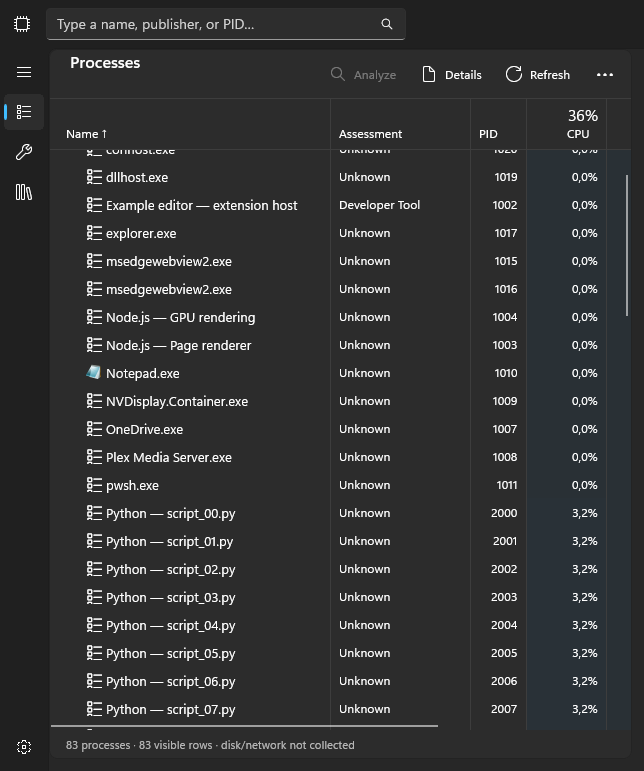
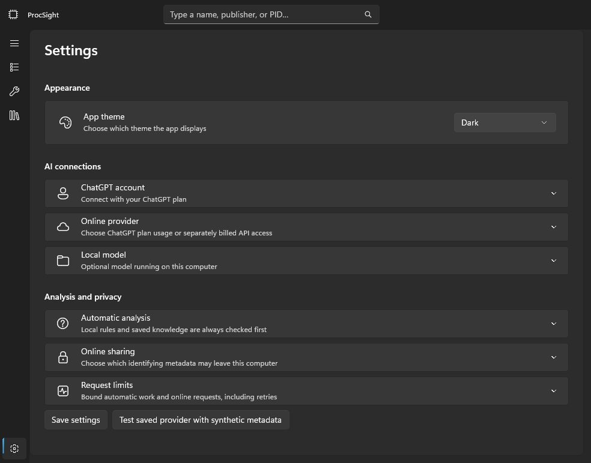
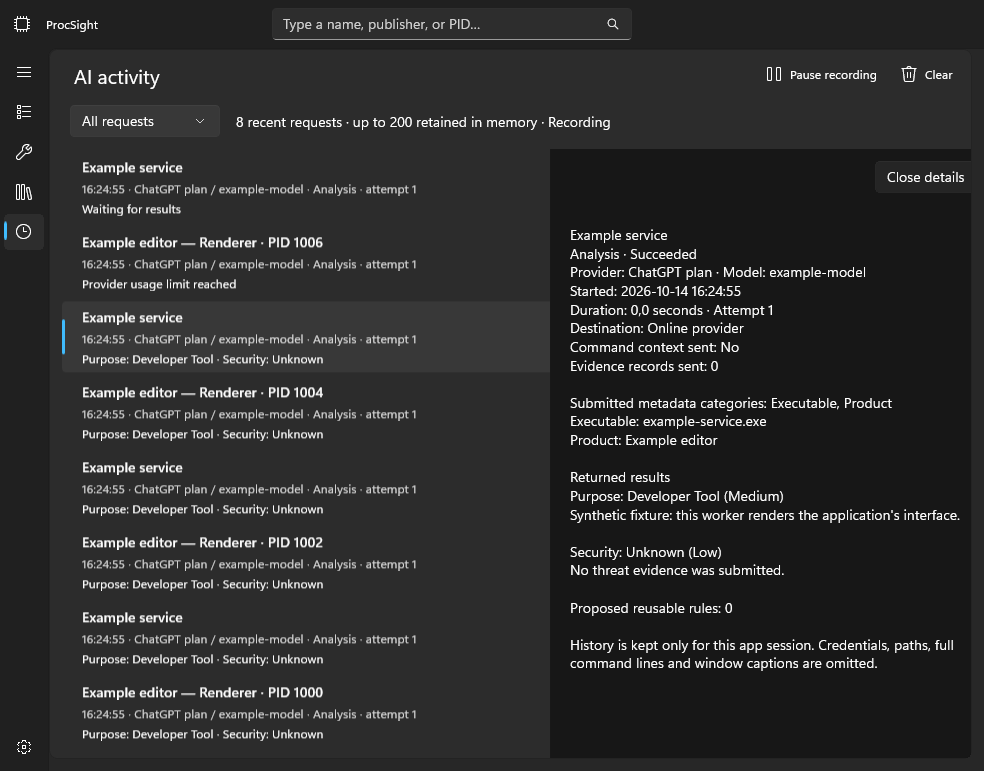

# Development verification

## Sampling, memory, local rules and shutdown — 2026-10-17

The short-path allocation regression failed before pooling, then passed with synthetic long-path
growth and access-denied checks. The CPU-only row allocation fixture likewise failed before resource
format caching, then passed. Held candidate-batch invalidation/retry tests each failed before the
generation guard and passed afterward. Filtered Infrastructure tests passed 116; Application 137,
Windows 69 and Core 74 passed (396 total), excluding `FullyQualifiedName!~ChatGptAuth`.
Release and optimized Debug builds passed with zero warnings/errors. Native WM_CLOSE returned
in 8.18 ms during deliberately blocked background cleanup; repeated close shared one cleanup.
Synthetic shading/column/row fixtures and UI performance harness passed. Live local sampling fed
the native table for 25 observations, writing only numeric aggregates and restoring synthetic rows
before capture. No saved accounts, credentials or providers were accessed. Sampling console runs
covered system/GPU counters, WMI metadata and full inventory; synthetic SQLite batch comparisons
showed substantially lower allocations. See [measurements and limits](PERFORMANCE.md).
Independent review caught an ETW lazy-source race and stale batch fingerprint race; both were
corrected. Final light/narrow row, shading, columns, performance-navigation and native close fixtures
passed; native close returned in 8.34 ms on that repeat. The sampling script's four one-sample modes,
PowerShell syntax, locked restore, local Markdown links and updated Mermaid sequence rendering passed.
Active elevated ETW stop, prolonged user-session memory, scaling and accessibility still
require desktop acceptance. Private/working-set memory must not be presented as retained GC heap.

## Resource shading roof and color — 2026-10-17

Debug/Release builds passed with zero warnings/errors. Selected Release suites passed Core 74,
Application 136, Windows 67 and Infrastructure 113 (390 total); Infrastructure excludes
`FullyQualifiedName!~ChatGptAuth`. Tests cover the brighter 50% default, direct 80% roof,
floor constraints, custom RGB validation and preference round-trip. Native fixtures verify all
five resource columns share the custom color, CPU/Memory reach the configured roof, stable
palette refreshes avoid redundant CPU/Memory notifications, and Off remains clear. Native
settings checks exercise debounced persistence, invalid drafts and switching back to system color.
Dark wide/light narrow shading, settings, row checks and column fixtures passed. Independent
review identified the missing color-picker focus-loss flush; it was added before final verification.
No authentication, credentials, provider or live inventory access occurred. Desktop accessibility,
scaling and subjective contrast acceptance remain manual checks.

## Performance logarithmic time axis — 2026-10-17

Debug and Release builds passed with zero warnings/errors. Selected Release suites passed Core
74, Application 135, Windows 67 and Infrastructure 113 (389 total); Infrastructure excludes
`FullyQualifiedName!~ChatGptAuth`. Tests cover log/linear positions, endpoints, recent-history
expansion, invalid times and preference round-trip/backward compatibility. Native dark 1200px
and light 660px logarithmic fixtures passed labelled ticks, both toggle directions and sidebar
identity retention; ordinary navigation and narrow Overview also passed. Both log captures were
visually inspected. No authentication, credentials, provider or live inventory access occurred.
Desktop accessibility, scaling and live driver acceptance remain separate checks.
Independent time-axis review found no actionable defects; its two filtered synthetic mapping
tests also passed. Local documentation links and whitespace checks passed.

## Minimum shading and friendly start times — 2026-10-17

The native floor check first reproduced the old unconditional tint. It now checks the configurable
5% default, zero-floor behavior and transparent unavailable readings. Application tests cover a
faded valid cell at 5%, 0% and 7% floors, disabled/missing/high-contrast cases, local Today/Yesterday
boundaries, exact ISO export and chronological sorting across UTC offsets. Selected Release suites
passed Core 74, Application 133, Windows 67 and Infrastructure 113 (387 total); Infrastructure
excluded `FullyQualifiedName!~ChatGptAuth`. Debug/Release builds passed with zero warnings/errors.
Native row checks passed dark wide/light narrow; expanded minimum-shading settings and shading
fixtures also passed. No authentication, credentials or provider access ran. Desktop accessibility
and scaling acceptance remain pending.

## Automatic-sort native reset regression — 2026-10-17

The 83-row synthetic live-sort fixture reproduced 81 native vector Reset events from managed
Move notifications while the managed Reset count stayed zero. LiveRowCollection now emits
remove/insert for logical moves. The expanded fixture passes with no native or managed Reset
through repeated bidirectional automatic sorts and retains process selection. Dark 1200px and
light 660px live-sort, column customization and detail-selection fixtures passed. Debug and Release
builds passed with zero warnings/errors. No authentication, credentials, provider or live inventory
access occurred. Full desktop motion/keyboard/scaling acceptance remains separate from these
native event and capture checks.

## Resource shading and optional live sorting — 2026-10-17

Debug/Release builds passed with zero warnings/errors. Selected Release suites passed Core 74,
Application 130, Windows 67 and Infrastructure 113 (384 total); Infrastructure excludes
`FullyQualifiedName!~ChatGptAuth`. No authentication, credentials, live inventory or providers were
used. Numeric tests cover unchanged-poll fade, visible precision, missing values, repeated snapshots,
activity/spike/relative modes and idle zero; preferences tests cover new and older settings files.

Native dark wide/light narrow shading, expanded settings, large-list live sorting and column
dragging fixtures passed. The 83-row sort fixture first reproduced an unwanted collection Reset;
the fix distinguishes automatic ordering from explicit bulk reorder, retaining selection and
using incremental moves. Independent review found that issue and no other concrete shading,
timer, drag-binding or persistence defects. Captures remain ignored under `artifacts/resource-shading`.
Keyboard interaction, Narrator, high contrast, scaling and sustained live-load frame timing remain
manual acceptance items. Shading indicates observation recency/activity, never confidence or threat.
The optimized synthetic UI/rules harness also completed: 1,000-row refresh mean 7.36 ms (p95
18.00 ms), column translation 0.05 ms (p95 0.09 ms), and crossing preview 0.22 ms (p95 0.33 ms).
Large explicit sort/search remained above a frame budget (means 34.66/28.88 ms); these figures
do not establish sustained live frame-rate acceptance. The highlighting sequence diagram rendered
with Mermaid CLI; local documentation links and whitespace checks passed.

## Per-process GPU and I/O permission feedback — 2026-10-17

A read-only token check confirmed the user's running instance was not elevated; `logman query -ets`
reported no active tracing session. This explains the unavailable process disk/network readings.
The process page now exposes the existing package-checked administrator restart action and safe
monitoring failure reasons; no automated elevation or live ETW session was requested.

Debug and solution Release builds passed with zero warnings/errors in isolated output. Release
tests passed: Core 74, Application 127, Windows 66 and Infrastructure 113 (380 total), with
`FullyQualifiedName!~ChatGptAuth` on Infrastructure. GPU projection tests cover busiest-engine
aggregation, invalid counters, idle zero and reused lifetime warm-up; application checks cover
partial groups, numeric ordering, selectable columns and invariant local export. Dark wide/light
narrow `process-io` native fixtures passed GPU bindings and the permission notice; persistent
Performance navigation also passed again. A local counter smoke check sampled only its own process,
observing warm-up followed by an available 0% idle result. This does not prove active-workload GPU
attribution across drivers. Elevated disk/network attribution, high contrast, Narrator and scaling
remain pending. No authentication, credential access or live provider request ran.
Independent review identified a PID-reuse gap; GPU collection now occurs before the final kernel
lifetime confirmation, with rejected lifetimes removed from the next baseline. No other concrete
GPU parsing, routing, export or restart-safety defect was reported.

## Stable Performance navigation — 2026-10-17

The native navigation fixture first failed against the previous implementation because selecting
GPU replaced the sidebar. After separating persistent navigation from right-hand content, dark
1200px and light 660px navigation fixtures passed across all subsystems, including synchronized
compact selection and retained sidebar/item instances. A network detail fixture also passed.
Debug and Release builds passed with zero warnings/errors using isolated ignored output because
the user's running Debug executable was locked. No authentication tests or real account access ran.

## Resource monitoring and selected Performance layout — 2026-10-17

Locked restore and solution Release build passed with zero warnings/errors. Release suites passed:
Core 74, Application 125, Windows 64 and Infrastructure 113 (376 total). Infrastructure used
`--filter "FullyQualifiedName!~ChatGptAuth"`; authentication tests were excluded under the user's
instruction. No sign-in, account credential access or live provider requests were performed.
New checks cover lifetime-scoped I/O accumulation, warm-up, late/reused PID events, invalidation,
loss reset/pruning, partial grouped rates, adapter replacement/reset and directional throughput.
A local system sampler smoke test verified RAM and CPU warm-up without process inventory.

Debug native captures passed for Overview/navigation, all five subsystem detail views, empty and
unavailable histories, and process throughput availability. Captures include dark wide and light
narrow views under ignored `artifacts/performance-ui/final`; Overview geometry and readable rate
states were visually inspected. These are synthetic UI fixtures, not live performance evidence.
Local documentation links and whitespace checks passed. The monitoring sequence diagram rendered
successfully with Mermaid CLI into ignored `artifacts/performance-ui/diagram/monitoring.svg`.

Independent collector review found and corrected kernel-provider startup ordering, real-time
event-loss queries and synchronous shutdown before dispatcher exit, including startup-failure
serialization. Explicit ThreadToProcess parser tracking avoids filename tracking. Elevated live
event delivery/attribution, normal/tray Exit session removal, driver-specific GPU availability,
keyboard, Narrator, high contrast and scaling remain pending. Counters may be unavailable without
the required permissions/driver support; missing values are never advertised as measured zero.

## Manual ChatGPT sign-in diagnosis (2026-10-17)

At the user's request, no automated authentication test or credential inspection ran. The user
performed sign-in in a self-contained diagnostic executable launched under the installed MSIX
identity with Invoke-CommandInDesktopPackage. Only the bounded, typed authentication log was read.
It showed transient visual unload immediately cancelling model loading, followed by a Windows
stowed XAML exception when reopening the dialog. Code inspection found the retained visual parent
and cleanup attached to transient Unloaded notifications.

After switching to owner-controlled cleanup and fresh per-dialog editors, the user's next attempt
logged successful callback validation, token exchange, identity validation, session/catalog writes,
account-picker publication and discovery of seven models. Release build passed with zero warnings
or errors; Direct package generation and content inspection passed. Normal installed activation,
repeated close/reopen acceptance and the full automated suite were not established by this check.
The diagnostic launcher provides package identity but is not identical to normal activation.

## Earlier verification records

Recorded 2026-10-17. ProcSight is an unreleased development preview, not a completed
release certification. No real API credentials, process dumps, or paid provider requests
were used for automated verification.

## Local checks

### 2026-10-17 analysis identity and rule reuse across restart

Synthetic SQLite tests reproduced a successful wire response with no proposed rules leaving no
reusable identity after launch arguments changed, and a legacy entry-level name lost because separately
deserialized assessment collections compared by reference. The fixed path creates an exact-hash rule
for supported known-purpose results without proposed rules and restores supported legacy names by
assessment content. No global migration or write to the real knowledge database was performed.

Eight integration cases cover fresh-store/coordinator restart, changed PID and unshared arguments,
matching private command scope with a reloaded key, changed binary/path isolation, rejected proposals,
Unknown-only and partially known output, and legacy names with disabled dependencies/user correction.
The partial-known regression first reproduced an independently reviewed rejection caused by unsupported
Unknown axes; only known assessments now enter the synthesized rule. Unknown axes remain unresolved.
These use fake providers and synthetic data, with no live API calls. Current-user unpackaged database
inspection was read-only and aggregate-only; it did not establish which database/profile held the
user's earlier sessions.

Final locked Release verification passed 393 .NET tests (74 Core, 122 Application, 139 Infrastructure,
58 Windows) and 70 script checks, with zero build warnings/errors. Independent review identified the
partial-Unknown edge case before completion and confirmed its correction. All 30 architecture diagrams
rendered, 161 relative links in the affected root/verification documents resolved, and whitespace checks
passed. No native UI layout changes were made or desktop/provider acceptance claimed.

### 2026-10-17 measured UI and local rules performance

[PERFORMANCE.md](PERFORMANCE.md) records the broad synthetic baseline, implementation changes,
repeatable commands and remaining limitations. Measurements covered 500/1000-row projection and
refresh, sorting, searching, grouping, details selection, resizing, column motion, bundled-rule
browsing and local rule evaluation/SQLite candidate reads. No provider calls or live inventory were
used. Final optimized native UI measurements were repeated through scripts/measure-ui.ps1.

At 1000 rows, column crossings averaged 47.70→0.29ms, sorting 298.26→28.85ms, ordinary refresh
16.10→9.36ms (20.63→5.01MB allocated). Rule evaluation with 200 learned rules and 373 bundled
definitions fell from 4307→135ms per 1000 entities, preserving matching-proof validation. SQLite
catalog reads remain the main rules follow-up. These timings include native layout where documented,
not actual GPU frame rate or physical mouse latency. Occasional refresh/sort stalls remain.

Native row contracts first failed on missing memory-denominator heat notification, then passed
metadata/command/window/identity/analysis/group transitions and CPU-only notification checks.
Projection/rule allocation regressions also reproduced before fixes. The performance fixture verifies
multiple selected lifetimes through bulk sorting, unchanged logical layout during drag preview and
shared transform attachment after scrolling/recycling. Actual Escape/keyboard-focus, Narrator,
high-contrast and scaling acceptance remain manual.

Final verification passed 385 .NET tests (74 Core, 122 Application, 131 Infrastructure, 58 Windows),
70 script checks and 24 native UI scenarios across 1200/700 effective pixels in Dark/Light. The new
UI measurement script ran end-to-end; the committed Rules harness restored in locked mode, built and
ran successfully. Independent review found no blocking correctness/privacy issue. All 29 Mermaid
diagrams rendered, 162 relative documentation links resolved and whitespace checks passed.

### 2026-10-17 fluid full-column dragging and invisible resize targets

A native fixture first reproduced the stock Thumb drawing extra resize chrome. The transparent
replacement retains native input and the resize cursor; its 20px target spans 10px on each side of
the existing divider. Native checks cover no grip geometry, continuous pointer offsets shared by
header/body cells, fixed Name placement and restoration of CPU resource-background bindings.

`columns`, `columns-services`, `column-drag` and `row-menu` passed at 1200/700 effective pixels in
Dark/Light (16 captures). Mid-motion captures exposed neighboring theme-transition text drawing
over the dragged column and a brush using the system theme instead of the app override. Short XAML
transform animations and a theme-aware opaque surface corrected those captures. Existing header/row
controls remain attached; only realized cells are visited during pointer movement. Native fixture
coverage is separate from physical pointer acceptance, including Escape and rapid vertical scrolling
while a neighbor animation is active, which remains manual. Narrator/high contrast/scaling were not
revalidated.

The user subsequently accepted the column interaction in `e438eb4` on 2026-10-17 as the desired
behavior. This is recorded as the approved baseline in WINUI3-DESIGN.md; it does not independently
establish the untested accessibility, cancellation or rapid-scroll cases above.

Locked Release verification passed 378 .NET tests and 70 script checks with zero build warnings or
errors. Independent static review found a Services fixture incorrectly assuming a CPU column; it was
corrected. No further blocking findings remained. Architecture diagrams parsed/rendered and relative
documentation links and whitespace were checked. No real inventory or provider data was used.

### 2026-10-17 native columns, context actions and local export

Locked Release verification passed 378 .NET tests (70 Core, 119 Application, 131 Infrastructure,
58 Windows) and 70 script checks, with zero build warnings/errors. Ten new application tests cover
layout invariants, stable drag previews across unequal widths, selection/group lifetime deduplication,
CSV/TSV quoting/formula protection, JSON null/text fidelity and excluded context in export names.

Native `columns`, `columns-services`, `row-menu`, `column-chooser` and `inventory-export` fixtures
passed at 1200/700 effective pixels in Dark/Light themes (20 captures). Final chooser/export captures
also assert the actual dialog theme matches the app. Geometry checks cover resizing, horizontal
scrolling, multiselection refresh, stable saved layouts, optional sorting, native menu invocation,
chevron behavior and rejection of a replacement selected lifetime. Reorder retains the row template
and header controls; repeated Disk/Network moves produced no BindingFailed events or captured managed
first-chance exceptions in synthetic checks. The user's original debugger messages were not supplied,
so their exact cause was not independently established.

Real pointer input first reproduced the nonworking native drag-start path, then verified PID and
Disk/Network reordering and edge resizing after replacing it. The later Task Manager recording was
reviewed as an interaction reference: live preview, drag feedback, resize cursor and stable cells are
documented in WINUI3-DESIGN.md. The live-preview refinement has stable-slot and in-place-control
regressions; a fresh real-pointer check of that final refinement and Escape cancellation remains manual.
The recording and extracted frames are not tracked and supply no product inventory/rules.

Independent review identified mutable correction/copy targets and a narrow-versus-wide preview
oscillation; those were fixed and reviewed again. Architecture diagrams (29) parsed/rendered,
relative links (156) resolved and whitespace checks passed. End-to-end Save picker/file writing,
especially administrator mode, remains a manual acceptance check: unattended fixtures exercise the
export dialog and serializers without opening a picker or changing the real clipboard. Narrator,
high contrast and text scaling were not revalidated. No provider/credential access or uploads occurred.

### 2026-10-17 detail expansion while browsing

Native Debug fixtures first reproduced selection resetting expanded process/service details and
collapsed rule matching conditions. After the fix, `details-selection`, `details-service-selection`
and `rules-selection` passed at 1200/700 effective pixels in Dark/Light themes (12 captures).
They cover open and closed choices, learned/bundled rules, empty selection, page recreation and
replacement of displayed item identity. Existing `details-stability` and `details-evidence` also
passed resource/metadata refresh and nested evidence/scroll checks. Captures use synthetic metadata,
isolated output and no real credentials/providers. Wide dark and narrow light entity views were
visually inspected. Narrator, high contrast and text scaling were not revalidated for this fix.

Locked Release restore/build passed with zero warnings/errors, all 368 .NET tests and 70 script
checks passed. Section choices are window-session preferences keyed only by app-owned section kinds;
they do not preserve another item's metadata or widen evidence lifetime/selection checks.

On Windows 11 x64 with .NET SDK 10.0.301 and installed Windows App Runtime 2.2:

```powershell
./scripts/verify.ps1 -Configuration Release
```

Locked restore and native Release build passed with zero warnings/errors. Test results:

| Project | Passed | Focus |
| --- | ---: | --- |
| Core | 70 | Identity/privacy/rules, research projection and independent connection profiles |
| Application | 119 | Presentation, local export/columns, rejection/research diagnostics, routing and immediate settings |
| Infrastructure | 131 | Storage/OAuth/SSE, inline search/citation validation and scoped rule decisions |
| Windows | 58 | Collection/lifetimes/icons, credential binding, tray metrics/lifecycle, package context and elevation handoff |
| Total | 378 | No failed or skipped tests |

### 2026-10-17 MSIX and local release tooling

Locked Release restore/build and all 368 tests passed with zero build warnings/errors.
`verify.ps1` also runs 20 version checks, 27 packaging checks and 23 synthetic release-workflow
checks. Workflow fixtures use temporary Git repositories and fake package output: dirty/detached
checkout, missing identity, duplicate tag, dry-run, failed verification, intervening edits,
failed packaging, annotated tags, resume and immutable existing tags. No actual product release
commit or tag was created. The real checkout's release DryRun also passed without mutation.

Package-context tests cover declared/absent/unknown elevation capability, hostile/oversized XML,
and separate package-family data/credential namespaces. These are policy tests, not proof of
Windows deployment lifecycle. Actual installed update preservation of consent, settings, rules
and account references remains an explicit acceptance requirement.

Direct self-contained MSIX generation uses locked restore and isolated output, followed by SDK
MakeAppx unpack, exact identity/version/capability/content checks and binary source-commit validation.
The native WinUI map-control HTML asset is allowlisted by exact framework path; arbitrary HTML and
private configuration remain rejected. Build output is unsigned development output, not installable
until explicitly signed with a trusted certificate. The SDK may warn about missing optional PDB
conversion tooling; no symbols package is distributed.

Reserved Store identity, trusted signing, certificate trust, actual install/update/uninstall,
packaged elevation handoff, OAuth callback/local endpoint access and installed WACK acceptance
remain unverified. No certificate was created/imported, no app was installed, and nothing was
pushed, uploaded or submitted. Architecture Mermaid diagrams parsed/rendered in the installed
browser; source and generated packages do not establish Store acceptance.

The inspected development artifact from source commit `7554325` is under
`artifacts/packages/Direct/0.1.0/bd8e26e420bd4227843bcb60cc1efd24/`; its local JSON records the
full commit and SHA-256. Independent review found an undeclared PowerShell 7 requirement, now
documented and guarded before entry-point actions. A Windows PowerShell 5.1 invocation reproduced
the early rejection. All 368 .NET tests and 70 script checks then passed. Relative documentation
links (149) resolved, 27 Mermaid diagrams parsed/rendered and whitespace checks passed. The new
packaged-permission InfoBar still needs installed-package visual/accessibility acceptance.

### 2026-10-17 analysis and account-dialog corrections

Locked Release verification passed with zero warnings/errors. Regression tests first reproduced
case/path-root false rejection, early invocation-scope rejection, ChatGPT routing exclusion, source
11 incorrectly rejected after truncation, and failed inline responses accepted as valid. The corrected
tests pass, with forged source references still rejected and command/private metadata excluded from
tools-enabled requests. Original rejection codes and research outcome survive SQLite restart.

Separate from automated tests, an authorized live smoke used the configured ChatGPT account and
synthetic public Notepad metadata only. The first research request exposed the unsupported
max_tool_calls parameter. After its removal, web search returned one cited record in 8.4 seconds.
The final combined analysis/search request returned all three assessments, ten attributable source
records and one tool call in 15.7 seconds. Actual model discovery returned seven eligible models in
0.8 seconds. These are observations, not performance guarantees; no tokens/account IDs, actual local
process data or raw provider responses were copied into the repository.

The native delayed-model fixture reproduced permanent disabled/empty controls after panel reattachment
before the fix, then passed with a populated enabled picker and selected configured model afterward.
Wide/narrow light/dark fixtures validate viewport fit. Rejected/Unknown rule fixtures render prominent
decision/recovery and research status. [Account dialog](images/chatgpt-models-dialog.png) and
[rejection details](images/rules-rejection-details.png) contain synthetic data only. Independent review
findings about decision provenance, adaptive button positions, source truncation and terminal-success
checks were addressed with regression coverage. Keyboard/Narrator, high contrast and additional display
scaling remain unverified; live checks do not establish release readiness.

The 2026-10-16 account-settings layout change passed the full locked-restore/Release/test
script above (zero build warnings/errors). Synthetic actual-XAML captures at 1100px dark
and 600px light showed adaptive account/model selectors and grouped account actions without
overflow. The Debug fixture used a scratch output because a running debug app locked the
normal apphost; the debug session was preserved. These captures used no real account data
or network requests. Keyboard, Narrator, high contrast and additional scaling remain unverified.
Immediate settings, profile priority, app icon/tray monitoring and administrator mode are implemented.
Their synthetic tests cover order/disable/fallback, independent auth pauses, cumulative rapid edits,
storage-failure permission/budget reductions, destination-bound key commits, post-budget consent
revocation, tray registration/recovery and native HICON generation/disposal, UAC failure/readiness
handoff and elevated privacy defaults. A fresh independent reviewer found seven material issues;
targeted regressions and the full 330-test suite passed after fixes. New profiles also cannot borrow
legacy API keys. No real provider test or account data was used for this acceptance pass.

Native synthetic Settings/administrator/tray-settings captures were produced at 1100/600 widths in
both light/dark themes, using in-memory fake account records without collection or network calls.
The administrator fixture simulates UI/privacy mode; it does not elevate the fixture process.
Actual UAC consent, alternate-account/Administrator Protection isolation, elevated WinAppRuntime
bootstrap, live shell tray/menu behavior and Explorer restarts, metric accuracy against Windows
tools, keyboard/Narrator/high-contrast/scaling checks remain unverified. No running user debug
session or Explorer process was stopped for verification.
All 25 Mermaid diagrams in the living architecture and current design parsed and rendered with
Mermaid 11.17.2 in the installed browser; updated administrator/settings diagrams were inspected.
Relative links in the 11 affected documentation/plan files and whitespace checks passed.

Representative synthetic views: [connections](images/settings-connections-dark.png),
[narrow settings](images/settings-connections-narrow.png), [administrator session](images/settings-administrator.png)
and [tray preferences](images/settings-tray.png).

The subsequent connection-layout revision passed all 332 tests, with a warning-free Release build.
Twelve synthetic wide/narrow light/dark captures cover the compact page and native local/API
configuration dialogs. UI Automation invokes Configure; fixtures assert that provider fields stay
out of the main page, Configure/Test/Remove exist, and the dialog follows the app's selected theme.
Profile-removal tests cover remaining order/configuration, research-reference cleanup and removing
the last profile. These tests do not revoke or inspect any real account/credential records.
Dialogs: [API configuration](images/settings-connection-dialog-dark.png) and
[narrow light configuration](images/settings-connection-dialog-light.png).

Key behaviors covered include same-name owners at different paths, PID reuse, all three
classification axes, rejected name-only rules, expired referenced evidence, changed-owner
reanalysis, zero provider calls after learned-rule restart, disabled-rule cache invalidation,
unchanged failure suppression, successful knowledge expiry during a live session, daily
caps/retries, authentication pause, older-policy rejection, queued-work cancellation, and
local-only cloud projection using a shareable identity.

Privacy checks use synthetic secrets and quoted commands. They cover full-line preservation
when allowed, cloud omission in Off/Local only, exclusion from research, safe command-derived
outputs, arbitrary private rule/evidence rejection, and origin persistence after restart.
Storage checks include atomic corrections, separate clear scopes/usage accounting, retention,
and rejection of a newer schema. These focused tests are not exhaustive corruption/fault injection.

Windows integration queries the current process and available services without elevation.
A first-chance exception observer verifies that protected-process counter reads do not throw
managed Win32Exception probes. Task cancellation exceptions may still appear in a debugger
when cooperative shutdown cancels awaited operations; a normal exit code 0 is expected.

## Native UI observations

The Debug-only `--visual-fixture` mode renders the actual WinUI XAML tree with synthetic
processes and assessments, then exits. It does not collect machine metadata, load preferences,
access credentials, or send provider requests. Dark wide-table and light narrow-detail
captures were inspected. Header/row alignment and the light detail background were corrected
from those captures. The renderer omits native caption buttons and Mica composition.
The expanded-group fixture exercises expansion/collapse/re-expansion with the same selected
group through the actual window handler. Its rendering shows distinct extension-host,
renderer, and GPU-worker labels and a Shell-loaded Notepad icon. This verifies fixture state
and rendering, not physical mouse delivery. Metric-order and single-member-group regressions
are covered by portable tests; a real signed Windows service host validates catalog matching.


A live credential-free launch exposed the native title bar, navigation, processes, group
counts, CPU/memory totals, and search through accessibility inspection. The computer-use
capture returned the background window, and input failed with unavailable coordinate
geometry. Therefore desktop clicks, keyboard/screen-reader behavior, and live caption/Mica
appearance are not claimed verified by that tool.

Twelve Mermaid class, sequence, and state diagrams in [ARCHITECTURE.md](../ARCHITECTURE.md) were
parsed and rendered locally. Local documentation targets and whitespace were checked.

## Outstanding acceptance work

- Run the live provider smoke test with a user-selected model and synthetic metadata;
  check structured-output and web-search support on that account/model. Fake HTTP coverage
  does not establish current hosted API compatibility.
- Check full-command-line routing with a synthetic, non-secret process against an explicit
  local/online endpoint, including live policy changes and provider-side retention behavior.
- Complete keyboard, narrator, narrow/wide, and 100/150/200% desktop scaling checks.
  The 500-row test checks projection identity/churn, not a timed native UI performance claim.
- Exercise recovery and storage fault injection while collection runs, and audit the complete
  package redistribution/license inventory before distributing executable releases.
- Finish the baseline independent whole-branch review. A fresh reviewer reported ownership-identity
  and referenced-evidence/cache freshness findings, reproduced and fixed, then stopped because
  the account usage limit prevented review completion. No independent security audit is claimed.

A focused independent review of this live-list/catalog change completed. Real certificate
subject matching, conflict/correction precedence, and preservation of specific role labels
were corrected and verified. A reported selection-action concern was checked against the
existing post-reconciliation action refresh; collapse now selects the parent explicitly.

At that checkpoint disk/network counters and GPU collection were deferred; the performance
monitoring extension below supersedes that limitation. Management/cleanup remains deferred.
Missing/inaccessible executable artwork uses a fallback native symbol.

## Signed catalog and invocation rules extension

The same Release verification covers 373 bundled references (96 process/277 service), scoped
unique IDs, actual .NET signer/product metadata, publisher-only unknown purpose, separate service
host/implementation proofs, module replacement, private service-argument exclusion, per-user
suffix constraints, and Windows servicing/Defender location gates. Runtime tests cover Python,
.NET and PowerShell roles, opaque inline code, option arity, and script-argument boundaries.
Independent focused review found two coverage/parsing defects; both have regression tests.

The catalog was curated from read-only local observations into public identifiers and references.
The real inventory remains ignored scratch data and is not distributed. Windows enrichment does
not verify actual loaded service modules or online certificate revocation. Searchable catalog
UI builds successfully; its physical desktop input remains part of outstanding UI validation.

## Host names and native table interaction revision

Available local command lines are always retained for display/rules; online sharing controls
command transmission and identifying metadata separately. Tests cover host — hosted names for
scripts/modules/MCP launchers/extensions, signed PowerToys components, retained owner grouping,
verbatim local Details, opposite sort directions, and name sorting by displayed labels.
A two-script local-model regression verifies invocation-specific learned rules cannot transfer
between unrelated Python scripts; no raw command or argument is persisted.

Single-member applications now render directly. Three additional portable regressions cover
blank Windows descriptions, stable single/group ordering, and selected-child survival. The native
groups fixture also removes siblings and verifies that the selected remaining row exposes its
PID with no group header or expander, then restores the original group.

The actual Debug XAML fixture at 660px overflows both axes, checks that the vertical scrollbar
stays inside the window and stationary during horizontal scrolling, checks full-height header
button bounds, and exercises sort direction toggling. Header and body scrolling synchronize in
both directions. These are layout/handler checks, not physical pointer delivery or full narrator
acceptance. Normal Debug and Release builds both passed with zero warnings/errors after the
user stopped the running Debug session that initially held build outputs open.



Read-only live investigation retrieved 392 available command lines from 547 observed processes.
Only executable/pattern counts and option names were displayed; raw lines and private argument
values were held in memory and were not written to the repository or diagnostics.

## Local window metadata

Synthetic caption tests verify local names, foreground selection, complete local Details,
stable analysis identity, and exclusion from serialized snapshots and every provider destination.
Native tests create/destroy off-screen windows owned by the test process, verify caption/class
collection, requested-PID filtering, changed-lifetime rejection, and bounded reads from an
unresponsive own-window thread. Window classes/captions remain transient and local.
Focused independent review caught the synchronous own-window caption risk; the timeout fix and
native regression now pass. Full desktop acceptance remains separate from these API checks.

## ChatGPT plan, Settings and AI activity

Synthetic OAuth checks cover callback state/PKCE, nonce, signed issuer/audience/expiration,
missing grants, returning client/subject mismatch, protected Unicode token chunking, rotated-token
reuse across service restart, serial renewal, mutex cancellation and revocation retry. Temporary
renewal response-body/network failures remain transient instead of permanently pausing authentication.
SSE tests require completed validated output and cover partial/refused/malformed/error streams,
exact response/output bounds, cancellation, account errors and fixed public endpoints.

The user completed browser sign-in in the Debug app. A read-only model-discovery check using
ProcSight's protected session received HTTP 200 with 10 model records and 7 visible choices.
The approximately 600 KiB catalog exposed the old 256 KiB limit; the discovery-only 2 MiB bound
now returns all 7 selectable models. Synthetic large-catalog/over-limit tests cover the regression.
Only status, counts, JSON field names and size were displayed; credentials, account identity,
model instruction content and process metadata were not printed or committed. Live inference,
live switching/revocation, and provider-side retention behavior remain outstanding.

Native Debug fixtures rendered the rebuilt Settings at wide/narrow sizes and inspected an
expanded light-theme connection panel. AI activity fixtures render success/failure/running rows
and selected returned explanations. They use synthetic entries and memory-only credentials;
no real account or machine collection is used for screenshots. Normal Debug and Release builds
passed with zero warnings/errors. These are renderer checks, not complete pointer/accessibility acceptance.

Activity tests cover the 200-entry bound, immutable safe snapshots, pause/clear/in-flight behavior,
command-bearing output projection, location/secret omission, observer failure isolation and actual
provider/research attempts/retries/cancellation. Local cache hits do not produce AI requests.





## Failure diagnosis revision

The user's earlier generic malformed-output entry did not preserve its validation reason, so its
specific rejection cannot be reconstructed. Two direct in-memory Responses smoke requests—one
synthetic and one using targeted Task Manager file metadata—returned HTTP 200/completed output and
passed the existing evidence/rule validator. Commands, paths and ownership were withheld online;
only status/event counts, sizes and validation outcomes were printed. No raw responses were saved.
This proves those requests, not that the earlier intermittent failure's cause has been identified.

Failures now carry fixed typed reasons for missing/unknown evidence, invalid values/duplicate axes,
JSON/structure problems, rule indexes/label limits, incomplete streams and output limits. The activity
details shows cause and recovery guidance without storing raw exception/provider text. Tests check
reason classification, adapter-to-activity propagation and private-text exclusion. Validation was not relaxed.

## Empty ChatGPT completion output regression

A synthetic Node.js request was traced through the actual ChatGptPlanProvider, with the HTTP
handler returning the received SSE bytes unchanged to the production parser. Before the fix,
HTTP 200 streamed 1,192 text characters but response.completed contained an empty output array.
The provider discarded the valid deltas and returned NoOutput. The earlier standalone probe had
preserved deltas, explaining why that probe passed while the application failed.

After the fix, the same production-path synthetic request again completed with an empty output
array and returned three validated assessments. Tracing printed only status, event counts,
byte/character counts and validation outcomes; tokens and response text were not written or logged.
Regression tests first reproduced failure, then verified streamed-text preservation, genuinely empty
output rejection, and nonempty invalid final output overriding valid deltas and remaining rejected.

Rule inspection and metadata availability checks cover contribution versus matching, correction
and conflict precedence, legacy JSON without provenance, trusted coordinator provenance, hidden
private fingerprints, partial restricted service fields and safe unavailable reasons. Native Debug
`rules` and `rules-process` fixtures rendered the library and top-of-details inspection entry point
with synthetic data and no provider calls. Release and normal Debug builds passed without warnings.
Full protected-process/other-user service acceptance remains unverified on a representative matrix.
All 14 architecture Mermaid diagrams parsed and rendered, and changed-document relative links
and `git diff --check` passed. These checks do not establish live protected-process coverage.

## Native rules redesign

The rules library follows [WINUI3-DESIGN.md](WINUI3-DESIGN.md), with Microsoft source links and
separate project choices. Synthetic native fixtures rendered wide and narrow selected views in
both light and dark themes; visual inspection corrected theme-bound secondary text and expanded
content padding. Naming tests reject unrelated metadata for a hash-scoped rule and inspection
reports effective default Windows location gates. Concurrent reloads queue a fresh read after
rule mutation and suppress snapshots already known to be outdated.

Native automation-peer fixtures exercised Refresh preserving selection, disable, enable, delete
requiring confirmation, Cancel preserving the rule, confirmed deletion updating SQLite/list counts,
source filtering and search/reset. They do not access real credentials, providers or machine dumps.
Screenshots: [dark library](images/rules-library-dark.png), [light library](images/rules-library-light.png),
[narrow details](images/rules-details-narrow.png). All 15 architecture diagrams parsed and rendered.
Full Narrator, high-contrast, keyboard-only traversal and text/DPI scaling remain unverified.
Final locked Release verification passed: 62 Core, 80 Application, 102 Infrastructure and 26 Windows
tests (270 total), with zero failures/skips and zero build warnings/errors. Normal Debug build,
changed-document links and diff whitespace checks passed too.

## Structured native process details

Synthetic native fixtures rendered process details at wide/narrow sizes in light/dark themes,
including expanded local command context. `details-stability` asserts that resource ticks retain
controls, and version/signature/signer enrichment for the same ProcessKey retains expanded
sections and a valid scroll offset. `details-evidence` covers reopen, nested evidence expansion
and metadata refresh preserving evidence scroll. Selection-scoped and analysis-identity-scoped
state are distinct, so enrichment refreshes evidence without resetting the lifetime's presentation.

Portable tests cover grouped local command/window display, restricted reasons, JSON/diagnostic
exclusion of private field values, and separation of service host/implementation signatures.
Screenshots: [native pane](images/process-details-native.png), [local command](images/process-command-native.png).
Full Narrator, high-contrast, keyboard-only and text/DPI scaling acceptance remain outstanding.
Final locked Release verification passed all 274 tests (62 Core, 84 Application, 102 Infrastructure,
26 Windows), with zero failures/skips and zero build warnings/errors. Normal Debug, native fixtures,
all 16 architecture diagrams, documentation links and diff whitespace checks passed.

## Process-page alignment regression

A native geometry fixture reproduced the toolbar title sitting 13.359 effective pixels above the
action center before the fix. Explicit CommandBar content centering corrected it. Table headers
now use max(minimum, content extent, viewport), left alignment and guarded layout synchronization.
The synthetic fixture starts with an empty collection, populates 83 rows, checks matching header/
row cell positions and widths, resizes narrow, scrolls horizontally and restores wide. Light and
dark runs passed; the existing scrollbar/full-height-header/sort fixture passed too.
[Current native process page](images/process-page-aligned.png) uses synthetic data.
Final Debug/locked Release builds passed with zero warnings/errors and all 274 tests passed.
Native layout assertions, changed-document links and diff whitespace checks passed. Live DPI,
Narrator and high-contrast acceptance remain outstanding.

## Restricted-process continuity and service icons

Synthetic lifetime tests cover stable session/sequence scopes, PID reuse, permission flapping,
conservative missing-proof fallback, malformed buffer rejection and missing final confirmation.
Bounded current-kernel and live collector checks passed on Windows build 26300 without printing or
persisting an inventory. A delayed fake provider completes limited manual analysis across polling
with the same lifetime scope. Name-only automatic analysis remains disabled rather than implying
identity/trust. The native `details-restricted` fixture preserves the selected process and expanded
command section through three collection ticks.

Eight icon-source tests cover service implementation/host precedence, absent paths, changed file keys
and cosmetic trust boundaries. Native `services` fixtures verify two real file icons and gear fallback
in dark/light modes, including a long name constrained to its column.
[Native service icons](images/services-icons-native.png) contain synthetic services only. Older Windows
API fallback and the full protected-process/access-permission matrix remain unverified.
Final locked Release verification passed 290 tests (62 Core, 92 Application, 103 Infrastructure,
33 Windows) without failures/skips or build warnings/errors. Native fixtures, changed-document
links, diff whitespace checks and all 17 architecture diagrams passed. No live provider calls ran.
